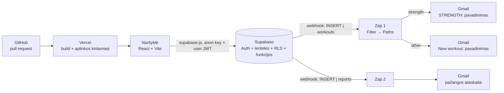

<h1 align="center"></h1>

<p align="center"><a href="README.md">English</a> · Lietuviškai</p>

**Logify** – tai internetinis treniruočių žurnalas. Sportininkai vykdo treniruočių planus (savo arba trenerio priskirtus), registruoja jėgos ir kardio treniruotes, o treneris automatiškai gauna el. laišką apie kiekvieną naują treniruotę.

Baigiamasis kurso *„Pilnas ciklas nuo idėjos iki produkto“* projektas: viena programa, kuri veikia internete, saugo duomenis, atskiria naudotojus ir el. paštu praneša apie kiekvieną svarbų įvykį.

> **Būsena: pagrindinis ir išplėstinis lygiai sukurti.** Kode yra registracija ir prisijungimas, planai, treniruotės su serijomis, pažangos diagramos, tikslai ir pasiūlymai, ataskaitos ir dalijimasis su treneriu. Supabase Database Webhooks siunčia kiekvieną naują ar redaguotą treniruotę (Zap 1) ir kiekvieną ataskaitą (Zap 2) į Zapier. Dar reikia: patikimumo patikrų (klaidų tvarkyklė, kaina) ir demonstracijos.
>
> **v5: telefono programėlė, veikianti be ryšio.** „Logify“ galima įdiegti telefono pradžios ekrane, ji atsidaro be ryšio, rodo paskutinius gautus duomenis ir leidžia įrašyti treniruotę be ryšio; grįžus ryšiui treniruotė išsiunčiama, o treneris gauna laišką lygiai vieną kartą. Žr. [docs/lt/pwa.md](docs/lt/pwa.md).
>
> **Veikianti svetainė:** https://workout-log-murex-three.vercel.app/
>
> **Projekto dokumentacija („Notion“):** [Logify: Projekto dokumentacija](https://app.notion.com/p/Logify-Projekto-dokumentacija-4160ecfaf1178121a9a7ded3cfc6e929)

## Ką ji daro

- **Paskyros**: registracija ir prisijungimas su el. paštu ir slaptažodžiu. Kiekvienas naudotojas mato tik savo planus ir treniruotes; tai užtikrina pati duomenų bazė per Row Level Security.
- **Mano planai** (sąrašas): kiekvienas planas (A lentelė) su jame įrašytomis treniruotėmis (B lentelė); treniruotės pavadinimą galima redaguoti. **Naujas planas** atveria plano kūrimo puslapį; savo planus galite **redaguoti** arba **ištrinti** (prieš trinant paklausiama, o kartu ištrinamos ir plano treniruotės). Trenerio priskirtų planų redaguoti ar trinti negalima. Treneris negali ištrinti plano, pagal kurį sportininkai jau įrašė treniruočių.
- **Įrašyti treniruotę** (kūrimas): pasiekiama paspaudus **+ Įrašyti treniruotę** plano kortelėje; treniruotė įrašoma pagal tą planą su pavadinimu, tipu (`strength` / `other`) ir trukme. Jėgos treniruotėms: pratimai su serijomis pakartojimai × kg, kiekvienam pratimui rodomas praėjusio karto rezultatas. Kardio treniruotėms: veikla ir atstumas. Pastabos abiem tipams.
- **Treniruotės informacija**: treniruotės serijos pagal pratimą, kiekviena su ankstesne treniruote; arba kardio trukmė, atstumas ir tempas.
- **Pažanga**: sunkiausia serija per treniruotę pagal pratimą (linijinė diagrama) ir minutės per savaitę, jėga ir kita (sudėtiniai stulpeliai), kiekviena su vienos eilutės santrauka ir lentelės rodiniu.
- **Tikslai**: Pažangos ekrane nustatykite tikslą (pratimas, svoris, data) ir matykite juostą su savo sunkiausia serija iki šiol palyginti su tikslu; pasiekti ir pavėluoti tikslai pažymimi.
- **Pasiūlymai**: taisyklėmis pagrįsti kiti žingsniai Pažangos ekrane, kiekvienas su skaičiais, kuriais remiamasi: pridėti 2,5 kg pakartojus tas pačias serijas su didžiausiu svoriu, nedidinti svorio, jei pakartojimų mažėjo dvi treniruotes iš eilės, grįžti prie treniruočių po 7 dienų pertraukos ir savaitinis prieaugis, kurio dar reikia tikslui pasiekti. Skaičiuojama naršyklėje; be dirbtinio intelekto.
- **Ataskaita treneriui**: Pažangos ekrane mygtukas išsiunčia pastarųjų 7 dienų santrauką; ją sudaro duomenų bazė, o antras webhook → Zap 2 → Gmail pristato ją el. paštu.
- **Sportininkai ir treneriai**: vaidmenį pasirenkate registruodamiesi. Sportininkas dalijasi su treneriu įvesdamas trenerio kodą skiltyje **Dalijimasis** ir gali nustoti bet kada.
- **Mano sportininkai** (treneriai): jūsų kodas, kiekvieno sportininko naujausia veikla ir sportininko puslapis su jo pasiūlymais, tikslais, naujausiomis treniruotėmis (su serijomis), ataskaitomis ir diagramomis. Puslapis tik skaitomas: duomenis gali keisti tik pats sportininkas.
- **Planų priskyrimas**: treneris vieną planą priskiria daugeliui sportininkų. Kiekvienas pagal jį įrašo savo treniruotes; skiltyje „Mano planai“ jis rodomas su užrašu *Priskyrė jūsų treneris*.
- **El. laiškas sportininko treneriui**: kiekviena nauja treniruotė → Supabase Database Webhook → Zapier → Gmail, adresuotas treneriui (treneriams), su kuriuo sportininkas dalijasi (`instructor_emails` užpildo duomenų bazės trigeris; sportininkas, kuris nesidalija su niekuo, laiško nesiunčia). Jėgos treniruotės ateina kaip *STRENGTH: pavadinimas*, kitos – kaip *New workout: pavadinimas*; laiške išvardytos serijos (pvz., *Squat: 2 × 5 @ 100 kg, 5 @ 102.5 kg*).
- **Kalbos**: lietuvių (numatytoji) ir anglų. Dvi mažos vėliavėlės, Lietuvos ir Didžiosios Britanijos, yra antraštėje greta logotipo (taip pat prisijungimo ekrane): bakstelėkite vieną, kad pakeistumėte kalbą; pasirinkimas įsimenamas naršyklėje, todėl išlieka naršant ir perkrovus. Visi tekstai yra `src/i18n/translations.js`. Jūsų įvesti duomenys (planų pavadinimai, pratimai, pastabos) niekada neverčiami, taip pat neverčiamos ataskaitos ir serijų santraukos, kurias duomenų bazė rašo į savo eilutes (jos patenka ir į el. laiškus).
- **Telefono programėlė (v5)**: įdiekite „Logify“ „Android“ ar iPhone telefone ir naudokite be ryšio. Planai, istorija ir pažanga (treneriams – jų sportininkai) rodo paskutinius išsaugotus duomenis, o be ryšio įrašyta treniruotė telefone laukia kaip *Laukia išsiuntimo*, kol grįš ryšys, tada išsaugoma ir išsiunčiama el. paštu lygiai vieną kartą. Telefonuose meniu yra apatinė kortelių juosta. Žr. [Naršyklės ir įrenginiai](#naršyklės-ir-įrenginiai) ir [docs/lt/pwa.md](docs/lt/pwa.md).
- **Keturios būsenos** kiekviename ekrane, kuris kraunasi ar saugo duomenis: Kraunama, Klaida (paprasta kalba, su *Bandyti dar kartą*), Tuščia, Pavyko.

## Kaip tai veikia



Visas vaizdas pateiktas [docs/lt/architecture.md](docs/lt/architecture.md): visų aštuonių lentelių **ERD** (dvi pradinės užduoties lentelės, `plans` ir `workouts`, paryškintos), **diegimo ir infrastruktūros diagrama** ir kas ką gali skaityti.

- **Duomenys**: A lentelė `plans` → B lentelė `workouts` (`plan_id → plans.id`), plius `workout_sets` – jėgos treniruotės serijoms, `reports` – treneriui išsiųstoms ataskaitoms, `goals`, o dalijimuisi – `profiles` (vaidmuo), `instructor_links` ir `plan_assignments`; visa tai aprašyta [`supabase/schema.sql`](supabase/schema.sql).
- **Įvykiai**: įrašyta treniruotė yra vienas `INSERT` į `workouts` (Zap 1); išsiųsta ataskaita – vienas `INSERT` į `reports` (Zap 2).
- **Maršrutizavimo laukas**: `workouts.type` yra `strength` arba `other` (kardio, mobilumas ir t. t.); pagal jį Zapier Paths pasirenka laišką.

## Technologijos

| Dalis | Įrankis |
|---|---|
| Kodas | [GitHub](https://github.com) (funkcijų šakos + pull request) |
| Sąsaja | [React](https://react.dev) 19 + [Vite](https://vite.dev), JavaScript, [React Router](https://reactrouter.com), paprastas CSS; [Recharts](https://recharts.org) Pažangos diagramoms |
| Telefono programėlė | [vite-plugin-pwa](https://vite-pwa-org.netlify.app/) 2 ([Workbox](https://developer.chrome.com/docs/workbox) service worker + programos manifestas): įdiegiama, atsidaro be ryšio. Kūrimo metu naudojamas įrankis: nepriduoda vykdymo priklausomybės |
| Duomenys ir autentifikacija | [Supabase](https://supabase.com) (Auth, 8 lentelės, RLS, SQL funkcijos) |
| Diegimas | [Vercel](https://vercel.com) |
| Automatizacija | [Zapier](https://zapier.com) (2 Zap: Webhook → Filter → Paths → Gmail; ataskaitos webhook → Gmail) |
| El. paštas | [Gmail](https://www.google.com/gmail/about/) |
| Testai | [Vitest](https://vitest.dev) + [Testing Library](https://testing-library.com) |
| Linteris | [oxlint](https://oxc.rs/docs/guide/usage/linter.html) |
| Dokumentacija | [Notion](https://www.notion.so) ([projekto puslapis](https://app.notion.com/p/Logify-Projekto-dokumentacija-4160ecfaf1178121a9a7ded3cfc6e929)) + šis README; diagramos [Mermaid](https://mermaid.js.org) |
| DI įrankiai | [Claude](https://claude.ai) per [Claude Code](https://claude.com/claude-code): Claude Opus 5.5, Claude Sonnet 5.5; [Google Gemini](https://gemini.google.com) |

## Naršyklės ir įrenginiai

„Logify“ yra internetinė programa, veikianti naršyklėje kompiuteryje, planšetėje ar telefone, ir ją galima įdiegti telefone kaip programėlę (žemiau). Ji sukurta šiuolaikinėms nuolat atnaujinamoms naršyklėms; minimalios versijos išplaukia iš numatytojo Vite kūrimo tikslo (`baseline-widely-available`) ir programos naudojamo CSS.

| Naršyklė | Minimali versija |
|---|---|
| Chrome (kompiuteris ir Android) | 111 |
| Edge | 111 |
| Firefox | 121 (pasirinkto varianto paryškinimas naudoja `:has()`) |
| Safari (macOS ir iOS / iPadOS) | 16.4 |

„Internet Explorer“ ir senesnės šių naršyklių versijos nepalaikomos. Slapukai ir „JavaScript“ turi būti įjungti: programa prisijungia per Supabase Auth.

**Įdiekite telefone.** Diegti nebūtina; įdiegta „Logify“ atsidaro per visą ekraną su sava piktograma, o be ryšio veikia ir taip, ir taip (žr. žemiau). Reikia HTTPS, kurį veikianti svetainė turi.

| Telefonas | Kaip |
|---|---|
| **Android** („Chrome“) | Atidarykite „Logify“, tada paspauskite **Įdiegti** kortelėje **Mano planai** viršuje arba naršyklės meniu pasirinkite **Install app** / **Add to Home screen** |
| **iPhone** („Safari“) | Atidarykite „Logify“ naršyklėje **Safari**, bakstelėkite **Bendrinti**, tada **Pridėti prie pradžios ekrano** |

„Android“ sistemoje ilgai paspaudus piktogramą, siūlomi trumpiniai *Įrašyti treniruotę* ir *Pažanga*. **iPhone įdiegta programėlė turi savo atmintį**, atskirą nuo „Safari“: joje prisijunkite dar kartą.

**Be ryšio.** Kartą atidarę „Logify“ su ryšiu ir prisijungę, toliau galite naudotis be ryšio:

- Ji **atsidaro** be tinklo, kiekviename ekrane, o prisijungęs naudotojas lieka prisijungęs.
- Planai, istorija, treniruotės informacija ir Pažanga (treneriams – Mano sportininkai ir anksčiau atidaryti sportininkai) rodo **paskutinius išsaugotus duomenis** su eilute, kada jie išsaugoti.
- **Treniruotės įrašymas veikia.** Ji laikoma telefone, rodoma kaip *Laukia išsiuntimo* ir išsiunčiama automatiškai, kol programa atidaryta ir yra ryšys. Ji išsaugoma, o treneris gauna laišką, lygiai vieną kartą, kad ir kiek kartų siuntimas būtų kartojamas. Pusiau užpildyta forma taip pat išsaugoma jums rašant.
- Nauji, redaguoti ar ištrinti planai, tikslai, ataskaitos, dalijimasis ir planų priskyrimas vis dar reikalauja ryšio.
- Nauja programos versija siūloma mygtuku **Atnaujinti**; ji niekada pati nesiperkrauna.

Kaip tai veikia, kaip išbandyti ir kokios ribos: [docs/lt/pwa.md](docs/lt/pwa.md). Kad treniruotė būtų išsaugota lygiai vieną kartą, duomenų bazė turi būti v5; senesnė vis tiek veikia, tik su įspėjimu ([docs/lt/supabase.md](docs/lt/supabase.md#6-treniruočių-įrašymas-be-ryšio-v5)).

**Pritaikyta mobiliesiems.** Programa skirta naudoti telefone, pavyzdžiui, serijai užfiksuoti sporto salėje:

- Puslapis nustato mobilųjį vaizdo langą (`width=device-width`, `viewport-fit=cover`), todėl nėra sumažinamas kaip kompiuterio puslapis.
- Maketas prisitaiko prie mažų ekranų: kai plotis ne didesnis nei 640 px, meniu tampa **apatine kortelių juosta** (Mano planai, Įrašyti, Pažanga ir Dalijimasis arba Mano sportininkai), o antraštė susitraukia į vieną eilutę; kai ne didesnis nei 480 px, tarpai sumažinami. Atsijungimas yra piktograma (jos patarimas rodo *Atsijungti* ir jūsų el. paštą), o paskyros el. paštas sutrumpinamas „…“ ir niekada neužlenda ant vėliavėlių.
- Mygtukai ir planų bei pratimų pasirinkimai yra bent 44 px aukščio – patogus paspausti pirštu.
- Šviesi ir tamsi tema seka įrenginio nustatymą, o naršyklės adreso juosta įgauna programos žalsvai mėlyną spalvą (`theme-color`).

Programa nebandyta kiekviename įrenginyje; jei kažkas jūsų įrenginyje atrodo netaip, sukurkite problemos pranešimą (issue) nurodydami naršyklę, jos versiją ir ekrano dydį.

## Paleidimas lokaliai

Reikia Node.js 22.12 ar naujesnės versijos. „Windows“ sistemoje `scripts\setup.ps1` įdiegia įrankius ir sukuria aplinkos failus ([setup.md](docs/lt/setup.md)).

```bash
npm install
cp .env.example .env.local     # tada įrašykite dvi reikšmes
npm run dev                    # http://localhost:5173
```

Supabase projektą reikia vieną kartą paruošti: paleiskite `supabase/schema.sql`, tada `supabase/seed.sql` demonstraciniams duomenims ir išjunkite *Confirm email* ([docs/lt/supabase.md](docs/lt/supabase.md)). Prieš v5 paruoštam projektui pakanka dar kartą paleisti `supabase/schema.sql` ([kaip](docs/lt/supabase.md#v5-pritaikymas-esamam-projektui)).

## Demonstracinės paskyros

[`supabase/seed.sql`](supabase/seed.sql) naujame, tuščiame projekte sukuria šias tris paskyras kartu su jų planais, treniruotėmis, serijomis, tikslais, ataskaita ir dalijimusi su treneriu. Projekte, kuriame jau yra naudotojų, jis nieko nedaro. Veikianti duomenų bazė 2026-11-12 atstatyta tiksliai į šį pradinį rinkinį, todėl veikianti svetainė turi tas pačias paskyras ir duomenis.

| El. paštas | Slaptažodis | Vaidmuo | Ką pamatysite |
|---|---|---|---|
| `demo.athlete.a@example.com` | `WorkoutLog-demo-2026` | Sportininkas | 8 savaitės jėgos treniruočių ir bėgimo, pritūpimų tikslas, jau išsiųsta ataskaita; pasiūlymai nedidinti spaudimo gulint svorio ir pridėti 2,5 kg prie pritūpimų |
| `demo.athlete.b@example.com` | `WorkoutLog-demo-2026` | Sportininkas | Pradedantysis, 8 dienas neįrašęs jokios treniruotės, su deadlift tikslu |
| `demo.instructor@example.com` | `WorkoutLog-demo-2026` | Treneris | Kodas **GYM234**, abu sportininkai dalijasi, jiems priskirti 3 planai |

Kas tai perskaito, gali prisijungti su šiais duomenimis: tai demonstracinės paskyros. Veikiančioje svetainėje įrašius treniruotę ar išsiuntus ataskaitą kaip viena iš jų, laišką per Zapier gauna treneris, su kuriuo ji dalijasi (`demo.instructor@example.com`, netikras adresas, kuris pašto gauti negali), kaip ir iš bet kurios kitos paskyros.

| Komanda | Ką daro |
|---|---|
| `npm run dev` | Kūrimo serveris adresu `http://localhost:5173` |
| `npm test` | Vienetų testai (Vitest); jie niekada nesikreipia į Supabase |
| `npm run lint` | Linteris (oxlint) |
| `npm run build` | Produkcinė kūrimo versija į `dist/`, su service worker ir manifestu |
| `npm run preview` | Pateikia produkcinę versiją adresu `http://localhost:4173`; naudokite įdiegiamai programėlei be ryšio išbandyti (`npm run dev` veikia be service worker) |

## Aplinkos kintamieji

Tik pavadinimai; reikšmių niekada nekomituokite. `.env.local` yra ignoruojamas git; tuos pačius du kintamuosius nustatykite Vercel.

| Kintamasis | Kur gauti | Slaptas? |
|---|---|---|
| `VITE_SUPABASE_URL` | Supabase → Project Settings → Data API | Ne |
| `VITE_SUPABASE_ANON_KEY` | Supabase → Project Settings → API Keys (publishable / anon raktas) | Saugus tik su įjungtu RLS |

Telefono programėlei nauji kintamieji nereikalingi. Supabase `service_role` raktas ir Zapier Catch Hook adresas **niekada** negali patekti į programą, Vercel ar šią saugyklą.

## Dokumentacija

| Failas | Turinys |
|---|---|
| [Notion: projekto dokumentacija](https://app.notion.com/p/Logify-Projekto-dokumentacija-4160ecfaf1178121a9a7ded3cfc6e929) | Apimties kortelė, užduočių lentelė, sprendimų žurnalas, klaidų žurnalas, testų lentelė, architektūros ir ERD diagramos, demonstracinės paskyros |
| [docs/user-manual/](docs/user-manual/README.md) | **Naudotojo vadovai** su ekrano nuotraukomis sportininkams ir treneriams: [sportininko](docs/user-manual/lt/athlete.md), [trenerio](docs/user-manual/lt/instructor.md) |
| [docs/lt/architecture.md](docs/lt/architecture.md) | **ERD**, **diegimo ir infrastruktūros diagrama**, kodo sluoksniai, duomenų srautai, veikimo be ryšio sluoksnis su sekos diagrama, prieigos modelis (kaip sukurta) |
| [docs/lt/pwa.md](docs/lt/pwa.md) | **Telefono programėlė**: įdiegimas, kas veikia be ryšio, išsaugoti duomenys, siuntimo eilė ir „lygiai vieną kartą“, senesnės duomenų bazės įspėjimas, bandymas be ryšio, piktogramų atkūrimas, ribos |
| [docs/lt/implementation-plan.md](docs/lt/implementation-plan.md) | Apimties lygiai, duomenų modelis, Zapier dizainas, testų lentelė, paskaitų planas |
| [docs/lt/setup.md](docs/lt/setup.md) | Įrankiai, paketai ir aplinkos paruošimas |
| [docs/lt/supabase.md](docs/lt/supabase.md) | Lentelės, Row Level Security, registracijos ir URL nustatymai, v5 duomenų bazės pakeitimas; 1 ir 4 testai |
| [docs/lt/deployment.md](docs/lt/deployment.md) | Vercel: aplinkos kintamieji, Supabase adresai, inkognito testas |
| [docs/lt/zapier.md](docs/lt/zapier.md) | Webhook → Zap → Gmail, klaidų tvarkyklė, kaina, sutvarkymas; 2, 3 ir 5 testai |

## Saugyklos struktūra

```
src/
  pages/          Prisijungimas, Mano planai, Naujas planas, Įrašyti treniruotę, Treniruotės informacija, Pažanga, Dalijimasis, Mano sportininkai
  components/     antraštė ir apatinė kortelių juosta, būsenos eilutė, plano kortelė, treniruotės eilutė, formos, įdiegimo kortelė, keturios sąsajos būsenos
  auth/           sesijos tiekėjas (be ryšio lieka prisijungęs) ir maršruto sargas
  offline/        išsaugoti duomenys, siuntimo eilė, neišsaugotos formos juodraštis, duomenų bazės versija, pasiruošimas
  pwa/            service worker registracija (atnaujinimo pasiūlymas) ir įdiegimo pasiūlymas
  api/            Supabase užklausos planams ir treniruotėms
  i18n/           Visi sąsajos tekstai lietuvių ir anglų kalbomis (translations.js), kalbos saugykla ir t()
  lib/            Supabase klientas, nustatymų patikra, klaidų pranešimai, pažangos skaičiavimai, tikslų ir pasiūlymų taisyklės
  test/           testų paruošimas ir netikri objektai (be tinklo)
public/               logo.svg („Logify“ logotipas), favicon.svg ir programėlės piktogramos (pwa-*.png, maskable, apple-touch)
pwa-assets.config.js  kaip piktogramos generuojamos iš favicon.svg (žr. docs/lt/pwa.md)
vite.config.js        Vite, testai ir PWA manifestas bei service worker
supabase/schema.sql   lentelės + Row Level Security + funkcijos (v5: log_workout su p_id ir p_logged_at, schema_version())
supabase/seed.sql     demonstracinės paskyros ir duomenys naujam, tuščiam projektui
supabase/tests/       SQL testai (kiekvienas pats save atšaukia)
docs/                 vadovai (žr. Dokumentacija); lietuviški – docs/lt/
scripts/setup.ps1     automatinis paruošimas „Windows“ sistemai (saugu paleisti iš naujo)
vercel.json           leidžia kliento pusės maršrutams išlikti perkrovus puslapį
_task/                kurso užduočių skaidrės (LT / EN) ir užklausos, naudotos idėjai apibrėžti
```

## Veiksmų planas

Sukurta per keturias paskaitas, kiekvienai funkcijai – viena `feature/…` šaka ir vienas pull request:

1. **Pagrindas:** apimties kortelė, Notion puslapis, saugykla, Vite programa, Supabase projektas ir lentelės.
2. **Naudotojai ir sąsaja:** Auth, 3 ekranai su 4 būsenomis (kraunama, klaida, tuščia, pavyko), RLS. *Kodas baigtas: `feature/auth`, `feature/plans-workouts`.*
3. **Diegimas ir automatizacija:** Vercel su aplinkos kintamaisiais, Supabase webhook, Zap su Filter ir Paths, Gmail. *Veikia Vercel; webhook pristato į Zapier.*
4. **Tikrinimas ir pristatymas:** testų lentelė, klaidų tvarkymas, README ir Notion, 5 minučių demonstracija.

Išplėstinė apimtis (pratimai/serijos/pakartojimai, diagramos, tikslai ir pasiūlymai, pažangos ataskaitos el. paštu, trenerio vaidmuo ir planų priskyrimas) sukurta; žr. įgyvendinimo planą ir [docs/lt/architecture.md](docs/lt/architecture.md).
