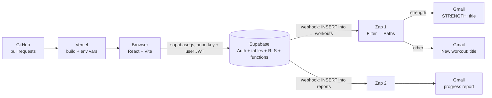

# Workout Log

A web workout log. Athletes follow workout plans (their own, or ones an instructor assigned to them), log strength and cardio sessions, and the instructor is emailed automatically about every new workout.

Capstone project for the course *"The full cycle from idea to live product"*: one app that runs online, stores data, separates users, and reports every important event by email.

> **Status: Core and Extended tiers built.** Sign-up/login, plans, workouts with sets, progress charts, goals and suggestions, reports, and instructor sharing are in the code. Supabase Database Webhooks send every new or edited workout (Zap 1) and every report (Zap 2) to Zapier. Still to do: the reliability checks (error handler, cost) and the demo.
>
> **Live:** https://workout-log-murex-three.vercel.app/

## What it does

- **Accounts**: sign up and log in with email and password. Every user sees only their own plans and workouts, enforced in the database with Row Level Security.
- **My plans** (list): each plan (table A) with the workouts (table B) logged under it; a workout's title can be edited.
- **Log workout** (create): create a plan; log a workout under a plan with title, type (`strength` / `other`) and duration. For strength: exercises with sets of reps × kg, showing last time's result for each exercise. For cardio: activity and distance. Notes for both.
- **Workout detail**: a workout's sets by exercise, each with the previous session; or duration, distance and pace for cardio.
- **Progress**: the heaviest set per session of an exercise over time (line chart) and minutes per week, strength vs other (stacked columns), each with a one-line summary and a table view.
- **Goals**: set a goal on Progress (exercise, weight, date) and see a bar of your heaviest set so far against it; reached and overdue goals are marked.
- **Suggestions**: rule-based next steps on Progress, each with the numbers behind it: add 2.5 kg after repeating the same sets at your top weight, hold the weight when reps drop two sessions in a row, pick up again after 7 days without a workout, and the weekly gain a goal still needs. Worked out in the browser; no AI.
- **Report to the instructor**: a button on Progress sends a summary of the last 7 days; the database builds it, and a second webhook → Zap 2 → Gmail delivers it.
- **Athletes and instructors**: choose your role when you sign up. An athlete shares with an instructor by typing the instructor's code under **Sharing**, and can stop at any time.
- **My athletes** (instructors): your code, each athlete's recent activity, and an athlete page with their suggestions, goals, recent workouts (with sets), reports and charts. It is read-only: only the athlete can change their data.
- **Plan assignment**: an instructor assigns one plan to many athletes. Each logs their own workouts under it; it shows as *Assigned by your instructor* under My plans.
- **Email to the instructor**: each new workout → Supabase Database Webhook → Zapier → Gmail. Strength workouts arrive as *STRENGTH: title*, others as *New workout: title*; the email lists the sets (e.g. *Squat: 2 × 5 @ 100 kg, 5 @ 102.5 kg*).
- **Four states** on every screen that loads or saves: Loading, Error (plain language, with *Try again*), Empty, Success.

## How it works



The full picture is in [docs/architecture.md](docs/architecture.md): the **ERD** of all eight tables (the two from the initial task, `plans` and `workouts`, are highlighted), the **deployment and infrastructure diagram**, and who may read what.

- **Data**: table A `plans` → table B `workouts` (`plan_id → plans.id`), plus `workout_sets` for the sets of a strength workout, `reports` for the reports sent to the instructor, `goals`, and for sharing `profiles` (role), `instructor_links` and `plan_assignments`, all defined in [`supabase/schema.sql`](supabase/schema.sql).
- **Events**: a logged workout is one `INSERT` into `workouts` (Zap 1); a sent report is one `INSERT` into `reports` (Zap 2).
- **Routing field**: `workouts.type` is `strength` or `other` (cardio, mobility, etc.); Zapier Paths picks the email from it.

## Stack

| Part | Tool |
|---|---|
| Code | GitHub (feature branches + pull requests) |
| Interface | React 19 + Vite, JavaScript, React Router, plain CSS; Recharts for the Progress charts |
| Data and auth | Supabase (Auth, 8 tables, RLS, SQL functions) |
| Deployment | Vercel |
| Automation | Zapier (2 Zaps: Webhook → Filter → Paths → Gmail; report webhook → Gmail) |
| Tests | Vitest + Testing Library |
| Documentation | Notion + this README |

## Run it locally

Needs Node.js 22.12 or newer. On Windows, `scripts\setup.ps1` installs the tools and creates the env files ([setup.md](docs/setup.md)).

```bash
npm install
cp .env.example .env.local     # then fill in the two values
npm run dev                    # http://localhost:5173
```

The Supabase project needs a one-time setup: run `supabase/schema.sql`, then `supabase/seed.sql` for demo data, and turn off *Confirm email* ([docs/supabase.md](docs/supabase.md)).

## Demo accounts

[`supabase/seed.sql`](supabase/seed.sql) creates these three accounts on a new, empty project, together with their plans, workouts, sets, goals, a report and instructor sharing. On a project that already has users it does nothing. The live database was reset to exactly this seed on 2026-11-12, so the live site has the same accounts and data.

| Email | Password | Role | What you'll see |
|---|---|---|---|
| `demo.athlete.a@example.com` | `WorkoutLog-demo-2026` | Athlete | 8 weeks of strength and running, a squat goal, a report already sent; suggestions to hold the bench weight and add 2.5 kg to the squat |
| `demo.athlete.b@example.com` | `WorkoutLog-demo-2026` | Athlete | A beginner with nothing logged for 8 days and a deadlift goal |
| `demo.instructor@example.com` | `WorkoutLog-demo-2026` | Instructor | Code **GYM234**, both athletes sharing, 3 plans assigned to them |

Anyone who reads this can log in with these: they're demo accounts. On the live site, logging a workout or sending a report as one of them emails the instructor through Zapier, like any other account.

| Command | What it does |
|---|---|
| `npm run dev` | Development server at `http://localhost:5173` |
| `npm test` | Unit tests (Vitest); they never contact Supabase |
| `npm run lint` | Linter (oxlint) |
| `npm run build` | Production build into `dist/` |

## Environment variables

Names only; never commit values. `.env.local` is git-ignored; set the same two variables in Vercel.

| Variable | Where to get it | Secret? |
|---|---|---|
| `VITE_SUPABASE_URL` | Supabase → Project Settings → Data API | No |
| `VITE_SUPABASE_ANON_KEY` | Supabase → Project Settings → API Keys (publishable / anon key) | Safe only with RLS enabled |

The Supabase `service_role` key and the Zapier Catch Hook URL must **never** go into the app, Vercel or this repo.

## Documentation

| File | Contents |
|---|---|
| [docs/architecture.md](docs/architecture.md) | **ERD**, **deployment and infrastructure diagram**, code layers, data flows, access model (as built) |
| [docs/implementation-plan.md](docs/implementation-plan.md) | Scope tiers, data model, Zapier design, test table, lecture plan |
| [docs/setup.md](docs/setup.md) | Tools, packages and environment setup |
| [docs/supabase.md](docs/supabase.md) | Tables, Row Level Security, sign-up and URL settings; tests 1 and 4 |
| [docs/deployment.md](docs/deployment.md) | Vercel: env vars, Supabase URLs, incognito test |
| [docs/zapier.md](docs/zapier.md) | Webhook → Zap → Gmail, error handler, cost, cleanup; tests 2, 3 and 5 |

## Repository layout

```
src/
  pages/          Login, My plans (list), Log workout (create)
  components/     header, plan card, workout row, forms, the four UI states
  auth/           session provider and route guard
  api/            Supabase queries for plans and workouts
  lib/            Supabase client, settings check, error messages, progress maths, goal and suggestion rules
  test/           test setup and fakes (no network)
supabase/schema.sql   tables + Row Level Security
supabase/seed.sql     demo accounts and data for a new, empty project
supabase/tests/       SQL tests (each one rolls itself back)
docs/                 guides (see Documentation)
scripts/setup.ps1     automated setup for Windows (safe to re-run)
vercel.json           lets client-side routes survive a page reload
_task/                course task decks (LT / EN) and the prompts used to scope the idea
```

## Roadmap

Built in four lectures, one `feature/…` branch and pull request per feature:

1. **Foundation:** scope card, Notion page, repo, Vite app, Supabase project and tables.
2. **Users and interface:** Auth, 3 screens with 4 states (loading, error, empty, success), RLS. *Code done: `feature/auth`, `feature/plans-workouts`.*
3. **Deployment and automation:** Vercel with env vars, Supabase webhook, Zap with Filter and Paths, Gmail. *Live on Vercel; the webhook delivers to Zapier.*
4. **Verification and presentation:** test table, error handling, README and Notion, 5-minute demo.

The Extended scope (exercises/sets/reps, charts, goals and suggestions, progress reports by email, instructor role and plan assignment) is built; see the implementation plan and [docs/architecture.md](docs/architecture.md).
