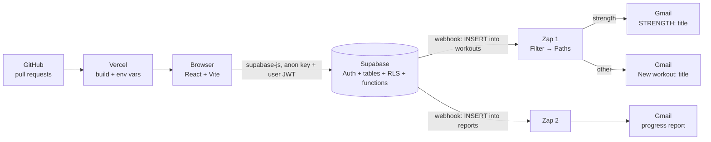

<h1 align="center"></h1>

<p align="center">English · <a href="README.lt.md">Lietuviškai</a></p>

**Logify** is a web workout log. Athletes follow workout plans (their own, or ones an instructor assigned to them), log strength and cardio sessions, and the instructor is emailed automatically about every new workout.

Capstone project for the course *"The full cycle from idea to live product"*: one app that runs online, stores data, separates users, and reports every important event by email.

> **Status: Core and Extended tiers built.** Sign-up/login, plans, workouts with sets, progress charts, goals and suggestions, reports, and instructor sharing are in the code. Supabase Database Webhooks send every new or edited workout (Zap 1) and every report (Zap 2) to Zapier. Still to do: the reliability checks (error handler, cost) and the demo.
>
> **v5: a phone app that works without signal.** Logify can be installed on a phone's home screen, opens without a connection, shows the last data it got, and lets you log a workout offline; the workout is sent, and the instructor emailed, exactly once when the signal returns. See [docs/pwa.md](docs/pwa.md); the design and the plan are in [docs/superpowers/](docs/superpowers/specs/2026-11-16-pwa-offline-design.md).
>
> **Live:** https://workout-log-murex-three.vercel.app/
>
> **Project documentation (Notion):** [Logify: Project documentation](https://app.notion.com/p/Workout-Log-Project-documentation-4150ecfaf117815bbf2dd6af5ee27323)

## What it does

- **Accounts**: sign up and log in with email and password. Every user sees only their own plans and workouts, enforced in the database with Row Level Security.
- **My plans** (list): each plan (table A) with the workouts (table B) logged under it; a workout's title can be edited. **New plan** opens the plan creation page; you can **edit** or **delete** your own plans (deleting asks first and also deletes the plan's workouts). Plans an instructor assigned to you can't be edited or deleted, and an instructor can't delete a plan athletes have logged workouts under.
- **Log workout** (create): reached from **+ Log workout** on a plan card; log a workout under that plan with title, type (`strength` / `other`) and duration. For strength: exercises with sets of reps × kg, showing last time's result for each exercise. For cardio: activity and distance. Notes for both.
- **Workout detail**: a workout's sets by exercise, each with the previous session; or duration, distance and pace for cardio.
- **Progress**: the heaviest set per session of an exercise over time (line chart) and minutes per week, strength vs other (stacked columns), each with a one-line summary and a table view.
- **Goals**: set a goal on Progress (exercise, weight, date) and see a bar of your heaviest set so far against it; reached and overdue goals are marked.
- **Suggestions**: rule-based next steps on Progress, each with the numbers behind it: add 2.5 kg after repeating the same sets at your top weight, hold the weight when reps drop two sessions in a row, pick up again after 7 days without a workout, and the weekly gain a goal still needs. Worked out in the browser; no AI.
- **Report to the instructor**: a button on Progress sends a summary of the last 7 days; the database builds it, and a second webhook → Zap 2 → Gmail delivers it.
- **Athletes and instructors**: choose your role when you sign up. An athlete shares with an instructor by typing the instructor's code under **Sharing**, and can stop at any time.
- **My athletes** (instructors): your code, each athlete's recent activity, and an athlete page with their suggestions, goals, recent workouts (with sets), reports and charts. It is read-only: only the athlete can change their data.
- **Plan assignment**: an instructor assigns one plan to many athletes. Each logs their own workouts under it; it shows as *Assigned by your instructor* under My plans.
- **Email to the athlete's instructor**: each new workout → Supabase Database Webhook → Zapier → Gmail, addressed to the instructor(s) the athlete shares with (a database trigger fills `instructor_emails`; an athlete who shares with nobody sends no email). Strength workouts arrive as *STRENGTH: title*, others as *New workout: title*; the email lists the sets (e.g. *Squat: 2 × 5 @ 100 kg, 5 @ 102.5 kg*).
- **Languages**: Lithuanian (default) and English. Two small flags, Lithuanian and British, sit in the header right next to the logo (and on the login screen): tap one to switch; the choice is kept in the browser, so it survives navigation and reloads. All texts live in `src/i18n/translations.js`. Data you enter (plan names, exercises, notes) is never translated, and neither are the report summary and set summary the database writes into its own rows (they also go into the emails).
- **Phone app (v5)**: install Logify on Android or iPhone, and use it without signal. Plans, history and progress (instructors: their athletes) show the last saved data, and a workout logged offline waits on the phone as *Waiting to send* until the connection returns, then is saved and emailed exactly once. On phones the menu is a bottom tab bar. See [Browsers and devices](#browsers-and-devices) and [docs/pwa.md](docs/pwa.md).
- **Four states** on every screen that loads or saves: Loading, Error (plain language, with *Try again*), Empty, Success.

## How it works



The full picture is in [docs/architecture.md](docs/architecture.md): the **ERD** of all eight tables (the two from the initial task, `plans` and `workouts`, are highlighted), the **deployment and infrastructure diagram**, who may read what, and the phone side in **[Mobile architecture (PWA)](docs/architecture.md#7-mobile-architecture-pwa)**: the installed app, what it keeps on the phone and where it talks to the network.

- **Data**: table A `plans` → table B `workouts` (`plan_id → plans.id`), plus `workout_sets` for the sets of a strength workout, `reports` for the reports sent to the instructor, `goals`, and for sharing `profiles` (role), `instructor_links` and `plan_assignments`, all defined in [`supabase/schema.sql`](supabase/schema.sql).
- **Events**: a logged workout is one `INSERT` into `workouts` (Zap 1); a sent report is one `INSERT` into `reports` (Zap 2).
- **Routing field**: `workouts.type` is `strength` or `other` (cardio, mobility, etc.); Zapier Paths picks the email from it.

## Stack

| Part | Tool |
|---|---|
| Code | [GitHub](https://github.com) (feature branches + pull requests) |
| Interface | [React](https://react.dev) 19 + [Vite](https://vite.dev), JavaScript, [React Router](https://reactrouter.com), plain CSS; [Recharts](https://recharts.org) for the Progress charts |
| Phone app | [vite-plugin-pwa](https://vite-pwa-org.netlify.app/) 2 ([Workbox](https://developer.chrome.com/docs/workbox) service worker + web app manifest): installable, opens offline. A build-time tool: it adds no runtime dependency |
| Data and auth | [Supabase](https://supabase.com) (Auth, 8 tables, RLS, SQL functions) |
| Deployment | [Vercel](https://vercel.com) |
| Automation | [Zapier](https://zapier.com) (2 Zaps: Webhook → Filter → Paths → Gmail; report webhook → Gmail) |
| Email | [Gmail](https://www.google.com/gmail/about/) |
| Tests | [Vitest](https://vitest.dev) + [Testing Library](https://testing-library.com): 524 unit tests in 49 files, on a fake backend with no network; plus 7 SQL test files in `supabase/tests/`, each rolling itself back |
| Lint | [oxlint](https://oxc.rs/docs/guide/usage/linter.html) |
| Documentation | [Notion](https://www.notion.so) ([project page](https://app.notion.com/p/Workout-Log-Project-documentation-4150ecfaf117815bbf2dd6af5ee27323)) + this README; diagrams in [Mermaid](https://mermaid.js.org) |
| AI tools | [Claude](https://claude.ai) through [Claude Code](https://claude.com/claude-code): Claude Opus 5.5, Claude Sonnet 5.5; [Google Gemini](https://gemini.google.com) |

## Browsers and devices

Logify is a web app that runs in the browser on a desktop, tablet or phone, and can also be installed on a phone like an app (below). It is built for current evergreen browsers; the minimums come from Vite's default build target (`baseline-widely-available`) and the CSS the app uses.

| Browser | Minimum version |
|---|---|
| Chrome (desktop and Android) | 111 |
| Edge | 111 |
| Firefox | 121 (the selected-option highlight uses `:has()`) |
| Safari (macOS and iOS / iPadOS) | 16.4 |

Internet Explorer and older versions of these browsers are not supported. Cookies and JavaScript must be on: the app signs you in through Supabase Auth.

**Install it on a phone.** Installing is optional; it makes Logify open full-screen with its own icon, and it works without signal either way (see below). It needs HTTPS, which the live site has.

| Phone | How |
|---|---|
| **Android** (Chrome) | Open Logify, then press **Install** on the card at the top of **My plans**, or use the browser menu → **Install app** / **Add to Home screen** |
| **iPhone** (Safari) | Open Logify in **Safari**, tap **Share**, then **Add to Home Screen** |

On Android, long-pressing the icon offers two shortcuts, to log a workout and to Progress (their names are in Lithuanian). **On iPhone the installed app keeps its own storage**, separate from Safari: log in once more inside it.

**Without signal.** Once you have opened Logify with a connection and logged in, it keeps working offline:

- It **opens** with no network, on every screen, and a signed-in user stays signed in.
- Plans, history, workout details and Progress (instructors: My athletes and the athletes opened before) show the **last saved data**, with a line saying when it was saved.
- **Logging a workout works.** It is kept on the phone, shown as *Waiting to send*, and sent automatically while the app is open and online. It is saved, and the instructor emailed, exactly once however many times the send is retried. The half-filled form is also kept as you type.
- New, edited or deleted plans, goals, reports, sharing and plan assignment still need a connection.
- A new version of the app is offered with **Update**; it never reloads by itself.

How it works, how to test it and its limits: [docs/pwa.md](docs/pwa.md). The database must be v5 for the exactly-once guarantee; an older database still works, with a warning ([docs/supabase.md](docs/supabase.md#6-offline-logging-v5)).

**Mobile friendly.** The app is meant to be used on a phone, for example to log a set in the gym:

- The page sets a mobile viewport (`width=device-width`, `viewport-fit=cover`), so it is not shrunk like a desktop page.
- The layout adapts to small screens: at 640 px and below the menu becomes a **bottom tab bar** (My plans, Log, Progress, and Sharing or My athletes) and the header shrinks to one row; at 480 px and below the spacing is tightened. Log out is an icon (its tooltip says *Log out* with your email), and the account email is shortened with … rather than ever running into the flags.
- Buttons and the plan and exercise choices are at least 44 px tall, a comfortable touch target.
- Light and dark theme follow the device setting, and the browser's address bar takes the app's teal (`theme-color`).

It has not been tested on every device; if something looks wrong on yours, please open an issue with the browser, its version and the screen size.

## Run it locally

Needs Node.js 22.12 or newer. On Windows, `scripts\setup.ps1` installs the tools and creates the env files ([setup.md](docs/setup.md)).

```bash
npm install
cp .env.example .env.local     # then fill in the two values
npm run dev                    # http://localhost:5173
```

The Supabase project needs a one-time setup: run `supabase/schema.sql`, then `supabase/seed.sql` for demo data, and turn off *Confirm email* ([docs/supabase.md](docs/supabase.md)). A project set up before v5 only needs `supabase/schema.sql` run again ([how](docs/supabase.md#applying-v5-to-an-existing-project)); never run an older (pre-v5) `schema.sql` on a v5 database ([why](docs/supabase.md#troubleshooting)).

`npm run dev` has no service worker, so to try the installable, offline app on your computer use `npm run build` and `npm run preview`, then DevTools → Application ([steps](docs/setup.md#try-the-phone-app-locally)). A real phone needs HTTPS: use a Vercel preview or the live site.

## Demo accounts

[`supabase/seed.sql`](supabase/seed.sql) creates these three accounts on a new, empty project, together with their plans, workouts, sets, goals, a report and instructor sharing. On a project that already has users it does nothing. The live database was reset to exactly this seed on 2026-11-12, so the live site has the same accounts and data.

| Email | Password | Role | What you'll see |
|---|---|---|---|
| `demo.athlete.a@example.com` | `WorkoutLog-demo-2026` | Athlete | 8 weeks of strength and running, a squat goal, a report already sent; suggestions to hold the bench weight and add 2.5 kg to the squat |
| `demo.athlete.b@example.com` | `WorkoutLog-demo-2026` | Athlete | A beginner with nothing logged for 8 days and a deadlift goal |
| `demo.instructor@example.com` | `WorkoutLog-demo-2026` | Instructor | Code **GYM234**, both athletes sharing, 3 plans assigned to them |

Anyone who reads this can log in with these: they're demo accounts. On the live site, logging a workout or sending a report as one of them emails the instructor they share with (`demo.instructor@example.com`, a fake address that cannot receive mail) through Zapier, like any other account.

| Command | What it does |
|---|---|
| `npm run dev` | Development server at `http://localhost:5173` |
| `npm test` | Unit tests (Vitest); they never contact Supabase |
| `npm run lint` | Linter (oxlint) |
| `npm run build` | Production build into `dist/`, including the service worker and manifest |
| `npm run preview` | Serves the production build at `http://localhost:4173`; use it to try the installable, offline app (`npm run dev` runs without a service worker) |

## Environment variables

Names only; never commit values. `.env.local` is git-ignored; set the same two variables in Vercel.

| Variable | Where to get it | Secret? |
|---|---|---|
| `VITE_SUPABASE_URL` | Supabase → Project Settings → Data API | No |
| `VITE_SUPABASE_ANON_KEY` | Supabase → Project Settings → API Keys (publishable / anon key) | Safe only with RLS enabled |

The phone app needs no new variables. The Supabase `service_role` key and the Zapier Catch Hook URL must **never** go into the app, Vercel or this repo.

## Documentation

| File | Contents |
|---|---|
| [Notion: project documentation](https://app.notion.com/p/Workout-Log-Project-documentation-4150ecfaf117815bbf2dd6af5ee27323) | Scope card, task table, decision log, error log, test table, architecture and ERD diagrams, demo accounts |
| [docs/user-manual/](docs/user-manual/README.md) | **User manuals** with screenshots, for athletes and for instructors, in English and Lithuanian, including installing on a phone and using Logify without signal |
| [docs/architecture.md](docs/architecture.md) | **ERD**, **deployment and infrastructure diagram**, code layers, data flows, the offline layer with a sequence diagram, access model (as built), and the **[Mobile architecture (PWA)](docs/architecture.md#7-mobile-architecture-pwa)** component diagram |
| [docs/pwa.md](docs/pwa.md) | **The phone app**: install, what works offline, saved data, the outbox and exactly-once, the older-database warning, testing offline, regenerating the icons, limits, and which module does what |
| Design records: [v5 design](docs/superpowers/specs/2026-11-16-pwa-offline-design.md) · [v5 plan](docs/superpowers/plans/2026-11-16-pwa-offline.md) | Why v5 is built the way it is: the approved design (with an *As built* section for what changed during the build) and the task-by-task plan |
| [docs/implementation-plan.md](docs/implementation-plan.md) | Scope tiers, data model, Zapier design, test table, lecture plan, and a short section on v5 |
| [docs/setup.md](docs/setup.md) | Tools, packages and environment setup; trying the phone app locally; the screenshot tool |
| [docs/supabase.md](docs/supabase.md) | Tables, Row Level Security, sign-up and URL settings, the v5 database change; tests 1 and 4 |
| [docs/deployment.md](docs/deployment.md) | Vercel: env vars, Supabase URLs, incognito test, the PWA on Vercel (HTTPS, caching of `sw.js`), releasing v5 |
| [docs/zapier.md](docs/zapier.md) | Webhook → Zap → Gmail, error handler, cost, cleanup; tests 2, 3 and 5; when the email arrives for a workout logged offline |

## Repository layout

```
src/
  pages/          Login, My plans, New plan, Log workout, Workout detail, Progress, Sharing, My athletes
  components/     header and bottom tab bar, status line, plan card, workout row, forms, install card, the four UI states
  auth/           session provider (stays signed in offline) and route guard
  offline/        saved data, the outbox, the unsaved-form draft, the database version, warm-up
  pwa/            service worker registration (update prompt) and the install prompt
  api/            Supabase queries for plans and workouts
  i18n/           All UI texts in Lithuanian and English (translations.js), the language store and t()
  lib/            Supabase client, settings check, error messages, progress maths, goal and suggestion rules
  test/           test setup and fakes (no network)
public/               logo.svg (the Logify logo), favicon.svg and the app icons (pwa-*.png, maskable, apple-touch)
pwa-assets.config.js  how the icons are generated from favicon.svg (see docs/pwa.md)
vite.config.js        Vite, tests, and the PWA manifest and service worker
supabase/schema.sql   tables + Row Level Security + functions (v5: log_workout with p_id and p_logged_at, schema_version())
supabase/seed.sql     demo accounts and data for a new, empty project
supabase/tests/       SQL tests (each one rolls itself back)
docs/                 guides (see Documentation); docs/superpowers/ holds the v5 design (specs/) and plan (plans/)
scripts/setup.ps1     automated setup for Windows (safe to re-run)
vercel.json           lets client-side routes survive a page reload
_task/                course task decks (LT / EN), the prompts used to scope the idea, and the capstone presentation (results/)
```

## Roadmap

Built in four lectures, one `feature/…` branch and pull request per feature:

1. **Foundation:** scope card, Notion page, repo, Vite app, Supabase project and tables.
2. **Users and interface:** Auth, 3 screens with 4 states (loading, error, empty, success), RLS. *Code done: `feature/auth`, `feature/plans-workouts`.*
3. **Deployment and automation:** Vercel with env vars, Supabase webhook, Zap with Filter and Paths, Gmail. *Live on Vercel; the webhook delivers to Zapier.*
4. **Verification and presentation:** test table, error handling, README and Notion, 5-minute demo.

The Extended scope (exercises/sets/reps, charts, goals and suggestions, progress reports by email, instructor role and plan assignment) is built; see the implementation plan and [docs/architecture.md](docs/architecture.md).
