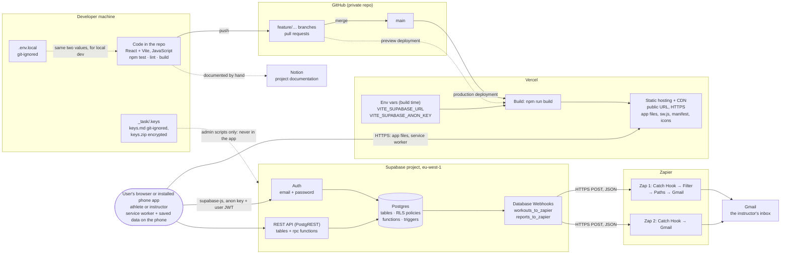
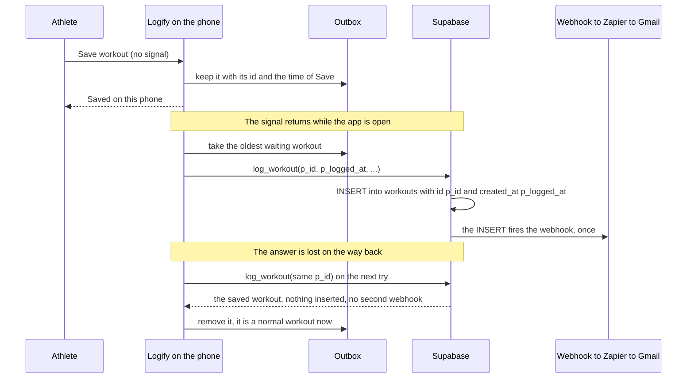
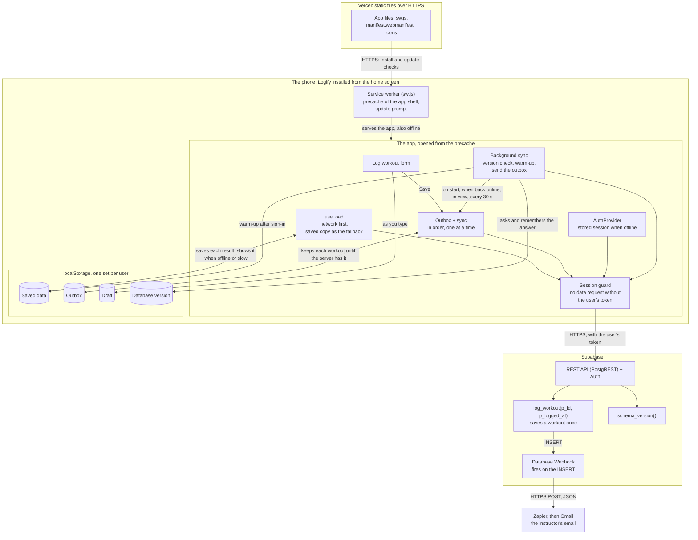

# Architecture

*English · [Lietuviškai](lt/architecture.md)*

How the finished app is built: the data model (ERD), where everything runs (deployment diagram), how a request and an email travel, and who may read what. The diagrams are [Mermaid](https://mermaid.js.org/), which GitHub renders in place.

The original scope is in [implementation-plan.md](implementation-plan.md); this page describes what was **built**, including where it differs from the plan.

## 1. Data model (ERD)

The two tables of the initial task, **`plans`** (table A) and **`workouts`** (table B), are highlighted. Everything else is the Extended scope, added table by table in later pull requests. `auth.users` is Supabase's own table.

| Table | Tier | Purpose |
|---|---|---|
| `plans` | **Initial task (A)** | A workout plan. Owned by one user; an instructor's plan can be assigned to athletes |
| `workouts` | **Initial task (B)** | One logged session under a plan. **Its INSERT fires the first webhook** (Zap 1); `instructor_emails` (set by a trigger) says who is emailed |
| `workout_sets` | Extended | Exercise, set number, reps and kg of a strength workout |
| `goals` | Extended | An exercise, a target weight and a date; reached or overdue is worked out from the sets |
| `reports` | Extended | A progress report, written only by `send_report()`. **Its INSERT fires the second webhook** (Zap 2) |
| `profiles` | Extended | One per user: role (`athlete` / `instructor`) chosen at sign-up, and the instructor's invite code |
| `instructor_links` | Extended | An athlete shares with an instructor (made by `link_instructor(code)`) |
| `plan_assignments` | Extended | One plan to many athletes |

`user_id` on `workouts` and `workout_sets` is a convenience copy of the owner, so every Row Level Security policy is a plain `user_id = auth.uid()` check. All tables are in [`supabase/schema.sql`](../supabase/schema.sql).

## 2. Deployment and infrastructure

| Piece | Runs on | What it does |
|---|---|---|
| React app | Vercel (static files on a CDN) | Everything the user sees. It talks to Supabase directly from the browser |
| Service worker and manifest | Built by Vercel's build (vite-plugin-pwa), served by Vercel like any static file, then kept on the phone | Make Logify installable and let it open without signal. They need HTTPS, which Vercel gives to production and to every preview. See [deployment.md](deployment.md#6-the-phone-app-pwa-on-vercel) |
| Phone app (PWA) | The user's phone | The installed app: the app's files in the service worker's cache, and saved data, the outbox and the draft in `localStorage`. See [section 7](#7-mobile-architecture-pwa) |
| Auth, API, database | Supabase, EU region | Accounts, data, access rules, and the webhooks |
| Automation | Zapier | Turns a webhook into an email (the Filter and Paths pick the subject by `workouts.type`) |
| Email | Gmail | Delivers to the instructor |
| Source and review | GitHub | One `feature/…` branch and pull request per feature; a push to `main` deploys production, every pull request gets a preview (also over HTTPS, so a real phone can install it and test it offline) |
| Documentation | Notion and this repo | Task table, decisions, errors, tests |

### Where secrets live

| Secret | Where it is | Where it must never be |
|---|---|---|
| Supabase URL and publishable (anon) key | Vercel env vars, `.env.local` | Safe to expose, but **only because RLS is on** |
| Supabase `service_role` / secret key | Admin scripts on the developer machine only | React, Vercel, the repo |
| Zapier Catch Hook URLs | Inside the two Supabase webhooks (database triggers) and in Zapier | The repo, README, Notion, screenshots, Vercel |
| Zapier, Notion, Vercel and Supabase tokens, demo logins | `_task/.keys/keys.md` (git-ignored); the repo holds only the password-protected, AES-256 `keys.zip` | The repo in plain text |

## 3. How the code is organized

| Layer | Folder | Rule |
|---|---|---|
| Screens | `src/pages`, `src/components` | Show the four states (loading, error, empty, success); no data access of their own |
| Data access | `src/api` | One function per question or write: `from(...)` queries and `rpc(...)` calls; the only place that knows table and function names |
| Logic | `src/lib` | Pure functions without I/O: progress maths, goals, suggestions, formatting. Easy to test |
| Texts | `src/i18n` | Every UI text lives in `translations.js` (Lithuanian and English, same keys). `t(key, params)` fills in `{placeholders}` and picks plural forms (Lithuanian has three); the chosen language is kept in `localStorage` and read by components through `useLanguage()`. Lithuanian is the default |
| Auth | `src/auth` | Session provider; the role in the menu comes from the sign-up metadata. Offline it falls back to the stored session |
| Offline | `src/offline`, `src/pwa` | Saved data, the outbox, the draft, the database version, and the service worker's update and install prompts. The only code that touches `localStorage` for them. See section 6 |
| Database | `supabase/schema.sql` | Tables, policies, functions, triggers; re-runnable. `seed.sql` adds demo data to an empty project |

Tests run without a network: the real `supabase-js` client talks to a fake `fetch` (`src/test/fakeBackend.js`), so they check the exact HTTP requests. The database has its own tests in `supabase/tests`, each of which rolls itself back.

## 4. Data flows

**Logging a workout.** The form calls `log_workout()` (one transaction: the workout and its sets). The `INSERT` into `workouts` fires the webhook once, with `sets_summary` already in the row, so Zap 1 can put the sets in the email. If anything fails, nothing is saved and nothing is sent. Since v5 the phone can make the workout's id and time itself and keep the workout when there is no signal: see [section 6](#6-the-offline-layer).

**Sending a report.** The button calls `send_report()`, which builds the numbers from the caller's own last 7 days, stores a `reports` row (at most one per 5 minutes) and so fires the second webhook.

**Who gets the emails.** A `BEFORE INSERT` trigger (`set_instructor_emails()`) on `workouts` and `reports` copies the emails of the athlete's linked instructors (`instructor_links`) into the row's `instructor_emails`. The webhook carries it, and each Zap's Filter stops the run when it is empty and uses it as Gmail's *To* otherwise. So the recipient is the athlete's own instructor, decided by the database and never typed by a user or stored in Zapier.

**Goals and suggestions.** Goals live in the database; whether one is reached or overdue, and every suggestion, is computed in the browser from the athlete's sets, so each can state its reason. No AI key anywhere.

**Sharing.** An athlete types the instructor's code; `link_instructor()` creates the link. The instructor then reads that athlete through two functions (below).

## 5. Who may read what

Row Level Security is the access control; the browser never filters by user.

| Data | Owner | A linked instructor |
|---|---|---|
| `plans`, `workouts`, `workout_sets`, `goals`, `reports` | Full access to their own rows (reports: read only) | Nothing through the tables |
| An athlete's progress | n/a | Through `my_athletes()` and `athlete_progress()`, which first check the link; read-only |
| An instructor's plan assigned to an athlete | n/a | The athlete can read it and log their own workouts under it (additive policies) |

**Editing and deleting plans.** Only the owner can edit or delete a plan (an assigned plan is read-only for the athlete). Deleting a plan also deletes its workouts and their sets, so the app asks first. A trigger refuses to delete a plan that *other people* logged workouts under (an instructor's plan with athletes' workouts), so an instructor can't erase athletes' history; deleting an account still works.

**Changed from the plan:** the plan proposed extra `select` policies for instructors on the athletes' tables. They would have mixed athletes' rows into an instructor's own screens, so instructors read through functions instead and the tables keep "own rows only". See [supabase.md](supabase.md#1-tables-and-policies).

## 6. The offline layer

Since v5 Logify is an installable phone app (a PWA) that opens and works without signal: you can see your plans, history and progress (instructors: their athletes) and log a workout. A workout logged offline waits on the phone and is sent, with the instructor's email, when the signal returns. The full story, with the limits and how to test it, is in [pwa.md](pwa.md); the parts and their network edges are drawn in [section 7](#7-mobile-architecture-pwa).

| Part | Where | What it does |
|---|---|---|
| Service worker and manifest | `vite.config.js` (vite-plugin-pwa, Workbox), `src/pwa/` | Keeps the app's own files on the phone, so every screen opens offline; offers an update with **Update**; the install card |
| Saved data | `src/offline/savedData.js`, `src/offline/plansCache.js`, `src/lib/useLoad.js` | `useLoad` asks the network first and saves each result per user; the saved copy is shown when the phone is offline, the request fails, or it takes over 4 s. My plans' copy keeps the Log workout plan list in step and gets every sent workout |
| Warm-up and hints | `src/offline/warmUp.js`, `src/offline/hints.js` | Saves plan options and Progress right after sign-in; offline, exercise names and *Last time* come from the saved Progress |
| Outbox | `src/offline/outbox.js`, `src/offline/sync.js` | Workouts logged on the phone, kept until the server has them; sent in order, one at a time |
| Draft | `src/offline/draft.js` | The half-filled Log workout form, kept as you type and dropped as soon as the outbox holds the workout |
| Database version | `src/offline/dbVersion.js`, `src/api/schema.js` | Asks `schema_version()` and remembers the answer; an older database gets a warning and the old way of sending |
| Signed-in offline | `src/auth/AuthProvider.jsx`, `src/auth/storedSession.js`, `src/lib/sessionGuard.js` | Uses the stored session at once when the phone is offline (after 3 s on a slow connection) and whenever supabase-js can't refresh it; never lets a data request go out without the user's token |
| Layout | `src/components/Layout.jsx`, `src/components/StatusBar.jsx`, `src/components/LanguageSwitcher.jsx`, `src/index.css` | The header (logo, the two language flags, the Log out icon), a bottom tab bar on phones (640 px and below), and the status line under the header |

Everything is per user (`logify.cache.v1.<user id>.…`, `logify.outbox.v1.<user id>`, `logify.draft.v1.<user id>`), so two people on one phone never see each other's data, and log out removes that user's saved data. The database stays the only place that decides who may read what: the saved copy is the same data the user was already allowed to read.

**Logging a workout offline.** Save writes the workout to the outbox with an id made on the phone and the time Save was pressed, then sends it. The database function `log_workout()` takes both as the optional parameters `p_id` and `p_logged_at`. If a workout with that id exists, the function returns it and inserts nothing, so the workout is saved, and the webhook fires, exactly once however many times a send is repeated. The unsaved form is dropped as soon as the outbox holds the workout, so a restart in between never brings back a form whose workout is already on its way.

The outbox also decides what to do with a refusal: a missing answer, a timeout, an HTTP 5xx, an expired sign-in or a duplicate id are tried again later; any other error marks that workout *Couldn't send* with **Try again** and **Delete**.

**Both directions are compatible.** The live app from before v5 keeps working against the v5 database, because the new parameters are optional and the other parts of the database are unchanged. The v5 app against an older database works too, with a warning: see [pwa.md](pwa.md#5-the-older-database-warning).

## 7. Mobile architecture (PWA)

The phone side of Logify in one picture: what is on the phone, what each part uses, and the only places where it talks to the network. Section 6 follows one workout through these parts; this section shows the parts themselves.

| Part | Where | What it does |
|---|---|---|
| App shell | Cache Storage, filled by the service worker from Vercel | The HTML, every JavaScript chunk (also the ones loaded on demand), the CSS and the icons. Opening any address, such as `/progress`, is answered from it, so the app opens with no network |
| `useLoad` | `src/lib/useLoad.js` | Every screen that reads data. Asks the network first and saves the result; shows the saved copy when the phone is offline, the request fails or it takes over 4 s. A load that started before a local change never overwrites that change: its answer is dropped and the load runs again |
| Outbox and sync | `src/offline/outbox.js`, `src/offline/sync.js` | A workout is written to the outbox before it is sent, and removed only when the server has returned it |
| Background sync | `src/offline/useBackgroundSync.js` | Despite the name it runs only while the app is open: it checks the database version, saves what logging offline needs, and sends the outbox when the app starts, the connection returns, the app comes into view, and every 30 s while a workout waits. Nothing is sent while the app is closed |
| AuthProvider | `src/auth/AuthProvider.jsx` | Keeps the user signed in on this phone with the session stored by supabase-js, also when the access token has expired and can't be refreshed offline. Tells the offline code whose data it is |
| Session guard | `src/lib/sessionGuard.js` | The `fetch` that supabase-js uses. A data request that would go out without the user's token (only the project key) is refused like a dropped connection, so Row Level Security's empty answer never replaces saved data. Sign-in requests and `schema_version()` pass |
| `localStorage` | `logify.cache.v1.…`, `logify.outbox.v1.…`, `logify.draft.v1.…`, `logify.dbVersion` | All saved state. The first three are per user, and log out wipes the saved data and the draft; the outbox stays, so waiting workouts aren't lost |
| `log_workout(p_id, p_logged_at)` | `supabase/schema.sql` | Saves the workout, its sets and one webhook, once per id, with the time Save was pressed |
| `schema_version()` | `supabase/schema.sql` | Returns `5`. Anyone may call it; an older database doesn't have it, and the app then warns and sends the old way |

**Without signal,** every arrow that crosses the phone's border (to Vercel and, through the session guard, to Supabase) simply gets no answer. Everything inside the phone keeps working: the app opens from the precache, screens read their saved copies, the form writes the draft, and Save puts the workout in the outbox. When the connection returns, background sync sends the outbox through the guard, `log_workout()` saves each workout once, and the webhook sends the instructor's email then.

**Security stays on the server.** Nothing on the phone widens what a user may read: a saved copy is data the user was already allowed to read, kept under their own id, and every request still carries their own token ([section 5](#5-who-may-read-what)).

More: [pwa.md](pwa.md) (what is kept where, the limits, how to test), [deployment.md](deployment.md#6-the-phone-app-pwa-on-vercel) (HTTPS, how `sw.js` is cached) and the [design record](superpowers/specs/2026-11-16-pwa-offline-design.md).

## Related

[supabase.md](supabase.md) (tables, policies, sharing, v5) · [pwa.md](pwa.md) (the phone app and offline use) · [deployment.md](deployment.md) (Vercel, the PWA on Vercel, releasing v5) · [zapier.md](zapier.md) (both Zaps) · [setup.md](setup.md) (local setup, testing the PWA) · [implementation-plan.md](implementation-plan.md) (scope, and the v5 section) · the v5 [design](superpowers/specs/2026-11-16-pwa-offline-design.md) and [plan](superpowers/plans/2026-11-16-pwa-offline.md)
