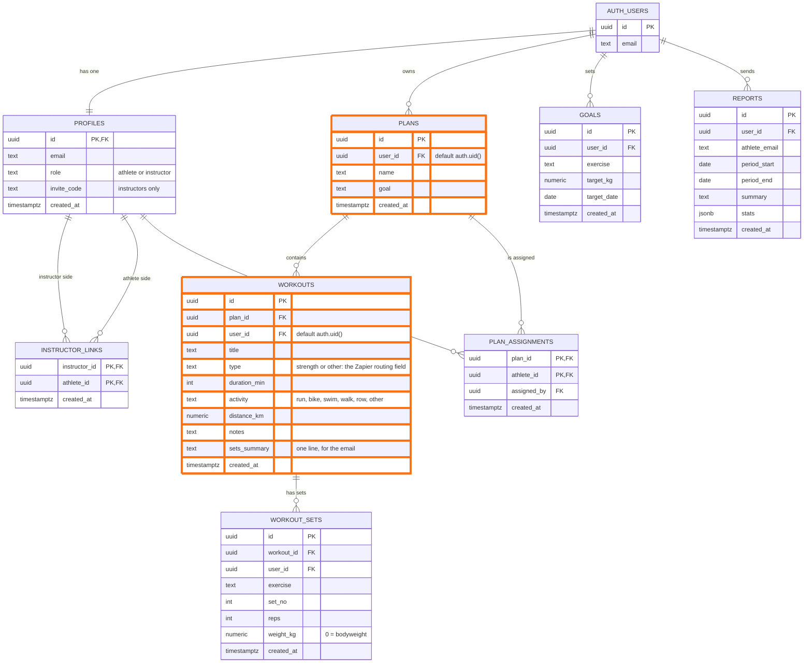
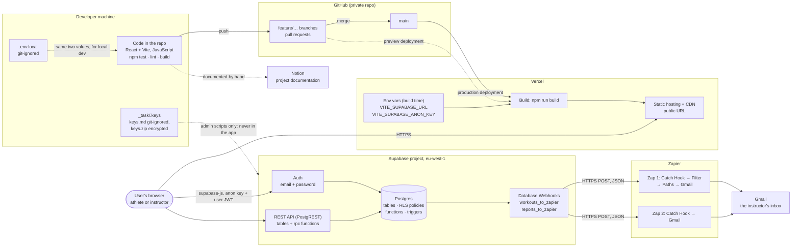

# Architecture

*English · [Lietuviškai](lt/architecture.md)*

How the finished app is built: the data model (ERD), where everything runs (deployment diagram), how a request and an email travel, and who may read what. The diagrams are [Mermaid](https://mermaid.js.org/), which GitHub renders in place.

The original scope is in [implementation-plan.md](implementation-plan.md); this page describes what was **built**, including where it differs from the plan.

## 1. Data model (ERD)

The two tables of the initial task, **`plans`** (table A) and **`workouts`** (table B), are highlighted. Everything else is the Extended scope, added table by table in later pull requests. `auth.users` is Supabase's own table.

| Table | Tier | Purpose |
|---|---|---|
| `plans` | **Initial task (A)** | A workout plan. Owned by one user; an instructor's plan can be assigned to athletes |
| `workouts` | **Initial task (B)** | One logged session under a plan. **Its INSERT fires the first webhook** (Zap 1) |
| `workout_sets` | Extended | Exercise, set number, reps and kg of a strength workout |
| `goals` | Extended | An exercise, a target weight and a date; reached or overdue is worked out from the sets |
| `reports` | Extended | A progress report, written only by `send_report()`. **Its INSERT fires the second webhook** (Zap 2) |
| `profiles` | Extended | One per user: role (`athlete` / `instructor`) chosen at sign-up, and the instructor's invite code |
| `instructor_links` | Extended | An athlete shares with an instructor (made by `link_instructor(code)`) |
| `plan_assignments` | Extended | One plan to many athletes |

`user_id` on `workouts` and `workout_sets` is a convenience copy of the owner, so every Row Level Security policy is a plain `user_id = auth.uid()` check. All tables are in [`supabase/schema.sql`](../supabase/schema.sql).

## 2. Deployment and infrastructure

| Piece | Runs on | What it does |
|---|---|---|
| React app | Vercel (static files on a CDN) | Everything the user sees. It talks to Supabase directly from the browser |
| Auth, API, database | Supabase, EU region | Accounts, data, access rules, and the webhooks |
| Automation | Zapier | Turns a webhook into an email (the Filter and Paths pick the subject by `workouts.type`) |
| Email | Gmail | Delivers to the instructor |
| Source and review | GitHub | One `feature/…` branch and pull request per feature; a push to `main` deploys production, every pull request gets a preview |
| Documentation | Notion and this repo | Task table, decisions, errors, tests |

### Where secrets live

| Secret | Where it is | Where it must never be |
|---|---|---|
| Supabase URL and publishable (anon) key | Vercel env vars, `.env.local` | Safe to expose, but **only because RLS is on** |
| Supabase `service_role` / secret key | Admin scripts on the developer machine only | React, Vercel, the repo |
| Zapier Catch Hook URLs | Inside the two Supabase webhooks (database triggers) and in Zapier | The repo, README, Notion, screenshots, Vercel |
| Zapier, Notion, Vercel and Supabase tokens, demo logins | `_task/.keys/keys.md` (git-ignored); the repo holds only the password-protected, AES-256 `keys.zip` | The repo in plain text |

## 3. How the code is organized

| Layer | Folder | Rule |
|---|---|---|
| Screens | `src/pages`, `src/components` | Show the four states (loading, error, empty, success); no data access of their own |
| Data access | `src/api` | One function per question or write: `from(...)` queries and `rpc(...)` calls; the only place that knows table and function names |
| Logic | `src/lib` | Pure functions without I/O: progress maths, goals, suggestions, formatting. Easy to test |
| Texts | `src/i18n` | Every UI text lives in `translations.js` (Lithuanian and English, same keys). `t(key, params)` fills in `{placeholders}` and picks plural forms (Lithuanian has three); the chosen language is kept in `localStorage` and read by components through `useLanguage()`. Lithuanian is the default |
| Auth | `src/auth` | Session provider; the role in the menu comes from the sign-up metadata |
| Database | `supabase/schema.sql` | Tables, policies, functions, triggers; re-runnable. `seed.sql` adds demo data to an empty project |

Tests run without a network: the real `supabase-js` client talks to a fake `fetch` (`src/test/fakeBackend.js`), so they check the exact HTTP requests. The database has its own tests in `supabase/tests`, each of which rolls itself back.

## 4. Data flows

**Logging a workout.** The form calls `log_workout()` (one transaction: the workout and its sets). The `INSERT` into `workouts` fires the webhook once, with `sets_summary` already in the row, so Zap 1 can put the sets in the email. If anything fails, nothing is saved and nothing is sent.

**Sending a report.** The button calls `send_report()`, which builds the numbers from the caller's own last 7 days, stores a `reports` row (at most one per 5 minutes) and so fires the second webhook.

**Goals and suggestions.** Goals live in the database; whether one is reached or overdue, and every suggestion, is computed in the browser from the athlete's sets, so each can state its reason. No AI key anywhere.

**Sharing.** An athlete types the instructor's code; `link_instructor()` creates the link. The instructor then reads that athlete through two functions (below).

## 5. Who may read what

Row Level Security is the access control; the browser never filters by user.

| Data | Owner | A linked instructor |
|---|---|---|
| `plans`, `workouts`, `workout_sets`, `goals`, `reports` | Full access to their own rows (reports: read only) | Nothing through the tables |
| An athlete's progress | n/a | Through `my_athletes()` and `athlete_progress()`, which first check the link; read-only |
| An instructor's plan assigned to an athlete | n/a | The athlete can read it and log their own workouts under it (additive policies) |

**Editing and deleting plans.** Only the owner can edit or delete a plan (an assigned plan is read-only for the athlete). Deleting a plan also deletes its workouts and their sets, so the app asks first. A trigger refuses to delete a plan that *other people* logged workouts under (an instructor's plan with athletes' workouts), so an instructor can't erase athletes' history; deleting an account still works.

**Changed from the plan:** the plan proposed extra `select` policies for instructors on the athletes' tables. They would have mixed athletes' rows into an instructor's own screens, so instructors read through functions instead and the tables keep "own rows only". See [supabase.md](supabase.md#1-tables-and-policies).

## Related

[supabase.md](supabase.md) (tables, policies, sharing) · [deployment.md](deployment.md) (Vercel) · [zapier.md](zapier.md) (both Zaps) · [setup.md](setup.md) (local setup)
