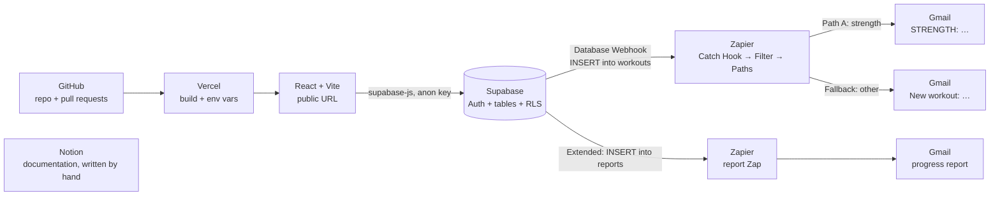

# Workout Log — high-level implementation plan

*English · [Lietuviškai](lt/implementation-plan.md)*

Capstone project "The full cycle from idea to live product" (idea from slide 3: **Workout log**, `plans → workouts`, `type: strength / other`).

Terms used here: **athlete** = a user who logs workouts; **instructor** = the coach role inside the app; **lecturer** = the course teacher who grades the project.

---

## 1. Product in short

A web workout log. Athletes follow workout plans — their own, or ones an instructor assigned to them — and log strength and cardio sessions (exercises, sets, reps, weights, duration, distance). The app shows progress, tracks goals and suggests the next step. The instructor is emailed automatically about every new workout and receives progress reports without opening a dashboard.

### Scope card (slide 5, as filled in)

| Question | Answer |
|---|---|
| Idea in one sentence | A web workout log: athletes follow workout plans (their own or assigned by an instructor), log strength and cardio sessions, and the instructor is automatically emailed about every new workout. |
| Tables A and B | **A: `plans`** – id, user_id, name, goal, created_at **B: `workouts`** – id, plan_id (→ plans.id), user_id, title, type, duration_min, created_at |
| What a "new record" is | A logged workout: the user submits the "Log workout" form → one INSERT into `workouts` → Supabase webhook → Zapier. |
| Routing field and its 2 values | `workouts.type`: `strength` / `other` (other = cardio, mobility, etc.) |
| Who gets the email and when | The instructor (my Gmail address), within ~1 min after each new workout. Path A, `type = strength`: "STRENGTH: " + title. Fallback, `type = other`: "New workout: " + title. |

---

## 2. Three scope tiers

The vision is bigger than the graded minimum, and the course has four lectures. Build in this order and stop wherever time runs out — every tier leaves a submittable product.

| Tier | Contents | Why this order |
|---|---|---|
| **Core** (graded) | Auth, `plans → workouts`, RLS, 3 screens, 4 states, Vercel, Zap with Filter + Paths + Gmail, error handler, Notion, README, 3+ PRs | Everything on the submission checklist (slide 21). Nothing else starts until this passes the test table (slide 19). |
| **Extended** (the vision) | Exercises/sets/reps/weights, cardio fields, instructor role, plan assignment to many athletes, sharing with the instructor, goals, rule-based recommendations, progress reports by email | What makes the product worth using. Each item is its own branch + PR and only *adds* to Core. |
| **Bonus** (extra points) | Progress chart from history (slide 4), AI-written report summary (slide 4) | The chart is cheap once sets are logged — do it first among the extras. |

### Where the vision meets the course rules

| Vision item | Course rule (slide 4) | How the plan handles it |
|---|---|---|
| Share data with an instructor | "Everyone sees only their own data" | Owner-only policies stay exactly as on slide 9. Sharing is an extra **read-only** `select` policy that applies only when an athlete has linked an instructor. Two unlinked users still see nothing of each other, so test 4 passes. **Needs the lecturer's OK.** |
| Automatic reports by email | No own server, no Edge Functions | Reports are rows in a `reports` table; an INSERT fires a second Database Webhook → Zapier → Gmail. Same pattern as the core flow, no server code. |
| Personalized recommendations | No Edge Functions (so no secret AI key in the app) | Rule-based, computed in the browser from history. The optional AI part runs as a Zapier step, where the key never touches React or Vercel. |
| Visualization | Bonus: "a chart from history" | Recharts on the Progress screen. |
| Use on the phone at the gym | No mobile version | Responsive CSS only; no native app, no PWA work. *(Later, in v5, a PWA was added after all: see [§15](#15-v5-a-phone-app-that-works-without-signal).)* |
| — | No TypeScript, payments, real-time, file uploads | JavaScript only; no Supabase Realtime; no progress photos or file import. CSV *export* is a browser download, not an upload. |

---

## 3. Requirement traceability

| Slide | Requirement | Covered by |
|---|---|---|
| 2, 13 | GitHub repo, branches, ≥ 3 merged PRs | §9 — one `feature/…` branch per PR; `auth`, `plans-workouts`, `zapier-docs` are the mandatory three |
| 2, 12 | React + Vite, JavaScript, 3 screens, 4 states | §6 |
| 2, 4, 9 | Supabase Auth, 2 related tables, RLS | §5 |
| 2, 14 | Vercel, public URL, env vars | §9 lecture 3 |
| 2, 15, 16 | Webhook → Filter → Paths → Gmail | §7 |
| 4 | One triggering event: new record in table B | INSERT into `workouts` |
| 4 | Routing field with 2 values | `workouts.type`: strength / other |
| 8 | Keys and secrets handling | §8 |
| 17 | Notion page, task list, decision log, error log, README | §10 |
| 18 | Error handler, error test, owner, cost, cleanup | §7 |
| 19 | Six test scenarios | §11 |
| 21 | Submission items + 5-min demo | §12 |

---

## 4. Architecture

*As built:* the report webhook (`reports_to_zapier`) exists, as does everything in the Extended scope. The finished ERD, the deployment and infrastructure diagram and the access model are in [architecture.md](architecture.md).

Data flow: browser → Supabase → webhook → Zapier → Gmail. Code flow, separately: GitHub → Vercel → public URL.

---

## 5. Data model

### Core (lecture 1)

| Table | Fields | Note |
|---|---|---|
| A: `plans` | `id` uuid pk, `user_id` uuid default `auth.uid()`, `name` text, `goal` text, `created_at` timestamptz | Main object |
| B: `workouts` | `id` uuid pk, `plan_id` → `plans.id`, `user_id` uuid default `auth.uid()`, `title` text, `type` text check in (`strength`, `other`), `duration_min` int, `created_at` timestamptz | The webhook fires here |

RLS on both tables, exactly as slide 9: `select / update / delete using (user_id = auth.uid())`, `insert with check (user_id = auth.uid())`.

Keep the schema as SQL files in the repo (`supabase/schema.sql`), even if tables are first created in the Table Editor — it documents the model and makes the RLS screenshots reproducible.

### Extended (added table by table, each in its own PR)

| Table | Purpose | Key fields |
|---|---|---|
| `workout_sets` | Exercises, sets, reps, weights of a strength workout | workout_id, user_id, exercise, set_no, reps, weight_kg |
| *(columns on `workouts`)* | Cardio and other activities | distance_km, activity (run / bike / swim / …), notes |
| `plan_exercises` | What a plan prescribes | plan_id, position, exercise, target_sets, target_reps, target_weight_kg |
| `profiles` | Display name and role | id (= auth user id), display_name, role (`athlete` / `instructor`) |
| `instructor_links` | Which instructor may see which athlete | instructor_id, athlete_id, status |
| `plan_assignments` | **One plan → many athletes** | plan_id, athlete_id, assigned_by, created_at |
| `goals` | Goal setting | user_id, exercise or metric, target_value, target_date, achieved_at |
| `reports` | Generated progress reports; INSERT triggers the report email | user_id, period_start, period_end, summary, recipient_email, created_at |

How assignment works: an instructor creates a plan once (a template, owned by the instructor). Assigning it writes one `plan_assignments` row per athlete. Each athlete logs their own `workouts` rows against that same `plan_id`, so the plan is shared and the results stay personal. An athlete's own plan works the same way in reverse: sharing it gives the linked instructor read access.

RLS additions (owner policies are never loosened):

- `plans`: extra `select` when the plan is assigned to me, or its owner is my linked athlete.
- `workouts`, `workout_sets`, `goals`, `reports`: extra `select` for the athlete's linked instructor.
- Writes stay owner-only everywhere. Put the "is this my athlete?" check in one `security definer` SQL function to avoid policies that reference each other recursively.

*As built (PR #11):* how the built version differs from the plan above:
- **No extra `select` policies for instructors.** Instructors read through two functions instead (`my_athletes()`, `athlete_progress()`), and both check `is_my_athlete()` first.
- **Why.** Extra policies would have mixed athletes' rows into an instructor's own screens. The app would then need user filters in React, against the "RLS, not filters" decision.
- **What stays as planned.** Only the additive policies for assigned plans were kept: an athlete reads an assigned plan and logs workouts under it.
- **Linking.** It works by the instructor's code, without a pending status.

---

## 6. Interface

### Core screens (slide 12)

| Screen | What's on it | Data |
|---|---|---|
| **Login** | Sign-up, login, logout | Supabase Auth (email + password) |
| **Plans** (list) | My plans and the workouts logged under each | `select` from `plans` and `workouts` |
| **Log workout** (create) | Form: new plan, and new workout with title, type, duration | `insert` into `plans` and `workouts` |

*As built:* the plan form is its own page (**New plan**, opened from My plans), and **Log workout** is reached from a plan card rather than the menu. Plans can be edited and deleted by their owner.

### The four states — on every screen that loads or saves

| State | What the user sees |
|---|---|
| Loading | "Loading your plans…" while the request runs |
| Error | A plain-language message and a "Try again" button |
| Empty | "No plans yet — create your first plan" with a button to the form |
| Success | The data; after saving, a confirmation ("Workout saved") |

Build these once as small shared components and reuse them; test 6 (slide 19) checks the Error state directly.

### Extended screens

| Screen | Contents |
|---|---|
| **Plan detail** | Prescribed exercises; who it is assigned to (instructor view) |
| **Workout detail** | Sets table for strength; duration/distance for cardio; previous result shown beside each exercise |
| **Progress** | Charts (weight per exercise over time, weekly volume, cardio minutes), goals with progress bars, recommendations, "Send report to instructor" |
| **Instructor dashboard** | My athletes, their recent workouts and reports, "Assign plan" |

Suggested structure: `src/lib/supabase.js`, `src/pages/…`, `src/components/…`, `react-router-dom` for navigation, plain CSS.

### Recommendations (rule-based, explainable)

Each one states its reason, so the user can see why:

- All target reps hit in the last two sessions of an exercise → "Add 2.5 kg next time."
- Reps dropped two sessions in a row → "Hold the weight or take a lighter week."
- No workout for 7 days → "You planned 3 a week — pick up where you left off."
- Goal date approaching and the pace is short → "You need +X kg per week to reach it."

---

## 7. Automation (Zapier)

### Zap 1 — new workout (Core)

| Step | Setting |
|---|---|
| Trigger | Webhooks by Zapier → Catch Hook |
| Supabase | Database Webhook on table `workouts`, HTTP POST to the Catch Hook URL |
| Filter | Continue only if `type` = `INSERT` **and** `record__instructor_emails` exists |
| Paths — A: Strength | `record__type` = `strength` → Gmail: Subject "STRENGTH: " + `record__title` |
| Paths — Fallback: Other | Doesn't match A → Gmail: Subject "New workout: " + `record__title` |
| Gmail *To* | `record__instructor_emails`: the athlete's own instructors, written by a database trigger (see the safety note under Zap 2) |
| Gmail body | `record__user_id`, `record__created_at`, `record__duration_min` |

Watch out: the webhook payload has its own top-level `type` (INSERT / UPDATE) **and** the row has `record__type` (strength / other). The Filter uses the first, Paths the second. Mixing them up is the most likely first bug — a good entry for the error log.

### Reliability (slide 18)

- **Error handler** on each Gmail step → emails me the error text. *As built:* three handlers (two in Zap 1, one in Zap 2), all sending to one Zapier global variable, `ERROR_EMAIL`, so the address is set in one place and not typed into each step.
- **Error test**: put a bad "To" address, log a strength workout, find "Handled error" in Zap history, restore the address.
- **Owner**: name, email and date in the Zap description.
- **Cost**: with 50 workouts a month, about 50 tasks — one Gmail action per workout; to my knowledge the trigger, Filter and Paths steps don't consume tasks. Verify against the rules from topics 23 and 26 and write the number and plan into Notion.
- **Cleanup after delivery**: turn the Zaps off, delete the test webhook and test data.

### Zap 2 — progress report (Extended)

1. The Progress screen computes a summary from the athlete's data: workouts this period, total volume, personal records, cardio minutes, goal progress.
2. "Send report" inserts a row into `reports` → second Database Webhook → Catch Hook → Gmail to the instructor.
3. **Automatic weekly version**: a scheduled SQL job in Supabase (`pg_cron`) inserts a report row per athlete every Monday, which fires the same webhook. This is database scheduling, not an Edge Function — confirm with the lecturer that it is allowed. Fallback if not: the app creates the report when the athlete opens it and the last one is older than 7 days.
4. **AI bonus**: an AI step in this Zap turns the numbers into a short written summary before the Gmail step.

Safety: the recipient address must come from the athlete's instructor link (set by a database trigger), never from a free-text field — otherwise any signed-up user could make my Gmail send mail to arbitrary addresses.

*As built:* the trigger `set_instructor_emails()` writes the athlete's linked instructors into an `instructor_emails` column on **both** `workouts` and `reports`, and both Zaps use it as Gmail's *To* (their Filters stop a run when it is empty, so an athlete who shares with nobody sends no email). No instructor address lives in Zapier. See [zapier.md](zapier.md#upgrading-zaps-that-are-already-published).

---

## 8. Keys and secrets (slide 8)

| Value | Lives in | Never in |
|---|---|---|
| `VITE_SUPABASE_URL`, `VITE_SUPABASE_ANON_KEY` | `.env.local`, Vercel env vars | — (safe only because RLS is on) |
| `service_role` key | Nowhere | React, Vercel, the repo |
| Zapier Catch Hook URLs | Supabase webhook settings | The repo, the README, Notion screenshots |
| `.env.local` | My computer | Git (`.gitignore`) |

---

## 9. Four-lecture plan

Core work is unmarked; `[+]` marks Extended/Bonus work to do only after that lecture's Core proof is in hand.

### Lecture 1 — Foundation

- Scope card shown to the lecturer; raise the open questions from §13.
- Notion project page: goal, scope card, task list, decision log.
- Repo cleanup, then first commit. Current state of this folder: branch is `master` with no commits; `index.js` and `package.json` are IDE placeholders.
  - Rename the branch to `main`.
  - Scaffold Vite into this folder (`npm create vite@latest . -- --template react`), replacing the placeholders; `npm install @supabase/supabase-js`.
  - `.gitignore`: `node_modules`, `dist`, `.env.local`, `.idea/`, and decide whether `_task/` (course slides) belongs in a public repo — it probably doesn't.
- New public GitHub repo with a README; push `main`. From here on only `feature/…` branches and PRs.
- Supabase project (EU region), tables `plans` and `workouts`, RLS policies, email login, Site URL `http://localhost:5173`.
- `.env.local` and `src/lib/supabase.js`.

**Proof:** repo with the first commit; both tables and their policies visible in Supabase.

### Lecture 2 — Users and interface

- **PR 1 `feature/auth`** — Login screen: sign-up, login, logout, session handling.
- **PR 2 `feature/plans-workouts`** — Plans list and Log workout form, all four states.
- Check RLS with two accounts.
- `[+]` **PR `feature/workout-sets`** — sets/reps/weights and cardio fields.
- `[+]` **PR `feature/progress-chart`** — Progress screen with the first chart (bonus points).

**Proof:** two users see different data; 2 merged PRs.

### Lecture 3 — Deployment and automation

- Vercel: import the repo, add both `VITE_` variables **before** the first deploy, then set Supabase Site URL and Redirect URLs to the Vercel link.
- Incognito test: sign up and log a workout as an outside user.
- Supabase Database Webhook → Zap 1 with Filter, Paths and both Gmail steps.
- **PR 3 `feature/zapier-docs`** — README, schema SQL, automation notes.
- `[+]` **PR `feature/instructor-sharing`** — profiles, instructor links, plan assignment, instructor dashboard.
- `[+]` **PR `feature/reports`** — `reports` table, "Send report", Zap 2.

**Proof:** live link; an email arrives after a new workout.

### Lecture 4 — Verification and presentation

- Run the full test table (§11) on the live site; take the screenshots for submission.
- Error handler + error test; owner in the Zap description; cost note.
- Finish Notion (task list, ≥ 3 decisions, ≥ 2 errors) and README.
- `[+]` goals, recommendations, weekly automatic report, AI summary — only if everything above is done.
- Rehearse the 5-minute demo.

**Proof:** submission checklist complete; demo delivered.

---

## 10. Documentation (slide 17)

| Where | Content |
|---|---|
| Notion: project page | Goal, links to Vercel and GitHub, the architecture diagram (§4) |
| Notion: task list | What was done in each lecture |
| Notion: decision log | ≥ 3 decisions with reasons. Ready candidates: why RLS instead of filtering in React; why sharing is an additive read-only policy; why reports go through a table + webhook instead of an Edge Function; why recommendations are rule-based |
| Notion: error log | ≥ 2 errors: symptom, cause, solution. Slide 20 lists the likely ones; add the `type` vs `record__type` mix-up if it happens |
| `README.md` | What the app does, how to run it, env variable names (no values), live link |

---

## 11. Test table (slide 19, adapted)

| No. | Scenario | Action | Expected |
|---|---|---|---|
| 1 | New user | Sign up in an incognito window | User appears in Supabase Users; the UI shows Empty |
| 2 | Other workout | Log a workout with `type = other` | 1 new row in `workouts`; Zap history shows the Fallback path; "New workout: …" email arrives |
| 3 | Strength workout | Log a workout with `type = strength` | Zap history shows path A; "STRENGTH: …" email arrives |
| 4 | Another user | Log in with a second, unlinked account | Sees only their own plans and workouts |
| 5 | Editing | Change a workout's title | Zap history shows the Filter stopped the run; no new email |
| 6 | Error | Bad env value or network off | The UI shows the Error state with "Try again" |
| 7 `[+]` | Linked instructor | Athlete links an instructor; instructor logs in | Instructor sees that athlete's workouts read-only, and nobody else's |
| 8 `[+]` | Plan assignment | Instructor assigns one plan to two athletes | Both see the plan; each sees only their own workouts under it |
| 9 `[+]` | Report | Athlete presses "Send report" | 1 new row in `reports`; the instructor receives the report email |

---

## 12. Submission and demo (slide 21)

1. Live Vercel link.
2. GitHub repo with README and ≥ 3 merged PRs.
3. Screenshots: Supabase tables and RLS policies.
4. Screenshots: the Zap with Paths, and Zap history for tests 2 and 3.
5. Notion documentation link.

**Demo, 5 min:** the problem and idea → the diagram → live: log a strength workout and show the email arriving → `[+]` show the progress chart and an assigned plan → what was hardest.

---

## 13. Open questions for the lecturer

1. **Sharing with an instructor** relaxes "everyone sees only their own data" for linked users only. Acceptable as an additive read-only policy?
2. **Fallback path**: slide 16 shows no email on the fallback, slide 19 (test 2) expects one. This plan sends one.
3. **Webhook events**: slide 15 says "Insert" only, but test 5 expects the Filter to stop an edit, which requires the webhook to fire on Update too. This plan enables Insert + Update so the Filter has something to stop.
4. **More than two tables** and a **second Zap** — fine as extras?
5. **`pg_cron`** for the weekly report — allowed, given "no Edge Functions"?

---

## 14. Market research: what exists and where this stands out

Researched November 2026. Most public comparisons are written by the vendors themselves and their price figures disagree, so prices below are indicative only.

| Product | Type | Known for | Gap relevant to this project |
|---|---|---|---|
| **Strong** | Personal logger | Fastest, minimal set logging | Solo use; reviewers complain that CSV export sits behind the paid tier |
| **Hevy** | Personal logger | Best-regarded free tier, social feed | Coaching is a separate paid product (Hevy Coach) |
| **Fitbod** | Personal logger | Algorithm-generated workouts | No free tier after a short trial; recommendations are a black box |
| **JEFIT** | Personal logger | Large exercise library, analytics | Ads on the free tier; ready-made plans gated to the paid tier |
| **Hevy Coach** | Coach platform | Assign programs, client graphs, messaging | Priced per client count (from about $25/month); reviewers miss scheduling |
| **TrueCoach** | Coach platform | Lean plan building and delivery | Tiered by active clients; plans flow coach → client only |
| **ABC Trainerize** | Coach platform | Broad: workouts, nutrition, messaging | Many features are paid add-ons; heavy for a single trainer |
| **TrainHeroic** | Coach platform | Team and athlete programming | Aimed at teams and strength coaches |

The pattern: the market is split into **personal loggers** (athlete-only) and **coach platforms** (paid per client, coach-driven). Little sits in between.

### What makes this platform stand out

1. **The instructor is told, not asked to look.** An email within a minute of each workout and a periodic progress report. Coach platforms expect the coach to open a dashboard. This is also exactly the automation the course grades.
2. **One free web app for both sides.** Athlete and instructor use the same product, with no per-client pricing and nothing to install (since v5 it can optionally be put on the phone's home screen: [§15](#15-v5-a-phone-app-that-works-without-signal)).
3. **Plans flow both ways.** Instructors assign a plan to many athletes; athletes can also write their own plan and share it with the instructor for feedback. Coach platforms are top-down.
4. **Strength and cardio in one log**, with a single progress view across both.
5. **Explainable recommendations.** Every suggestion states its rule, unlike generated-workout apps.
6. **Your data leaves freely.** Email reports and CSV export for everyone — the most common complaint about existing apps is data locked behind a subscription.

### Sources

- [Fitbod vs Strong vs Jefit vs Hevy (JEFIT blog)](https://www.jefit.com/blog/fitbod-vs-strong-vs-jefit-vs-hevy)
- [10 Best Workout Tracker Apps in 2026 (JEFIT)](https://www.jefit.com/wp/general-fitness/10-best-workout-tracker-apps-in-2026-complete-comparison-guide/)
- [Best workout logging apps (Boostcamp)](https://www.boostcamp.app/best/workout-logging)
- [Hevy vs Strong vs Fitbod vs JEFIT (Sensai)](https://www.sensai.fit/blog/hevy-vs-strong-vs-fitbod-vs-jefit)
- [6 Best Apps to Log Workouts in 2026 (Setgraph)](https://setgraph.app/ai-blog/best-apps-to-log-workouts)
- [Best Workout Tracker App Reddit (Setgraph)](https://setgraph.app/ai-blog/best-workout-tracker-app-reddit)
- [Hevy Coach (Capterra)](https://www.capterra.com/p/10015732/Hevy-Coach/)
- [Hevy Coach (GetApp)](https://www.getapp.com/recreation-wellness-software/a/hevy-coach/)
- [Hevy Coach profile (Software Advice)](https://www.softwareadvice.com/personal-trainer/hevy-coach-profile)
- [TrueCoach vs Trainerize (Coachway)](https://coachway.io/articles/truecoach-vs-trainerize/)
- [Trainerize vs TrueCoach (Exercise.com)](https://www.exercise.com/learn/trainerize-vs-truecoach/)
- [Compare TrueCoach vs TrainHeroic (Capterra)](https://www.capterra.com/compare/155784-202308/truecoach-vs-TrainHeroic)
- [Coaching platform comparison (FitBudd)](https://www.fitbudd.com/compare)
- [What clients say about coaching apps (Coachway)](https://coachway.io/articles/what-clients-say-about-coaching-apps/)

---

## 15. v5: a phone app that works without signal

*Added after the four-lecture plan. The tiers and decisions above are history and are left as they were.*

**What.** Logify became an installable phone app (a PWA) that opens and works without signal. You can see your plans, history and progress (instructors: their athletes) and log a workout. The workout waits on the phone and is sent, with the instructor's email, when the signal returns. On phones the menu is a bottom tab bar and the header is one row.

**Why.** Logify is used at the gym, and gyms often have weak or no signal. Before v5 the app didn't open without a connection, sat on *Loading…* with a weak one, sent a phone to Login once the sign-in token had expired offline, and lost a workout typed in with no signal. The scope row in section 2 (*Use on the phone at the gym*: responsive CSS only) was right for the graded tiers; v5 revisits it now that they are done.

**How, in one line each.**

- A service worker (vite-plugin-pwa, Workbox) keeps the app's files on the phone, so every screen opens offline.
- Every screen shows its last saved data when the network is down or slow, with the time it was saved; the signed-in user stays signed in offline.
- A workout logged offline waits in an outbox on the phone and is sent, in order, while the app is open.
- The database saves it exactly once: `log_workout()` takes an optional id and logged time from the phone, so a repeated send inserts nothing and the Zap runs once. `schema_version()` lets the app work, with a warning, against an older database.

**What stays as before.** The stack and the rules of the course: no server code or Edge Functions, no new runtime dependency, Row Level Security unchanged, both Zaps unchanged (a workout logged offline is emailed when it is sent: [zapier.md](zapier.md)). The live app from before v5 keeps working against the v5 database.

**Records.** The approved design is [superpowers/specs/2026-11-16-pwa-offline-design.md](superpowers/specs/2026-11-16-pwa-offline-design.md) (with an *As built* section for what changed during the build) and the task-by-task plan is [superpowers/plans/2026-11-16-pwa-offline.md](superpowers/plans/2026-11-16-pwa-offline.md). How it works and its limits: [pwa.md](pwa.md); the parts in one picture: [architecture.md](architecture.md#7-mobile-architecture-pwa); how it was released: [deployment.md](deployment.md#7-releasing-v5).

## Related

[architecture.md](architecture.md) (as built) · [pwa.md](pwa.md) (the phone app) · [supabase.md](supabase.md) (the database) · [deployment.md](deployment.md) (Vercel and releasing v5) · [zapier.md](zapier.md) (both Zaps) · [setup.md](setup.md) (local setup)
