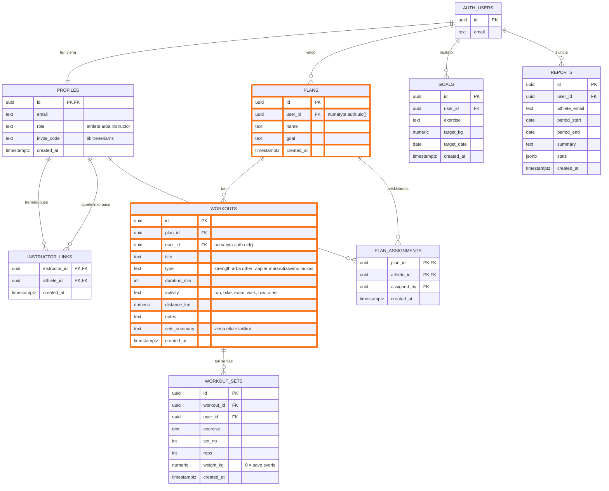
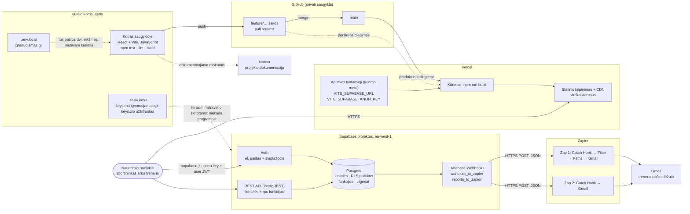

# Architektūra

*[English](../architecture.md) · Lietuviškai*

Kaip sukurta baigta programa: duomenų modelis (ERD), kur viskas veikia (diegimo diagrama), kaip keliauja užklausa ir el. laiškas, ir kas ką gali skaityti. Diagramos sukurtos su [Mermaid](https://mermaid.js.org/), kurį GitHub atvaizduoja tiesiogiai.

Pradinė apimtis aprašyta [implementation-plan.md](implementation-plan.md); šiame puslapyje aprašyta, kas buvo **sukurta**, įskaitant tai, kuo skiriasi nuo plano.

## 1. Duomenų modelis (ERD)

Dvi pradinės užduoties lentelės, **`plans`** (A lentelė) ir **`workouts`** (B lentelė), paryškintos. Visa kita – išplėstinė apimtis, pridėta lentelė po lentelės vėlesniuose pull request. `auth.users` yra paties Supabase lentelė.

| Lentelė | Lygis | Paskirtis |
|---|---|---|
| `plans` | **Pradinė užduotis (A)** | Treniruočių planas. Priklauso vienam naudotojui; trenerio planą galima priskirti sportininkams |
| `workouts` | **Pradinė užduotis (B)** | Viena įrašyta treniruotė pagal planą. **Jos INSERT paleidžia pirmąjį webhook** (Zap 1) |
| `workout_sets` | Išplėstinė | Jėgos treniruotės pratimas, serijos numeris, pakartojimai ir kg |
| `goals` | Išplėstinė | Pratimas, tikslinis svoris ir data; ar tikslas pasiektas ar pavėluotas, apskaičiuojama iš serijų |
| `reports` | Išplėstinė | Pažangos ataskaita, rašoma tik per `send_report()`. **Jos INSERT paleidžia antrąjį webhook** (Zap 2) |
| `profiles` | Išplėstinė | Po vieną kiekvienam naudotojui: registruojantis pasirinktas vaidmuo (`athlete` / `instructor`) ir trenerio kvietimo kodas |
| `instructor_links` | Išplėstinė | Sportininkas dalijasi su treneriu (sukuria `link_instructor(code)`) |
| `plan_assignments` | Išplėstinė | Vienas planas daugeliui sportininkų |

`user_id` lentelėse `workouts` ir `workout_sets` yra patogumo sumetimais laikoma savininko kopija, todėl kiekviena Row Level Security politika yra paprasta `user_id = auth.uid()` patikra. Visos lentelės yra [`supabase/schema.sql`](../../supabase/schema.sql).

## 2. Diegimas ir infrastruktūra

| Dalis | Kur veikia | Ką daro |
|---|---|---|
| React programa | Vercel (statiniai failai CDN tinkle) | Viskas, ką mato naudotojas. Su Supabase kalbasi tiesiogiai iš naršyklės |
| Auth, API, duomenų bazė | Supabase, ES regionas | Paskyros, duomenys, prieigos taisyklės ir webhook |
| Automatizacija | Zapier | Webhook paverčia el. laišku (Filter ir Paths pagal `workouts.type` parenka temą) |
| El. paštas | Gmail | Pristato treneriui |
| Šaltinis ir peržiūra | GitHub | Viena `feature/…` šaka ir vienas pull request kiekvienai funkcijai; push į `main` diegia produkciją, kiekvienas pull request gauna peržiūros versiją |
| Dokumentacija | Notion ir ši saugykla | Užduočių lentelė, sprendimai, klaidos, testai |

### Kur laikomos paslaptys

| Paslaptis | Kur ji yra | Kur jos niekada neturi būti |
|---|---|---|
| Supabase URL ir viešasis (anon) raktas | Vercel aplinkos kintamieji, `.env.local` | Saugu atskleisti, bet **tik todėl, kad įjungtas RLS** |
| Supabase `service_role` / secret raktas | Tik administravimo skriptuose kūrėjo kompiuteryje | React, Vercel, saugykla |
| Zapier Catch Hook adresai | Dviejuose Supabase webhook (duomenų bazės trigeriuose) ir Zapier | Saugykla, README, Notion, ekrano nuotraukos, Vercel |
| Zapier, Notion, Vercel ir Supabase raktai, demonstraciniai prisijungimai | `_task/.keys/keys.md` (ignoruojamas git); saugykloje laikomas tik slaptažodžiu apsaugotas, AES-256 užšifruotas `keys.zip` | Saugykla atviru tekstu |

## 3. Kaip organizuotas kodas

| Sluoksnis | Aplankas | Taisyklė |
|---|---|---|
| Ekranai | `src/pages`, `src/components` | Rodo keturias būsenas (kraunama, klaida, tuščia, pavyko); patys duomenų neprieina |
| Duomenų prieiga | `src/api` | Viena funkcija vienam klausimui ar įrašymui: `from(...)` užklausos ir `rpc(...)` kvietimai; vienintelė vieta, kuri žino lentelių ir funkcijų pavadinimus |
| Logika | `src/lib` | Grynosios funkcijos be įvesties/išvesties: pažangos skaičiavimai, tikslai, pasiūlymai, formatavimas. Lengva testuoti |
| Tekstai | `src/i18n` | Kiekvienas sąsajos tekstas yra `translations.js` (lietuvių ir anglų, tie patys raktai). `t(key, params)` įstato `{vietoženklius}` ir parenka daugiskaitos formas (lietuvių kalboje jų trys); pasirinkta kalba saugoma `localStorage`, o komponentai ją skaito per `useLanguage()`. Numatytoji kalba – lietuvių |
| Auth | `src/auth` | Sesijos tiekėjas; vaidmuo meniu imamas iš registracijos metaduomenų |
| Duomenų bazė | `supabase/schema.sql` | Lentelės, politikos, funkcijos, trigeriai; galima paleisti pakartotinai. `seed.sql` prideda demonstracinius duomenis į tuščią projektą |

Testai veikia be tinklo: tikras `supabase-js` klientas kalbasi su netikru `fetch` (`src/test/fakeBackend.js`), todėl jie tikrina tikslias HTTP užklausas. Duomenų bazė turi savo testus aplanke `supabase/tests`, kurių kiekvienas pats save atšaukia.

## 4. Duomenų srautai

**Treniruotės įrašymas.** Forma kviečia `log_workout()` (viena transakcija: treniruotė ir jos serijos). `INSERT` į `workouts` vieną kartą paleidžia webhook, o `sets_summary` jau yra eilutėje, todėl Zap 1 gali įtraukti serijas į laišką. Jei kas nors nepavyksta, nieko neišsaugoma ir nieko nesiunčiama.

**Ataskaitos siuntimas.** Mygtukas kviečia `send_report()`, kuri sudaro skaičius iš kvietėjo paties pastarųjų 7 dienų, išsaugo `reports` eilutę (daugiausia vieną per 5 minutes) ir taip paleidžia antrąjį webhook.

**Tikslai ir pasiūlymai.** Tikslai saugomi duomenų bazėje; ar tikslas pasiektas ar pavėluotas, ir kiekvienas pasiūlymas skaičiuojami naršyklėje iš sportininko serijų, todėl kiekvienas gali nurodyti savo priežastį. Jokio DI rakto niekur.

**Dalijimasis.** Sportininkas įveda trenerio kodą; `link_instructor()` sukuria ryšį. Tada treneris skaito tą sportininką per dvi funkcijas (žemiau).

## 5. Kas ką gali skaityti

Row Level Security yra prieigos kontrolė; naršyklė niekada nefiltruoja pagal naudotoją.

| Duomenys | Savininkas | Susietas treneris |
|---|---|---|
| `plans`, `workouts`, `workout_sets`, `goals`, `reports` | Pilna prieiga prie savo eilučių (ataskaitos: tik skaityti) | Per lenteles – nieko |
| Sportininko pažanga | netaikoma | Per `my_athletes()` ir `athlete_progress()`, kurios pirmiausia patikrina ryšį; tik skaityti |
| Trenerio sportininkui priskirtas planas | netaikoma | Sportininkas gali jį skaityti ir pagal jį registruoti savo treniruotes (papildančios politikos) |

**Planų redagavimas ir trynimas.** Planą redaguoti ar ištrinti gali tik savininkas (priskirtas planas sportininkui yra tik skaitomas). Ištrynus planą, kartu ištrinamos jo treniruotės ir jų serijos, todėl programa pirmiausia paklausia. Trigeris atsisako trinti planą, pagal kurį treniruotes įrašė *kiti žmonės* (trenerio planą su sportininkų treniruotėmis), todėl treneris negali ištrinti sportininkų istorijos; paskyros ištrynimas vis tiek veikia.

**Kuo skiriasi nuo plano:** plane buvo siūloma treneriams pridėti papildomas `select` politikas sportininkų lentelėse. Jos būtų sumaišiusios sportininkų eilutes su paties trenerio ekranais, todėl treneriai skaito per funkcijas, o lentelėse paliekama „tik savo eilutės“. Žr. [supabase.md](supabase.md#1-lentelės-ir-politikos).

## Susiję

[supabase.md](supabase.md) (lentelės, politikos, dalijimasis) · [deployment.md](deployment.md) (Vercel) · [zapier.md](zapier.md) (abu Zap) · [setup.md](setup.md) (vietinis paruošimas)
