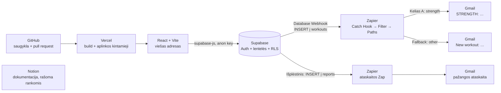

# Workout Log – aukšto lygio įgyvendinimo planas

*[English](../implementation-plan.md) · Lietuviškai*

Baigiamasis kurso „Pilnas ciklas nuo idėjos iki produkto“ projektas (idėja iš 3 skaidrės: **Treniruočių žurnalas**, `plans → workouts`, `type: strength / other`).

Čia vartojami terminai: **sportininkas** = naudotojas, kuris registruoja treniruotes; **treneris** = trenerio vaidmuo programoje; **dėstytojas** = kurso mokytojas, vertinantis projektą.

---

## 1. Produktas trumpai

Internetinis treniruočių žurnalas. Sportininkai vykdo treniruočių planus – savo arba trenerio jiems priskirtus – ir registruoja jėgos bei kardio treniruotes (pratimai, serijos, pakartojimai, svoriai, trukmė, atstumas). Programa rodo pažangą, seka tikslus ir pasiūlo kitą žingsnį. Treneris automatiškai gauna el. laišką apie kiekvieną naują treniruotę ir pažangos ataskaitas negalėdamas atidaryti jokio skydelio.

### Apimties kortelė (5 skaidrė, kaip užpildyta)

| Klausimas | Atsakymas |
|---|---|
| Idėja vienu sakiniu | Internetinis treniruočių žurnalas: sportininkai vykdo treniruočių planus (savo arba trenerio priskirtus), registruoja jėgos ir kardio treniruotes, o treneris automatiškai gauna el. laišką apie kiekvieną naują treniruotę. |
| A ir B lentelės | **A: `plans`** – id, user_id, name, goal, created_at **B: `workouts`** – id, plan_id (→ plans.id), user_id, title, type, duration_min, created_at |
| Kas yra „naujas įrašas“ | Įrašyta treniruotė: naudotojas pateikia formą „Įrašyti treniruotę“ → vienas INSERT į `workouts` → Supabase webhook → Zapier. |
| Maršrutizavimo laukas ir jo 2 reikšmės | `workouts.type`: `strength` / `other` (other = kardio, mobilumas ir pan.) |
| Kas gauna laišką ir kada | Treneris (mano Gmail adresas), maždaug per 1 min po kiekvienos naujos treniruotės. Kelias A, `type = strength`: „STRENGTH: “ + pavadinimas. Atsarginis kelias, `type = other`: „New workout: “ + pavadinimas. |

---

## 2. Trys apimties lygiai

Vizija didesnė nei vertinamas minimumas, o kurse yra keturios paskaitos. Kurkite šia tvarka ir sustokite ten, kur pritrūks laiko – kiekvienas lygis palieka tinkamą pateikti produktą.

| Lygis | Turinys | Kodėl tokia tvarka |
|---|---|---|
| **Pagrindinis (Core)** (vertinamas) | Auth, `plans → workouts`, RLS, 3 ekranai, 4 būsenos, Vercel, Zap su Filter + Paths + Gmail, klaidų tvarkyklė, Notion, README, 3+ PR | Viskas, kas yra pateikimo kontroliniame sąraše (21 skaidrė). Nieko kito nepradedama, kol tai neišlaiko testų lentelės (19 skaidrė). |
| **Išplėstinis (Extended)** (vizija) | Pratimai/serijos/pakartojimai/svoriai, kardio laukai, trenerio vaidmuo, plano priskyrimas daugeliui sportininkų, dalijimasis su treneriu, tikslai, taisyklėmis pagrįstos rekomendacijos, pažangos ataskaitos el. paštu | Tai, dėl ko produktu verta naudotis. Kiekvienas punktas – sava šaka + PR, ir tik *papildo* Core. |
| **Papildomas (Bonus)** (papildomi taškai) | Pažangos diagrama iš istorijos (4 skaidrė), DI parašyta ataskaitos santrauka (4 skaidrė) | Diagrama pigi, kai serijos jau registruojamos – iš papildomų darbų darykite ją pirmiausia. |

### Kur vizija susitinka su kurso taisyklėmis

| Vizijos punktas | Kurso taisyklė (4 skaidrė) | Kaip planas tai sprendžia |
|---|---|---|
| Dalijimasis duomenimis su treneriu | „Kiekvienas mato tik savo duomenis“ | Tik savininko politikos lieka tokios pat kaip 9 skaidrėje. Dalijimasis – papildoma **tik skaitoma** `select` politika, kuri taikoma tik tada, kai sportininkas susiejo trenerį. Du nesusieti naudotojai vienas kito nemato, todėl 4 testas praeina. **Reikia dėstytojo pritarimo.** |
| Automatinės ataskaitos el. paštu | Jokio savo serverio, jokių Edge Functions | Ataskaitos yra eilutės lentelėje `reports`; INSERT paleidžia antrą Database Webhook → Zapier → Gmail. Tas pats šablonas kaip pagrindiniame sraute, jokio serverio kodo. |
| Suasmenintos rekomendacijos | Jokių Edge Functions (todėl programoje nėra slapto DI rakto) | Taisyklėmis pagrįstos, skaičiuojamos naršyklėje iš istorijos. Neprivaloma DI dalis veikia kaip Zapier žingsnis, kur raktas niekada nepatenka į React ar Vercel. |
| Vizualizacija | Papildomai: „diagrama iš istorijos“ | Recharts Pažangos ekrane. |
| Naudojimas telefone sporto salėje | Jokios mobiliosios versijos | Tik prisitaikantis CSS; jokios natyvios programos, jokių PWA darbų. |
| — | Jokio TypeScript, mokėjimų, realaus laiko, failų įkėlimo | Tik JavaScript; jokio Supabase Realtime; jokių pažangos nuotraukų ar failų importo. CSV *eksportas* yra atsisiuntimas naršyklėje, o ne įkėlimas. |

---

## 3. Reikalavimų atsekamumas

| Skaidrė | Reikalavimas | Kur įgyvendinta |
|---|---|---|
| 2, 13 | GitHub saugykla, šakos, ≥ 3 sulieti PR | §9 – viena `feature/…` šaka kiekvienam PR; `auth`, `plans-workouts`, `zapier-docs` yra privalomi trys |
| 2, 12 | React + Vite, JavaScript, 3 ekranai, 4 būsenos | §6 |
| 2, 4, 9 | Supabase Auth, 2 susijusios lentelės, RLS | §5 |
| 2, 14 | Vercel, viešas adresas, aplinkos kintamieji | §9, 3 paskaita |
| 2, 15, 16 | Webhook → Filter → Paths → Gmail | §7 |
| 4 | Vienas paleidžiantis įvykis: naujas įrašas B lentelėje | INSERT į `workouts` |
| 4 | Maršrutizavimo laukas su 2 reikšmėmis | `workouts.type`: strength / other |
| 8 | Raktų ir paslapčių tvarkymas | §8 |
| 17 | Notion puslapis, užduočių sąrašas, sprendimų žurnalas, klaidų žurnalas, README | §10 |
| 18 | Klaidų tvarkyklė, klaidos testas, savininkas, kaina, sutvarkymas | §7 |
| 19 | Šeši testų scenarijai | §11 |
| 21 | Pateikiami dalykai + 5 min demonstracija | §12 |

---

## 4. Architektūra

*Kaip sukurta:* ataskaitos webhook (`reports_to_zapier`) yra, kaip ir viskas išplėstinėje apimtyje. Baigtas ERD, diegimo ir infrastruktūros diagrama bei prieigos modelis yra [architecture.md](architecture.md).

Duomenų srautas: naršyklė → Supabase → webhook → Zapier → Gmail. Kodo srautas atskirai: GitHub → Vercel → viešas adresas.

---

## 5. Duomenų modelis

### Pagrindinis (1 paskaita)

| Lentelė | Laukai | Pastaba |
|---|---|---|
| A: `plans` | `id` uuid pk, `user_id` uuid default `auth.uid()`, `name` text, `goal` text, `created_at` timestamptz | Pagrindinis objektas |
| B: `workouts` | `id` uuid pk, `plan_id` → `plans.id`, `user_id` uuid default `auth.uid()`, `title` text, `type` text check in (`strength`, `other`), `duration_min` int, `created_at` timestamptz | Čia veikia webhook |

RLS abiejose lentelėse, lygiai kaip 9 skaidrėje: `select / update / delete using (user_id = auth.uid())`, `insert with check (user_id = auth.uid())`.

Schemą laikykite SQL failais saugykloje (`supabase/schema.sql`), net jei lentelės pirmiausia sukuriamos Table Editor – tai dokumentuoja modelį ir leidžia atkartoti RLS ekrano nuotraukas.

### Išplėstinis (pridedama lentelė po lentelės, kiekviena savo PR)

| Lentelė | Paskirtis | Pagrindiniai laukai |
|---|---|---|
| `workout_sets` | Jėgos treniruotės pratimai, serijos, pakartojimai, svoriai | workout_id, user_id, exercise, set_no, reps, weight_kg |
| *(stulpeliai `workouts` lentelėje)* | Kardio ir kitos veiklos | distance_km, activity (run / bike / swim / …), notes |
| `plan_exercises` | Ką numato planas | plan_id, position, exercise, target_sets, target_reps, target_weight_kg |
| `profiles` | Rodomas vardas ir vaidmuo | id (= auth naudotojo id), display_name, role (`athlete` / `instructor`) |
| `instructor_links` | Kuris treneris gali matyti kurį sportininką | instructor_id, athlete_id, status |
| `plan_assignments` | **Vienas planas → daug sportininkų** | plan_id, athlete_id, assigned_by, created_at |
| `goals` | Tikslų nustatymas | user_id, exercise arba metric, target_value, target_date, achieved_at |
| `reports` | Sugeneruotos pažangos ataskaitos; INSERT paleidžia ataskaitos laišką | user_id, period_start, period_end, summary, recipient_email, created_at |

Kaip veikia priskyrimas: treneris vieną kartą sukuria planą (šabloną, priklausantį treneriui). Priskyrimas įrašo vieną `plan_assignments` eilutę kiekvienam sportininkui. Kiekvienas sportininkas įrašo savo `workouts` eilutes pagal tą patį `plan_id`, todėl planas bendras, o rezultatai asmeniniai. Paties sportininko planas veikia atvirkščiai: pasidalijus juo, susietas treneris gauna skaitymo prieigą.

RLS papildymai (savininko politikos niekada nepažeminamos):

- `plans`: papildomas `select`, kai planas priskirtas man arba jo savininkas yra mano susietas sportininkas.
- `workouts`, `workout_sets`, `goals`, `reports`: papildomas `select` sportininko susietam treneriui.
- Rašymas visur lieka tik savininkui. Patikrą „ar tai mano sportininkas?“ sudėkite į vieną `security definer` SQL funkciją, kad politikos nesusijungtų viena su kita rekursyviai.

*Kaip sukurta (PR #11):* kuo sukurta versija skiriasi nuo aukščiau pateikto plano:
- **Jokių papildomų `select` politikų treneriams.** Treneriai skaito per dvi funkcijas (`my_athletes()`, `athlete_progress()`), ir abi pirmiausia tikrina `is_my_athlete()`.
- **Kodėl.** Papildomos politikos būtų sumaišiusios sportininkų eilutes su paties trenerio ekranais. Tada programai reikėtų naudotojo filtrų React, o tai prieštarauja sprendimui „RLS, o ne filtrai“.
- **Kas lieka kaip planuota.** Palikta tik papildančių politikų priskirtiems planams dalis: sportininkas skaito priskirtą planą ir pagal jį registruoja treniruotes.
- **Susiejimas.** Veikia pagal trenerio kodą, be laukimo būsenos.

---

## 6. Sąsaja

### Pagrindiniai ekranai (12 skaidrė)

| Ekranas | Kas jame yra | Duomenys |
|---|---|---|
| **Prisijungimas** | Registracija, prisijungimas, atsijungimas | Supabase Auth (el. paštas + slaptažodis) |
| **Planai** (sąrašas) | Mano planai ir kiekvieno plano treniruotės | `select` iš `plans` ir `workouts` |
| **Įrašyti treniruotę** (kūrimas) | Forma: naujas planas ir nauja treniruotė su pavadinimu, tipu, trukme | `insert` į `plans` ir `workouts` |

*Kaip sukurta:* plano forma yra atskiras puslapis (**Naujas planas**, atidaromas iš Mano planų), o **Įrašyti treniruotę** pasiekiama iš plano kortelės, o ne iš meniu. Planus gali redaguoti ir ištrinti jų savininkas.

### Keturios būsenos – kiekviename ekrane, kuris kraunasi ar saugo

| Būsena | Ką mato naudotojas |
|---|---|
| Kraunama | „Kraunami jūsų planai…“, kol vyksta užklausa |
| Klaida | Paprasta kalba parašytas pranešimas ir mygtukas „Bandyti dar kartą“ |
| Tuščia | „Planų dar nėra – sukurkite pirmąjį planą“ su mygtuku į formą |
| Pavyko | Duomenys; išsaugojus – patvirtinimas („Treniruotė išsaugota“) |

Sukurkite jas vieną kartą kaip mažus bendrus komponentus ir naudokite pakartotinai; 6 testas (19 skaidrė) tiesiogiai tikrina Klaidos būseną.

### Išplėstiniai ekranai

| Ekranas | Turinys |
|---|---|
| **Plano informacija** | Numatyti pratimai; kam jis priskirtas (trenerio vaizdas) |
| **Treniruotės informacija** | Serijų lentelė jėgos treniruotei; trukmė/atstumas kardio; šalia kiekvieno pratimo rodomas ankstesnis rezultatas |
| **Pažanga** | Diagramos (svoris pagal pratimą per laiką, savaitinė apimtis, kardio minutės), tikslai su eigos juostomis, rekomendacijos, „Siųsti ataskaitą treneriui“ |
| **Trenerio skydelis** | Mano sportininkai, jų naujausios treniruotės ir ataskaitos, „Priskirti planą“ |

Siūloma struktūra: `src/lib/supabase.js`, `src/pages/…`, `src/components/…`, naršymui `react-router-dom`, paprastas CSS.

### Rekomendacijos (taisyklėmis pagrįstos, paaiškinamos)

Kiekviena nurodo savo priežastį, kad naudotojas matytų, kodėl:

- Paskutinėse dviejose pratimo treniruotėse pasiekti visi numatyti pakartojimai → „Kitą kartą pridėkite 2,5 kg.“
- Pakartojimai mažėjo dvi treniruotes iš eilės → „Nedidinkite svorio arba pasirinkite lengvesnę savaitę.“
- 7 dienas nebuvo treniruotės → „Planavote 3 per savaitę – grįžkite prie treniruočių.“
- Artėja tikslo data, o tempas per lėtas → „Kad pasiektumėte, reikia +X kg per savaitę.“

---

## 7. Automatizacija (Zapier)

### Zap 1 – nauja treniruotė (Core)

| Žingsnis | Nustatymas |
|---|---|
| Trigeris | Webhooks by Zapier → Catch Hook |
| Supabase | Database Webhook lentelėje `workouts`, HTTP POST į Catch Hook adresą |
| Filter | Tęsti tik jei `type` = `INSERT` **ir** `record__instructor_emails` egzistuoja |
| Paths – A: Strength | `record__type` = `strength` → Gmail: tema „STRENGTH: “ + `record__title` |
| Paths – Fallback: Other | Neatitinka A → Gmail: tema „New workout: “ + `record__title` |
| Gmail *To* | `record__instructor_emails`: paties sportininko treneriai, kuriuos įrašo duomenų bazės trigeris (žr. saugumo pastabą po Zap 2) |
| Gmail turinys | `record__user_id`, `record__created_at`, `record__duration_min` |

Atsargiai: webhook turinys turi savo aukščiausio lygio `type` (INSERT / UPDATE) **ir** eilutė turi `record__type` (strength / other). Filter naudoja pirmąjį, Paths – antrąjį. Jų sumaišymas yra labiausiai tikėtina pirmoji klaida – geras įrašas klaidų žurnalui.

### Patikimumas (18 skaidrė)

- **Klaidų tvarkyklė** kiekviename Gmail žingsnyje → atsiunčia man klaidos tekstą. *Kaip sukurta:* trys tvarkyklės (dvi Zap 1, viena Zap 2), visos siunčia į vieną Zapier globalų kintamąjį `ERROR_EMAIL`, todėl adresas nustatomas vienoje vietoje, o ne įvedamas kiekvienam žingsniui.
- **Klaidos testas**: įrašykite blogą „To“ adresą, įrašykite jėgos treniruotę, Zap istorijoje suraskite „Handled error“, atkurkite adresą.
- **Savininkas**: vardas, el. paštas ir data Zap aprašyme.
- **Kaina**: su 50 treniruočių per mėnesį – apie 50 užduočių (tasks), po vieną Gmail veiksmą kiekvienai treniruotei; kiek žinau, trigeris, Filter ir Paths žingsniai užduočių nenaudoja. Patikrinkite pagal 23 ir 26 temų taisykles ir skaičių bei planą įrašykite į Notion.
- **Sutvarkymas po pateikimo**: išjunkite Zap, ištrinkite bandomąjį webhook ir bandomuosius duomenis.

### Zap 2 – pažangos ataskaita (Extended)

1. Pažangos ekranas apskaičiuoja santrauką iš sportininko duomenų: šio laikotarpio treniruotės, bendra apimtis, asmeniniai rekordai, kardio minutės, tikslų eiga.
2. „Siųsti ataskaitą“ įrašo eilutę į `reports` → antras Database Webhook → Catch Hook → Gmail treneriui.
3. **Automatinė savaitinė versija**: suplanuotas SQL darbas Supabase (`pg_cron`) kiekvieną pirmadienį įrašo ataskaitos eilutę kiekvienam sportininkui, ir tai paleidžia tą patį webhook. Tai duomenų bazės planavimas, o ne Edge Function – pasitikslinkite su dėstytoju, ar leidžiama. Atsarginis variantas, jei ne: programa sukuria ataskaitą, kai sportininkas ją atidaro ir paskutinė yra senesnė nei 7 dienų.
4. **DI priedas**: šio Zap DI žingsnis prieš Gmail žingsnį paverčia skaičius trumpa parašyta santrauka.

Sauga: gavėjo adresas turi būti imamas iš sportininko ryšio su treneriu (nustatomo duomenų bazės trigeriu), niekada ne iš laisvo teksto lauko – kitaip bet kuris užsiregistravęs naudotojas galėtų priversti mano Gmail siųsti laiškus bet kokiais adresais.

*Kaip sukurta:* trigeris `set_instructor_emails()` įrašo sportininko susietus trenerius į stulpelį `instructor_emails` **abiejose** lentelėse `workouts` ir `reports`, o abu Zap naudoja jį kaip Gmail *To* (jų Filter sustabdo paleidimą, kai jis tuščias, todėl sportininkas, kuris nesidalija su niekuo, laiško nesiunčia). Zapier jokio trenerio adreso nelaikoma. Žr. [zapier.md](zapier.md#jau-publikuotų-zap-atnaujinimas).

---

## 8. Raktai ir paslaptys (8 skaidrė)

| Reikšmė | Kur laikoma | Niekada ne |
|---|---|---|
| `VITE_SUPABASE_URL`, `VITE_SUPABASE_ANON_KEY` | `.env.local`, Vercel aplinkos kintamieji | — (saugu tik todėl, kad įjungtas RLS) |
| `service_role` raktas | Niekur | React, Vercel, saugykla |
| Zapier Catch Hook adresai | Supabase webhook nustatymai | Saugykla, README, Notion ekrano nuotraukos |
| `.env.local` | Mano kompiuteris | Git (`.gitignore`) |

---

## 9. Keturių paskaitų planas

Pagrindiniai (Core) darbai nepažymėti; `[+]` žymi išplėstinius/papildomus darbus, kuriuos reikia daryti tik tada, kai turite tos paskaitos Core įrodymą.

### 1 paskaita – Pagrindas

- Apimties kortelė parodyta dėstytojui; iškelkite atvirus klausimus iš §13.
- Notion projekto puslapis: tikslas, apimties kortelė, užduočių sąrašas, sprendimų žurnalas.
- Saugyklos sutvarkymas, tada pirmas commit. Dabartinė šio aplanko būsena: šaka yra `master` be commit; `index.js` ir `package.json` yra IDE laikini failai.
  - Pervadinkite šaką į `main`.
  - Šiame aplanke sukurkite Vite karkasą (`npm create vite@latest . -- --template react`), pakeisdami laikinus failus; `npm install @supabase/supabase-js`.
  - `.gitignore`: `node_modules`, `dist`, `.env.local`, `.idea/`, ir nuspręskite, ar `_task/` (kurso skaidrės) turi būti viešoje saugykloje – tikriausiai ne.
- Nauja vieša GitHub saugykla su README; push `main`. Nuo šiol tik `feature/…` šakos ir PR.
- Supabase projektas (ES regionas), lentelės `plans` ir `workouts`, RLS politikos, el. pašto prisijungimas, Site URL `http://localhost:5173`.
- `.env.local` ir `src/lib/supabase.js`.

**Įrodymas:** saugykla su pirmu commit; abi lentelės ir jų politikos matomos Supabase.

### 2 paskaita – Naudotojai ir sąsaja

- **PR 1 `feature/auth`** – Prisijungimo ekranas: registracija, prisijungimas, atsijungimas, sesijos valdymas.
- **PR 2 `feature/plans-workouts`** – Planų sąrašas ir treniruotės įrašymo forma, visos keturios būsenos.
- Patikrinkite RLS su dviem paskyromis.
- `[+]` **PR `feature/workout-sets`** – serijos/pakartojimai/svoriai ir kardio laukai.
- `[+]` **PR `feature/progress-chart`** – Pažangos ekranas su pirmąja diagrama (papildomi taškai).

**Įrodymas:** du naudotojai mato skirtingus duomenis; 2 sulieti PR.

### 3 paskaita – Diegimas ir automatizacija

- Vercel: importuokite saugyklą, **prieš** pirmąjį diegimą pridėkite abu `VITE_` kintamuosius, tada Supabase Site URL ir Redirect URLs nustatykite į Vercel nuorodą.
- Inkognito testas: kaip pašalinis naudotojas užsiregistruokite ir įrašykite treniruotę.
- Supabase Database Webhook → Zap 1 su Filter, Paths ir abiem Gmail žingsniais.
- **PR 3 `feature/zapier-docs`** – README, schemos SQL, automatizacijos pastabos.
- `[+]` **PR `feature/instructor-sharing`** – profiliai, trenerių ryšiai, plano priskyrimas, trenerio skydelis.
- `[+]` **PR `feature/reports`** – lentelė `reports`, „Siųsti ataskaitą“, Zap 2.

**Įrodymas:** veikianti nuoroda; po naujos treniruotės ateina laiškas.

### 4 paskaita – Tikrinimas ir pristatymas

- Veikiančioje svetainėje paleiskite pilną testų lentelę (§11); padarykite ekrano nuotraukas pateikimui.
- Klaidų tvarkyklė + klaidos testas; savininkas Zap aprašyme; kainos pastaba.
- Užbaikite Notion (užduočių sąrašas, ≥ 3 sprendimai, ≥ 2 klaidos) ir README.
- `[+]` tikslai, rekomendacijos, savaitinė automatinė ataskaita, DI santrauka – tik jei viskas aukščiau padaryta.
- Repetuokite 5 minučių demonstraciją.

**Įrodymas:** pateikimo kontrolinis sąrašas užbaigtas; demonstracija pristatyta.

---

## 10. Dokumentacija (17 skaidrė)

| Kur | Turinys |
|---|---|
| Notion: projekto puslapis | Tikslas, nuorodos į Vercel ir GitHub, architektūros diagrama (§4) |
| Notion: užduočių sąrašas | Kas padaryta kiekvienoje paskaitoje |
| Notion: sprendimų žurnalas | ≥ 3 sprendimai su priežastimis. Paruošti kandidatai: kodėl RLS, o ne filtravimas React; kodėl dalijimasis yra papildanti tik skaitoma politika; kodėl ataskaitos eina per lentelę + webhook, o ne per Edge Function; kodėl rekomendacijos pagrįstos taisyklėmis |
| Notion: klaidų žurnalas | ≥ 2 klaidos: simptomas, priežastis, sprendimas. 20 skaidrėje išvardytos tikėtinos; pridėkite `type` ir `record__type` sumaišymą, jei jis įvyks |
| `README.md` | Ką daro programa, kaip ją paleisti, aplinkos kintamųjų pavadinimai (be reikšmių), veikianti nuoroda |

---

## 11. Testų lentelė (19 skaidrė, pritaikyta)

| Nr. | Scenarijus | Veiksmas | Tikimasi |
|---|---|---|---|
| 1 | Naujas naudotojas | Užsiregistruokite inkognito lange | Naudotojas atsiranda Supabase Users; sąsaja rodo Tuščią būseną |
| 2 | Kita treniruotė | Įrašykite treniruotę su `type = other` | 1 nauja eilutė `workouts`; Zap istorijoje rodomas Fallback kelias; ateina laiškas „New workout: …“ |
| 3 | Jėgos treniruotė | Įrašykite treniruotę su `type = strength` | Zap istorijoje rodomas kelias A; ateina laiškas „STRENGTH: …“ |
| 4 | Kitas naudotojas | Prisijunkite su antra, nesusieta paskyra | Mato tik savo planus ir treniruotes |
| 5 | Redagavimas | Pakeiskite treniruotės pavadinimą | Zap istorijoje matyti, kad Filter sustabdė vykdymą; naujo laiško nėra |
| 6 | Klaida | Bloga aplinkos reikšmė arba išjungtas tinklas | Sąsaja rodo Klaidos būseną su „Bandyti dar kartą“ |
| 7 `[+]` | Susietas treneris | Sportininkas susieja trenerį; treneris prisijungia | Treneris mato to sportininko treniruotes tik skaitydamas, ir niekieno kito |
| 8 `[+]` | Plano priskyrimas | Treneris vieną planą priskiria dviem sportininkams | Abu mato planą; kiekvienas po juo mato tik savo treniruotes |
| 9 `[+]` | Ataskaita | Sportininkas paspaudžia „Siųsti ataskaitą“ | 1 nauja eilutė `reports`; treneris gauna ataskaitos laišką |

---

## 12. Pateikimas ir demonstracija (21 skaidrė)

1. Veikianti Vercel nuoroda.
2. GitHub saugykla su README ir ≥ 3 sulietais PR.
3. Ekrano nuotraukos: Supabase lentelės ir RLS politikos.
4. Ekrano nuotraukos: Zap su Paths ir Zap istorija 2 ir 3 testams.
5. Nuoroda į Notion dokumentaciją.

**Demonstracija, 5 min.:** problema ir idėja → diagrama → gyvai: įrašyti jėgos treniruotę ir parodyti ateinantį laišką → `[+]` parodyti pažangos diagramą ir priskirtą planą → kas buvo sunkiausia.

---

## 13. Atviri klausimai dėstytojui

1. **Dalijimasis su treneriu** sušvelnina „kiekvienas mato tik savo duomenis“ tik susietiems naudotojams. Ar priimtina kaip papildanti tik skaitoma politika?
2. **Fallback kelias**: 16 skaidrė fallback šakoje laiško nerodo, 19 skaidrė (2 testas) tikisi vieno. Šis planas jį siunčia.
3. **Webhook įvykiai**: 15 skaidrėje rašoma tik „Insert“, bet 5 testas tikisi, kad Filter sustabdys redagavimą, o tam reikia, kad webhook veiktų ir Update atveju. Šis planas įjungia Insert + Update, kad Filter turėtų ką stabdyti.
4. **Daugiau nei dvi lentelės** ir **antras Zap** – ar tinka kaip papildomi darbai?
5. **`pg_cron`** savaitinei ataskaitai – ar leidžiama, atsižvelgiant į „jokių Edge Functions“?

---

## 14. Rinkos tyrimas: kas egzistuoja ir kuo ši platforma išsiskiria

Tirta 2026 m. lapkritį. Dauguma viešų palyginimų parašyti pačių pardavėjų, o jų kainų skaičiai nesutampa, todėl žemiau pateiktos kainos tik orientacinės.

| Produktas | Tipas | Žinomas dėl | Su šiuo projektu susijusi spraga |
|---|---|---|---|
| **Strong** | Asmeninis žurnalas | Greičiausias, minimalus serijų registravimas | Skirtas vienam naudotojui; apžvalgininkai skundžiasi, kad CSV eksportas yra mokamame lygyje |
| **Hevy** | Asmeninis žurnalas | Geriausiai vertinamas nemokamas lygis, socialinė naujienų juosta | Treniravimas yra atskiras mokamas produktas (Hevy Coach) |
| **Fitbod** | Asmeninis žurnalas | Algoritmų generuojamos treniruotės | Po trumpo bandomojo laikotarpio nemokamo lygio nėra; rekomendacijos yra „juodoji dėžė“ |
| **JEFIT** | Asmeninis žurnalas | Didelė pratimų biblioteka, analitika | Reklamos nemokamame lygyje; paruošti planai prieinami tik mokamame lygyje |
| **Hevy Coach** | Trenerių platforma | Programų priskyrimas, klientų grafikai, žinutės | Kaina pagal klientų skaičių (nuo maždaug 25 USD per mėnesį); apžvalgininkams trūksta planavimo |
| **TrueCoach** | Trenerių platforma | Liekna planų kūrimas ir pateikimas | Lygiai pagal aktyvius klientus; planai teka tik treneris → klientas |
| **ABC Trainerize** | Trenerių platforma | Plati: treniruotės, mityba, žinutės | Daug funkcijų yra mokami priedai; sunkus vienam treneriui |
| **TrainHeroic** | Trenerių platforma | Komandų ir sportininkų programavimas | Skirtas komandoms ir jėgos treneriams |

Dėsningumas: rinka padalyta į **asmeninius žurnalus** (tik sportininkui) ir **trenerių platformas** (mokamos pagal klientą, valdomos trenerio). Tarp jų yra mažai.

### Kuo ši platforma išsiskiria

1. **Treneris informuojamas, o ne prašomas pažiūrėti.** El. laiškas per minutę po kiekvienos treniruotės ir periodinė pažangos ataskaita. Trenerių platformos tikisi, kad treneris pats atidarys skydelį. Tai taip pat tiksliai ta automatizacija, kurią vertina kursas.
2. **Viena nemokama internetinė programa abiem pusėms.** Sportininkas ir treneris naudoja tą patį produktą, be kainos už klientą ir be nieko diegiamo.
3. **Planai teka abiem kryptimis.** Treneriai priskiria planą daugeliui sportininkų; sportininkai taip pat gali parašyti savo planą ir pasidalyti juo su treneriu atsiliepimui. Trenerių platformos veikia iš viršaus į apačią.
4. **Jėga ir kardio viename žurnale**, su vienu pažangos vaizdu abiem.
5. **Paaiškinamos rekomendacijos.** Kiekvienas pasiūlymas nurodo savo taisyklę, skirtingai nei generuojamų treniruočių programėlėse.
6. **Jūsų duomenys išeina laisvai.** El. pašto ataskaitos ir CSV eksportas visiems – dažniausias skundas dėl esamų programėlių yra duomenys, užrakinti už prenumeratos.

### Šaltiniai

- [Fitbod vs Strong vs Jefit vs Hevy (JEFIT blog)](https://www.jefit.com/blog/fitbod-vs-strong-vs-jefit-vs-hevy)
- [10 Best Workout Tracker Apps in 2026 (JEFIT)](https://www.jefit.com/wp/general-fitness/10-best-workout-tracker-apps-in-2026-complete-comparison-guide/)
- [Best workout logging apps (Boostcamp)](https://www.boostcamp.app/best/workout-logging)
- [Hevy vs Strong vs Fitbod vs JEFIT (Sensai)](https://www.sensai.fit/blog/hevy-vs-strong-vs-fitbod-vs-jefit)
- [6 Best Apps to Log Workouts in 2026 (Setgraph)](https://setgraph.app/ai-blog/best-apps-to-log-workouts)
- [Best Workout Tracker App Reddit (Setgraph)](https://setgraph.app/ai-blog/best-workout-tracker-app-reddit)
- [Hevy Coach (Capterra)](https://www.capterra.com/p/10015732/Hevy-Coach/)
- [Hevy Coach (GetApp)](https://www.getapp.com/recreation-wellness-software/a/hevy-coach/)
- [Hevy Coach profile (Software Advice)](https://www.softwareadvice.com/personal-trainer/hevy-coach-profile)
- [TrueCoach vs Trainerize (Coachway)](https://coachway.io/articles/truecoach-vs-trainerize/)
- [Trainerize vs TrueCoach (Exercise.com)](https://www.exercise.com/learn/trainerize-vs-truecoach/)
- [Compare TrueCoach vs TrainHeroic (Capterra)](https://www.capterra.com/compare/155784-202308/truecoach-vs-TrainHeroic)
- [Coaching platform comparison (FitBudd)](https://www.fitbudd.com/compare)
- [What clients say about coaching apps (Coachway)](https://coachway.io/articles/what-clients-say-about-coaching-apps/)
