# Logify: user manual for athletes

*English · [Lietuviškai](../lt/athlete.md) · [Instructor manual](instructor.md)*

Logify is a web workout log. You follow workout plans (your own, or ones your instructor gave you), log strength and cardio sessions, watch your progress, and let your instructor follow along. It runs in the browser on a computer, tablet or phone, and on a phone you can also install it like an app and keep using it without signal.

> The people, plans and workouts in the screenshots are made-up demo data.

**Contents**

1. [Sign up and log in](#1-sign-up-and-log-in)
2. [Language and menu](#2-language-and-menu)
3. [Plans](#3-plans)
4. [Log a workout](#4-log-a-workout)
5. [Open or rename a workout](#5-open-or-rename-a-workout)
6. [Progress](#6-progress)
7. [Share with your instructor](#7-share-with-your-instructor)
8. [Using Logify on a phone](#8-using-logify-on-a-phone)
9. [Install on your phone](#9-install-on-your-phone)
10. [Using Logify without signal](#10-using-logify-without-signal)
11. [Messages and what to do](#11-messages-and-what-to-do)

---

## 1. Sign up and log in

Open Logify in your browser. You land on the login screen.

**To create an account**

1. Under the form, press **Create an account**.
2. Enter your **Email** and a **Password** (at least 6 characters).
3. Under **I am signing up as**, keep **Athlete** selected.
4. Press **Sign up**.

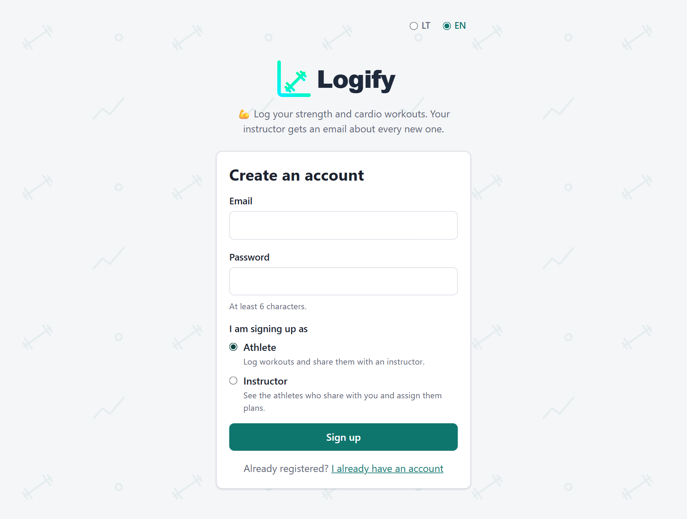

Depending on how the project is set up, you may be asked to confirm your email first: open the link in the message you receive, then log in.

**To log in**, enter your email and password and press **Log in**. If you already have an account, press **I already have an account** to switch back to the login form.

If the email or password is wrong, you will see a red message and nothing else happens. Check the details and try again.

To leave, press the **Log out** icon (a door with an arrow) at the top right. Pointing at it shows *Log out* and the email you are logged in with.

## 2. Language and menu

Logify speaks **Lithuanian** and **English**. The two small flags at the top, right next to the logo, switch the language: the Lithuanian flag for Lithuanian, the British one for English. They are on every screen, including the login screen, and the chosen one has a colored ring. Your choice is remembered in this browser.

Names you type yourself (plans, exercises, notes) are never translated.

On a computer the menu is at the top; on a phone it is a bar at the bottom of the screen (see [Using Logify on a phone](#8-using-logify-on-a-phone)). Athletes have these entries:

| Menu | What it is for |
|---|---|
| **My plans** | Your plans and the workouts under each |
| **Log** (phones only) | Log a workout |
| **Progress** | Suggestions, goals, the report to your instructor, charts |
| **Sharing** | Connect with an instructor |

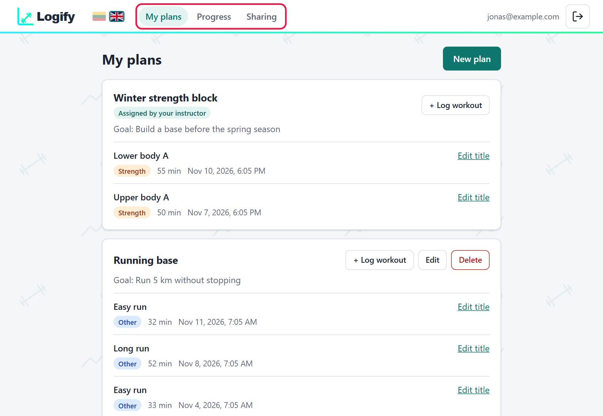

## 3. Plans

A **plan** is a folder for related workouts, for example *Upper / lower split* or *Running base*. Every workout you log belongs to a plan, so create a plan first.

### Create a plan

1. On **My plans**, press **New plan**.
2. Type a **Plan name** (required) and, if you like, a **Goal (optional)**.
3. Press **Create plan**.

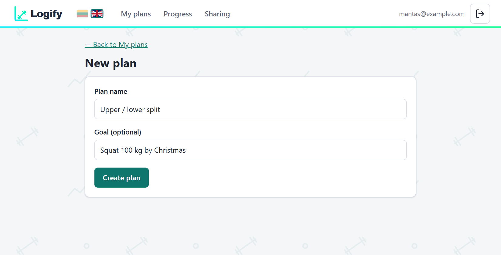

When the plan is created you can go straight on with **Log a workout under it**, or return with **Go to My plans**.

If you have no plans yet, **My plans** shows a button **Create your first plan**.

### Your plans and assigned plans

Each plan appears as a card with its goal and the workouts logged under it, newest first.

A plan that your instructor assigned to you carries the label **Assigned by your instructor**. You can log your own workouts under it, but you cannot edit or delete it.

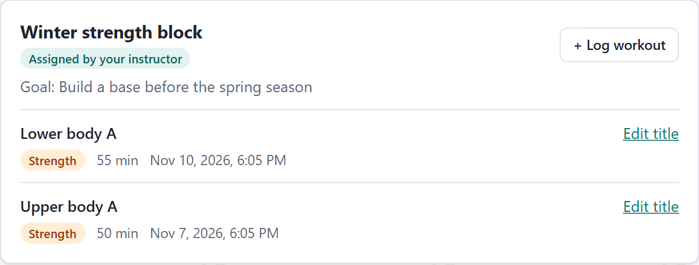

### Edit a plan

Press **Edit** on the plan card, change the name or goal, then press **Save plan** (or **Cancel**).

### Delete a plan

Press **Delete**. Logify asks first and tells you how many workouts will go with the plan. Press **Yes, delete plan** to confirm or **Cancel** to keep it. **Deleting cannot be undone.**

## 4. Log a workout

Press **+ Log workout** on a plan card. (You can also arrive here from the *Log a workout under it* button after creating a plan.)

1. **Plan**: check that the right plan is selected.
2. **Title**: for example *Leg day* or *5 km run*.
3. **Type**: choose **Strength**, or **Other (cardio, mobility…)**.
4. **Duration (minutes)**: whole minutes.
5. Fill in the details for the type you chose (below).
6. **Notes (optional)**.
7. Press **Save workout**.

> No signal at the gym? You can still log the workout: Logify keeps it on your phone and sends it later. See [Using Logify without signal](#10-using-logify-without-signal).

> Every saved workout automatically emails the instructor(s) you share with; strength workouts are flagged. This is why the form says so under **Type**. If you share with nobody, nobody is emailed (see [Share with your instructor](#7-share-with-your-instructor)).

### Strength workouts

Choosing **Strength** opens the **Exercises** section.

1. Press **Add exercise** and type its name, for example *Squat*. Names you used before are suggested as you type.
2. Under the name Logify shows what you did **last time** (for example *Last time (3 Nov): 2 × 5 @ 100 kg*), or *First time logging…* if it is new. Use it to decide today's weights.
3. For each set, enter the **reps** and the **kg**. **Add set** copies the previous set, so you only change what differs. **✕** removes a set.
4. Add more exercises with **Add exercise**; **Remove** deletes one.
5. For bodyweight exercises such as pull-ups, enter the reps and leave kg empty or 0.

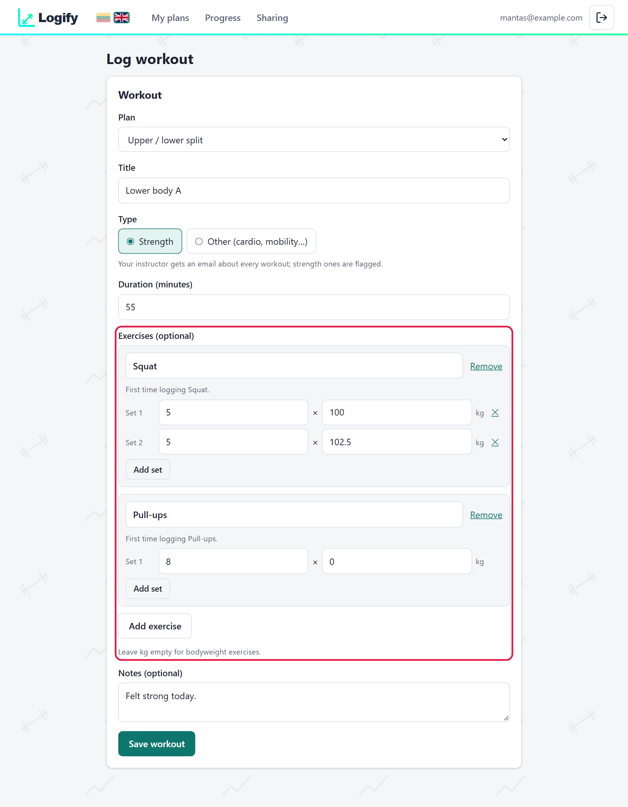

After saving, you see **Workout saved** with links **Open it** and **See it in My plans**, and the form is empty again, ready for the next workout.

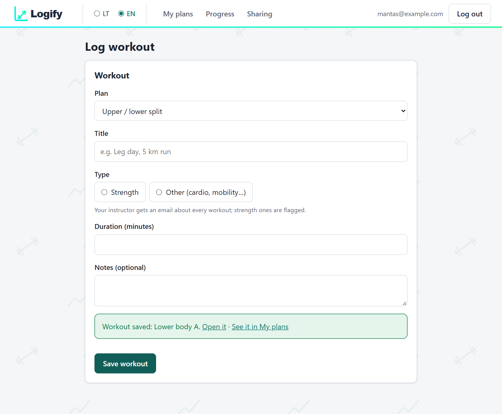

### Other workouts (cardio, mobility…)

Choosing **Other** shows **Activity** (Run, Bike, Swim, Walk, Row, Other) and **Distance (km)**. Both are optional.

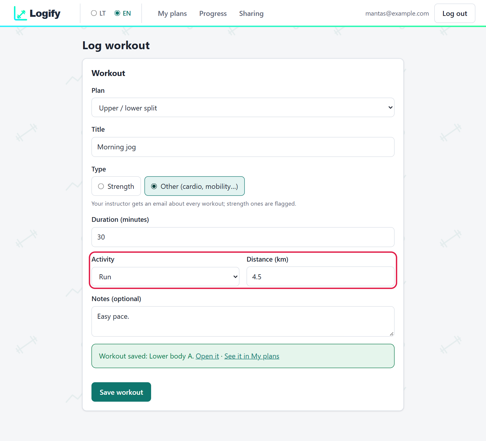

## 5. Open or rename a workout

On **My plans**, press a workout's title to open it. You see its duration, notes and, for strength workouts, every set grouped by exercise, with the previous session underneath. Cardio workouts show activity, distance and your **Pace**.

Use **← My plans** to go back.

To fix a typo in a title, press **Edit title** next to the workout, change it and press **Save** (or **Cancel**). Only the title can be edited; sets, duration and type cannot.

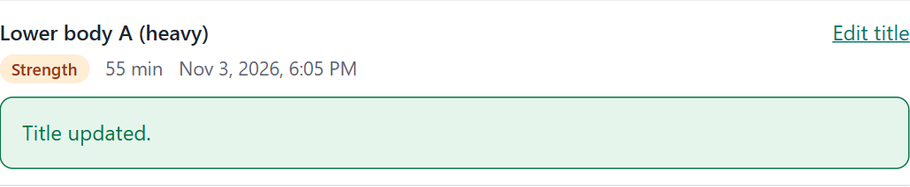

## 6. Progress

**Progress** has five cards. It needs at least one logged workout.

### Suggestions

Rule-based tips about what to do next, each with the numbers behind it. They are worked out in your browser, not by AI. Press **How suggestions work** to read the rules:

- **Add 2.5 kg** after you repeated the same sets at your top weight in your last two sessions.
- **Hold the weight** when your reps dropped two sessions in a row at the same weight.
- **Aim for more per week** when a goal needs a faster weekly gain than you have been making.
- **Pick up where you left off** after 7 days without a workout.

### Goals

A goal is an exercise, a target weight and a date. A bar shows your heaviest set so far against the target. Goals you have reached are marked ✓.

To add one, fill in **Exercise**, **Target (kg)** and **Reach it by**, then press **Add goal**. **Remove** deletes a goal. The date must be today or later.

### Report to your instructor

The card summarises your last 7 days. Press **Send report to instructor** to email it to the instructor(s) you share with (if you share with nobody, it is saved but no email goes out). You can send one about every 5 minutes; the card shows when you last sent one. The report text is written by the database and is always in English.

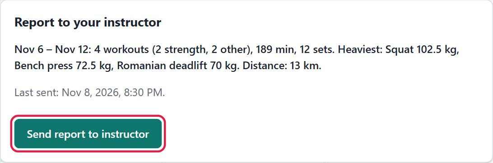

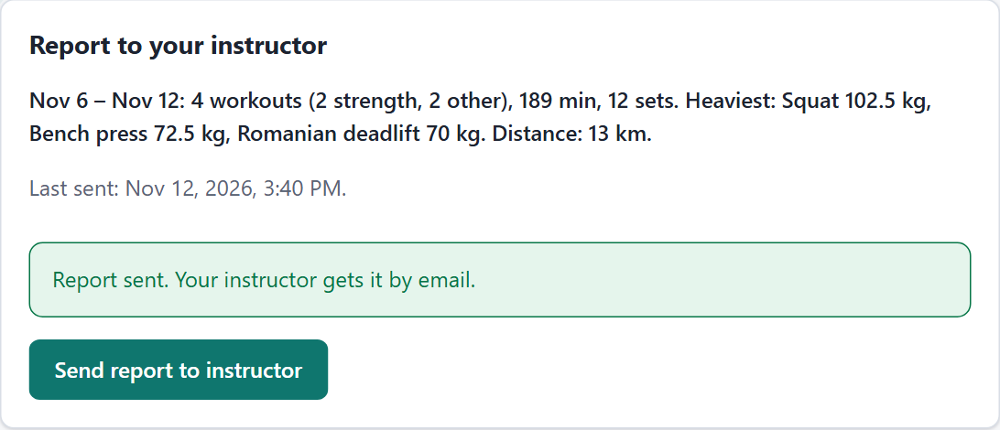

### Heaviest set per session

Pick an **Exercise** to see the heaviest set of every session as a line chart, plus a one-line summary such as *Squat: 82.5 kg → 102.5 kg over 8 sessions (+20 kg)*. Press **Show as a table** for the same numbers in a table.

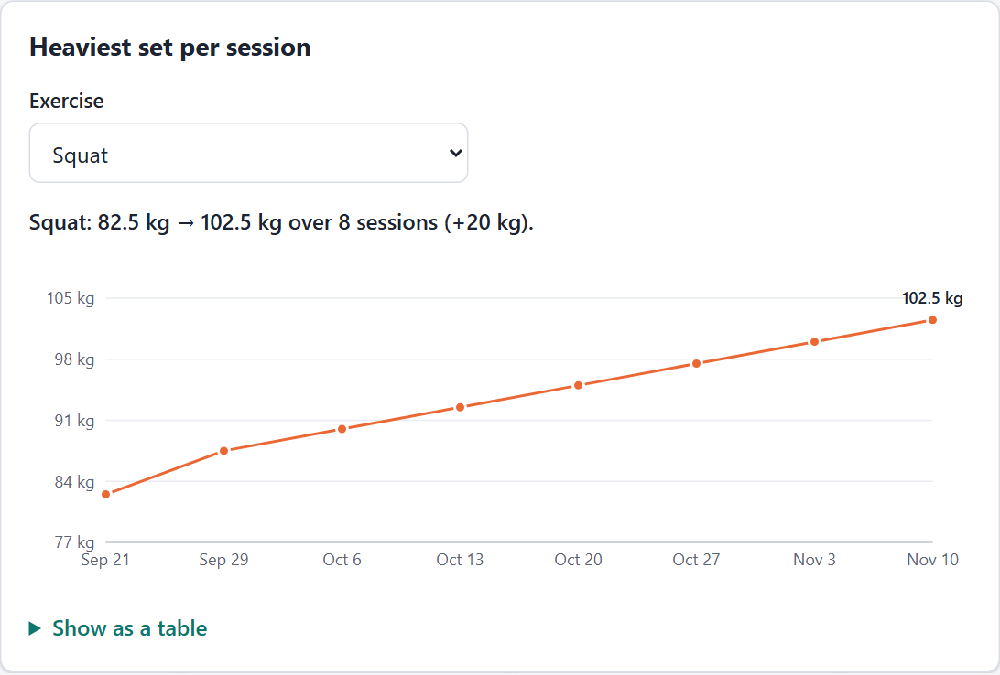

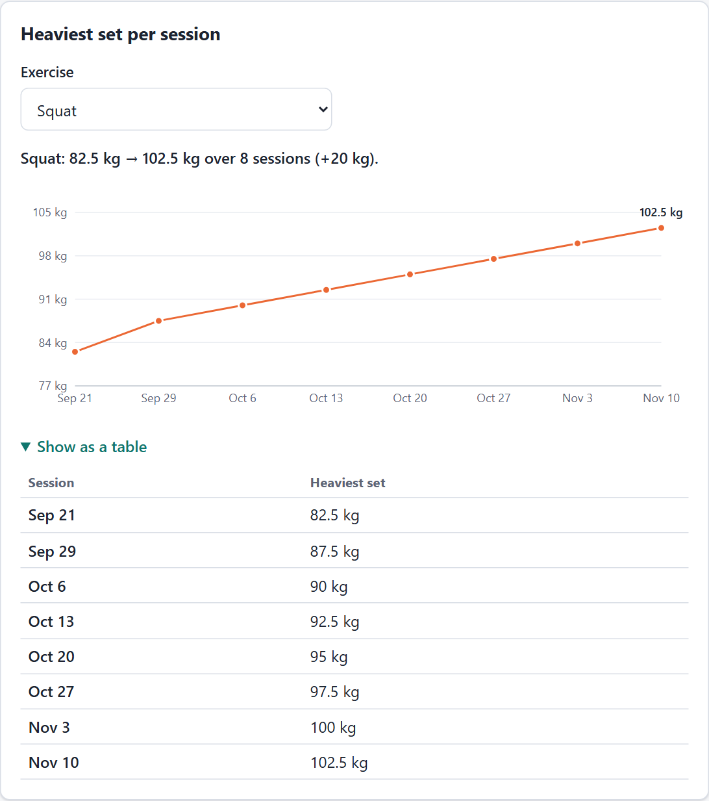

### Minutes per week

Columns for the last 8 weeks, split into strength and other.

## 7. Share with your instructor

Under **Sharing** you decide who can follow you. An instructor you share with can **read** your workouts, sets, goals and reports. They can **never change** them, and you can stop sharing at any time.

1. Ask your instructor for their **code** (six letters and digits, for example `K7P2QX`). They find it on their **My athletes** screen.
2. Open **Sharing** and type it into **Instructor's code**.
3. Press **Share**. You will see *You now share with …* and the instructor appears under **Who you share with**.

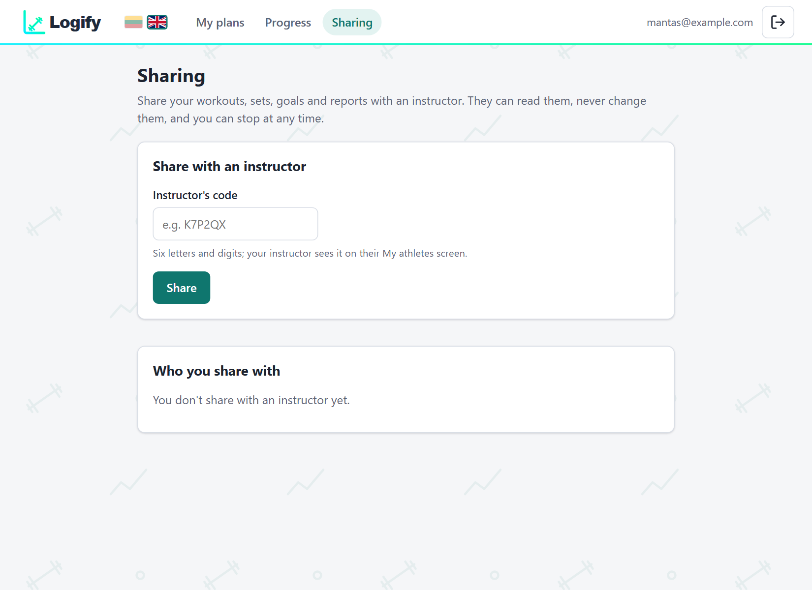

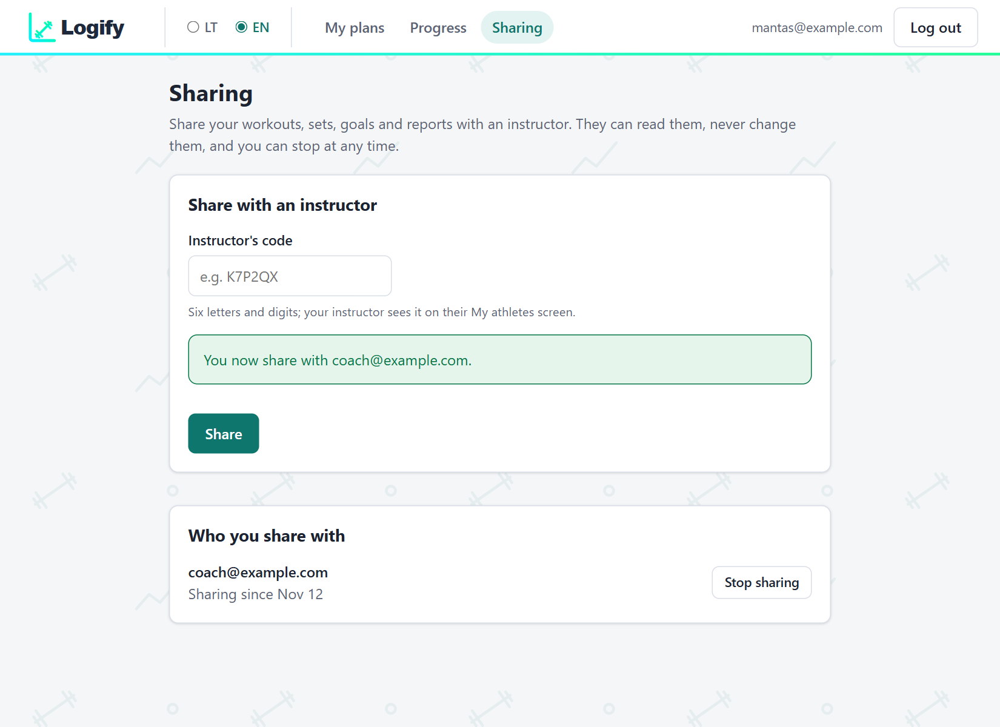

To stop, press **Stop sharing** next to the instructor. Your data stays yours; they just cannot see it any more.

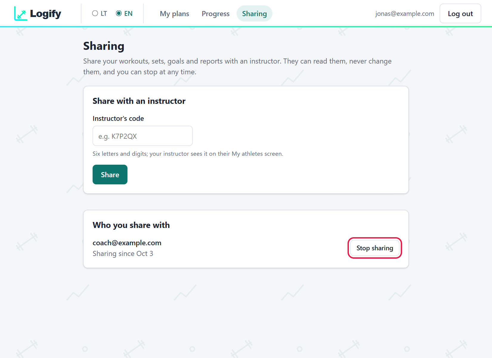

## 8. Using Logify on a phone

Logify is built to be used in the gym. On a phone (a screen up to 640 px wide) the menu becomes a **bar at the bottom of the screen**, like an app's: an icon and a label for each of **My plans**, **Log**, **Progress** and **Sharing**. The tab you are on is in the accent color. The **Log** tab opens the Log workout form straight away; it exists on phones only. The header shrinks to one row with the logo, the **LT / EN** switch and **Log out** (on the smallest screens your email is hidden), so there is more room for the screen itself.

Under the header a **status line** appears when there is something to say: you are offline, workouts are waiting to be sent, or a new version is ready. See [Using Logify without signal](#10-using-logify-without-signal).

Buttons and the plan and exercise choices stay large enough to tap.

| My plans | Log workout |
|---|---|
| 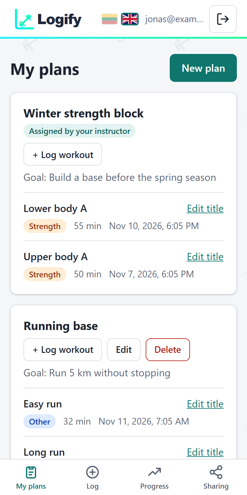 | 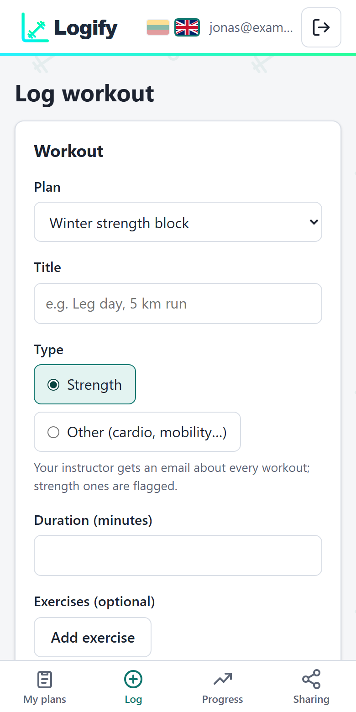 |

## 9. Install on your phone

Installing puts Logify on your home screen. It then opens full-screen with its own icon, like any app. It is optional, and Logify works without signal either way once you have opened it with a connection and logged in.

**Android (Chrome)**

1. Open Logify. On **My plans** a card says **Install Logify**: *It opens like an app and works without signal.*
2. Press **Install** and confirm. (If you press **Not now**, the card goes away for good; you can still use the browser's menu → **Install app** or **Add to Home screen**.)
3. Long-press the icon on the home screen to see two shortcuts, one for logging a workout and one for **Progress**. (Their names are always in Lithuanian: the app's install file can't follow the language switch.)

**iPhone (Safari)**

1. Open Logify in **Safari**. The card on **My plans** says *On iPhone: tap Share, then Add to Home Screen.*
2. Tap **Share**, then **Add to Home Screen**, then **Add**. Press **Got it** on the card.

> **On iPhone, the installed app keeps its own storage**, separate from Safari. Logging in in Safari does not log you in inside the home-screen app: **log in once more there**. The saved data and workouts waiting to send are separate too.

The card disappears once Logify is installed.

**Updates.** When a new version is ready, the status line says *A new version of Logify is ready.* with **Update**. Logify never reloads by itself; press **Update** when it suits you (a workout you were typing comes back after the reload). An open app also looks for a new version every hour.

## 10. Using Logify without signal

Gyms often have weak or no signal. Logify keeps working: it opens, shows what you saw last, and lets you log a workout, which is sent when the signal returns.

### Get ready once

Open Logify **with a connection** and log in. Right after that Logify quietly saves your plans and your progress, so offline works even for screens you haven't opened yet. To be able to open a workout's details offline, open it once while online (the 30 most recently opened workouts are kept). You stay logged in offline, even if you haven't had signal for hours.

### What you see offline

- The status line says *You're offline. Workouts you log are kept on this phone.*
- Plans, workouts, **Progress** and **Sharing** show the last data Logify got, with a line such as *Offline: showing data saved on Nov 16, 2026, 6:42 PM.* and **Try again**. When the connection returns, the screen refreshes by itself and the line goes away. Saved data can be old, so look at the time.
- The same happens on a weak connection: if a screen takes longer than about 4 seconds, you see the saved data (and the fresh data replaces it if it arrives).
- If something has never been saved on the phone, the screen says *You're offline, and this hasn't been saved on this phone yet.*
- While logging, the exercise-name suggestions and *Last time* come from your saved progress.

### Log a workout without signal

1. Open **Log** (or **+ Log workout** on a plan) and fill in the workout as usual.
2. Press **Save workout**. Instead of *Workout saved*, you see *Saved on this phone. It will be sent as soon as there's a connection, and your instructor gets the email then.* The form is empty again.
3. On **My plans** the workout appears under its plan with the label **Waiting to send**. It is not a link yet: it has no page until it has been sent. The status line says how many are waiting, for example *1 workout waiting to send*.

Your instructor is emailed when the workout is sent, not when you saved it on the phone.

If you are typing a workout and the phone closes the app, or you update Logify, the form comes back with *Unsaved workout restored.* Press **Start over** to clear it.

### When the signal returns

While Logify is open, waiting workouts are sent by themselves: when the connection returns, when you come back to the app, and every 30 seconds. Press **Send now** in the status line to send right away. The status line shows *Sending…* meanwhile, and a sent workout becomes a normal row. **Every workout is saved, and emailed, exactly once**, even if the connection drops in the middle of sending and Logify has to try again.

Logify sends only while the app is open (it can't send in the background), so open it once you are back in range. The time on the workout is the time you pressed **Save workout**, as long as that was in the last 30 days.

### If a workout can't be sent

If the server refuses a workout (for example, the plan was deleted, or your instructor stopped assigning it), it shows **Couldn't send: …** with the reason, and **Try again** and **Delete** buttons on **My plans**. **Delete** asks first: *Delete “…”? It was never sent, so it will be gone.* If the plan is no longer in your list, the workout appears in a card **Workouts waiting to send** at the top of **My plans**. The status line says *1 workout couldn't be sent: see My plans.*

### Logging out with workouts waiting

Logify asks first: *1 workout hasn't been sent yet. It stays on this phone and is sent the next time you log in here.* Log in again on this phone to send them. Logging out also works without signal, and removes your saved data from the phone (not the waiting workouts).

### What still needs signal

Creating, editing and deleting plans, renaming a workout, goals, sending a report, sharing with an instructor and logging in need a connection; without one you will see *Can't reach the server…* (or, on the login screen, *You're offline. Logging in needs a connection.*).

### If the phone's storage is full

Logify drops saved data to make room for your workout. If it still can't keep the workout on the phone, then with a connection the workout is sent straight away, as usual, and you see *Workout saved*. Only without a connection does the form say *This phone's storage is full, so the workout couldn't be kept here. Free some space, or save it when you're online.*, and it does not say the workout was saved.

### An older database

If the project's database hasn't been updated to the latest version yet, Logify still works, but the status line warns that workouts logged offline get the time they are sent, and that after a dropped connection one could be saved twice. Press **Hide** to hide it for the rest of the session. Whoever runs the project fixes it by updating the database ([docs/supabase.md](../../supabase.md#applying-v5-to-an-existing-project)).

## 11. Messages and what to do

| You see | What it means |
|---|---|
| *Wrong email or password.* | Check the details; they are case-sensitive for the password. |
| *An account with this email already exists. Log in instead.* | Use **I already have an account**. |
| *Please confirm your email first…* | Open the confirmation link in the email you received, then log in. |
| *Can't reach the server…* | Check your internet connection, then press **Try again**. (Logging a workout does not need it: it is kept on the phone.) |
| *You're offline. Logging in needs a connection.* | Log in once with a connection; after that Logify works offline. |
| *You're offline. Workouts you log are kept on this phone.* | No connection. Everything you log waits on the phone. |
| *Offline: showing data saved on …* | The screen shows the last saved data. It refreshes by itself when the connection returns, or press **Try again**. |
| *You're offline, and this hasn't been saved on this phone yet.* | Open that screen once while online. |
| *Saved on this phone. It will be sent as soon as there's a connection, and your instructor gets the email then.* | Your workout is safe. Leave Logify open once you have signal. |
| *1 workout waiting to send* · **Waiting to send** | Sent automatically; or press **Send now**. |
| *Couldn't send: …* | The server refused it; see the reason. **Try again** or **Delete**. |
| *1 workout couldn't be sent: see My plans.* | Open **My plans** and deal with it. |
| *This phone's storage is full, so the workout couldn't be kept here…* | Free some space on the phone, or save the workout when you have a connection. |
| *1 workout hasn't been sent yet. It stays on this phone…* | Shown when you log out. Log in on this phone later to send it. |
| *Unsaved workout restored.* | The form you were typing came back. **Start over** clears it. |
| *A new version of Logify is ready.* | Press **Update**. |
| *Logify's database is an older version than this app…* | See [An older database](#an-older-database). |
| *Too many attempts…* | Wait a few minutes. |
| *No instructor has that code…* | Check the code with your instructor. |
| *That is your own code…* | You typed an instructor account's own code. |
| *You sent a report a few minutes ago…* | Wait a few minutes before sending another report. |
| *Athletes have logged workouts under this plan, so it can't be deleted.* | Only shown to instructors: see the [instructor manual](instructor.md). |

Every screen that loads or saves shows one of four states: **Loading**, **Error** (in plain words, with a **Try again** button), **Empty** (with a hint what to do) or **Success**.

Supported browsers: Chrome and Edge 111+, Firefox 121+, Safari 16.4+. Cookies and JavaScript must be on.
