# Logify: user manual for athletes

*English · [Lietuviškai](../lt/athlete.md) · [Instructor manual](instructor.md)*

Logify is a web workout log. You follow workout plans (your own, or ones your instructor gave you), log strength and cardio sessions, watch your progress, and let your instructor follow along. There is nothing to install: it runs in the browser on a computer, tablet or phone.

> The people, plans and workouts in the screenshots are made-up demo data.

**Contents**

1. [Sign up and log in](#1-sign-up-and-log-in)
2. [Language and menu](#2-language-and-menu)
3. [Plans](#3-plans)
4. [Log a workout](#4-log-a-workout)
5. [Open or rename a workout](#5-open-or-rename-a-workout)
6. [Progress](#6-progress)
7. [Share with your instructor](#7-share-with-your-instructor)
8. [Using Logify on a phone](#8-using-logify-on-a-phone)
9. [Messages and what to do](#9-messages-and-what-to-do)

---

## 1. Sign up and log in

Open Logify in your browser. You land on the login screen.

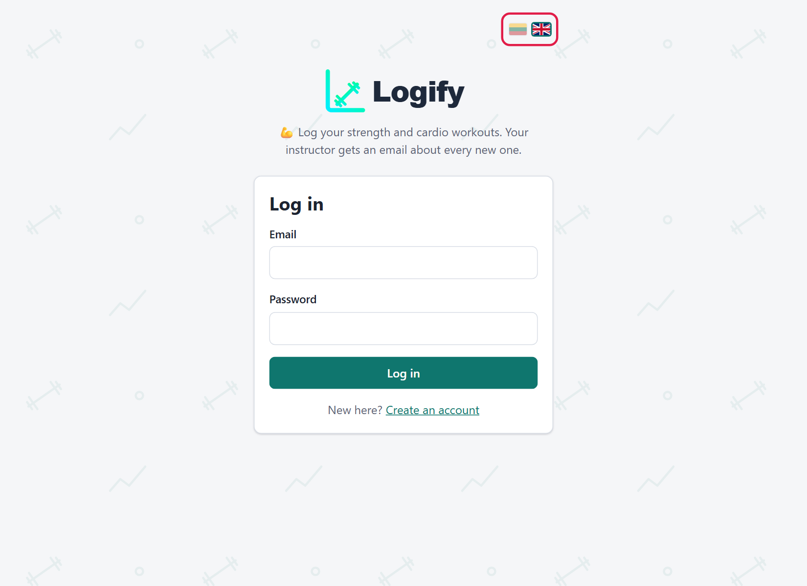

**To create an account**

1. Under the form, press **Create an account**.
2. Enter your **Email** and a **Password** (at least 6 characters).
3. Under **I am signing up as**, keep **Athlete** selected.
4. Press **Sign up**.

Depending on how the project is set up, you may be asked to confirm your email first: open the link in the message you receive, then log in.

**To log in**, enter your email and password and press **Log in**. If you already have an account, press **I already have an account** to switch back to the login form.

If the email or password is wrong, you will see a red message and nothing else happens. Check the details and try again.

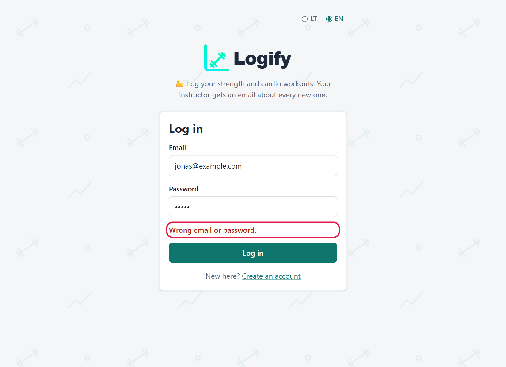

To leave, press **Log out** at the top right.

## 2. Language and menu

Logify speaks **Lithuanian (LT)** and **English (EN)**. The **LT / EN** switch sits at the top, next to the logo, on every screen including the login screen. Your choice is remembered in this browser.

Names you type yourself (plans, exercises, notes) are never translated.

The menu at the top has three entries for athletes:

| Menu | What it is for |
|---|---|
| **My plans** | Your plans and the workouts under each |
| **Progress** | Suggestions, goals, the report to your instructor, charts |
| **Sharing** | Connect with an instructor |

## 3. Plans

A **plan** is a folder for related workouts, for example *Upper / lower split* or *Running base*. Every workout you log belongs to a plan, so create a plan first.

### Create a plan

1. On **My plans**, press **New plan**.
2. Type a **Plan name** (required) and, if you like, a **Goal (optional)**.
3. Press **Create plan**.

When the plan is created you can go straight on with **Log a workout under it**, or return with **Go to My plans**.

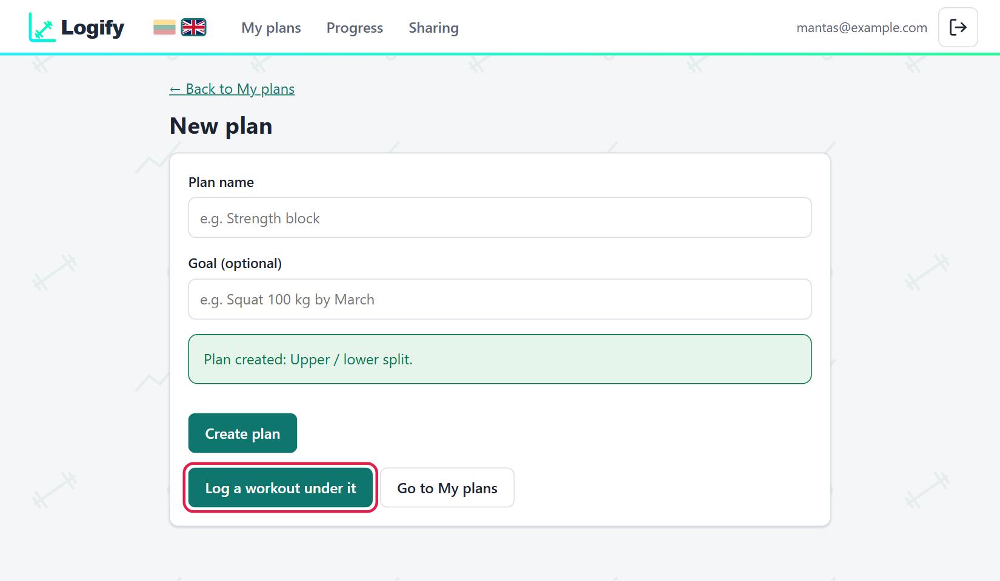

If you have no plans yet, **My plans** shows a button **Create your first plan**.

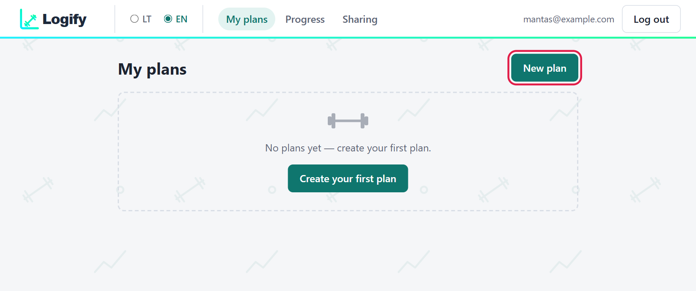

### Your plans and assigned plans

Each plan appears as a card with its goal and the workouts logged under it, newest first.

A plan that your instructor assigned to you carries the label **Assigned by your instructor**. You can log your own workouts under it, but you cannot edit or delete it.

### Edit a plan

Press **Edit** on the plan card, change the name or goal, then press **Save plan** (or **Cancel**).

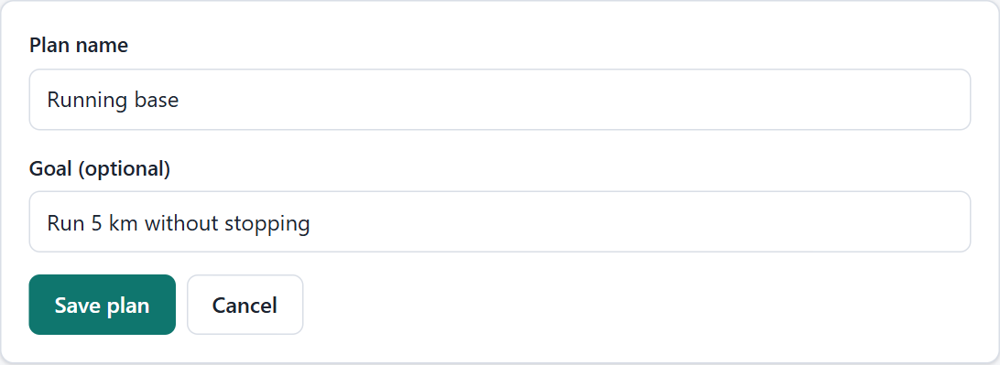

### Delete a plan

Press **Delete**. Logify asks first and tells you how many workouts will go with the plan. Press **Yes, delete plan** to confirm or **Cancel** to keep it. **Deleting cannot be undone.**

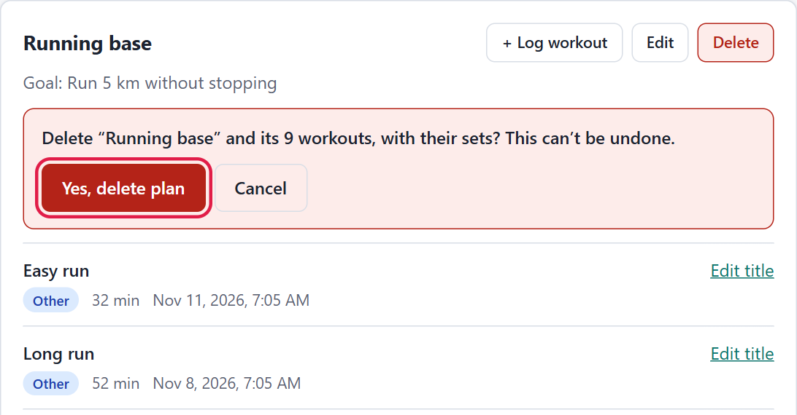

## 4. Log a workout

Press **+ Log workout** on a plan card. (You can also arrive here from the *Log a workout under it* button after creating a plan.)

1. **Plan**: check that the right plan is selected.
2. **Title**: for example *Leg day* or *5 km run*.
3. **Type**: choose **Strength**, or **Other (cardio, mobility…)**.
4. **Duration (minutes)**: whole minutes.
5. Fill in the details for the type you chose (below).
6. **Notes (optional)**.
7. Press **Save workout**.

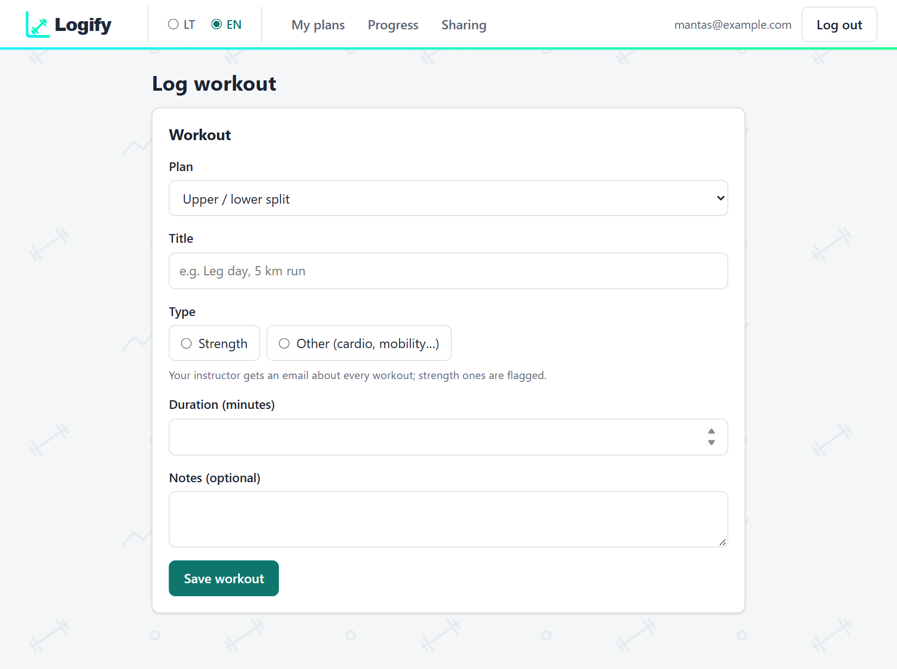

> Every saved workout automatically emails the instructor(s) you share with; strength workouts are flagged. This is why the form says so under **Type**. If you share with nobody, nobody is emailed (see [Share with your instructor](#7-share-with-your-instructor)).

### Strength workouts

Choosing **Strength** opens the **Exercises** section.

1. Press **Add exercise** and type its name, for example *Squat*. Names you used before are suggested as you type.
2. Under the name Logify shows what you did **last time** (for example *Last time (3 Nov): 2 × 5 @ 100 kg*), or *First time logging…* if it is new. Use it to decide today's weights.
3. For each set, enter the **reps** and the **kg**. **Add set** copies the previous set, so you only change what differs. **✕** removes a set.
4. Add more exercises with **Add exercise**; **Remove** deletes one.
5. For bodyweight exercises such as pull-ups, enter the reps and leave kg empty or 0.

After saving, you see **Workout saved** with links **Open it** and **See it in My plans**, and the form is empty again, ready for the next workout.

### Other workouts (cardio, mobility…)

Choosing **Other** shows **Activity** (Run, Bike, Swim, Walk, Row, Other) and **Distance (km)**. Both are optional.

## 5. Open or rename a workout

On **My plans**, press a workout's title to open it. You see its duration, notes and, for strength workouts, every set grouped by exercise, with the previous session underneath. Cardio workouts show activity, distance and your **Pace**.

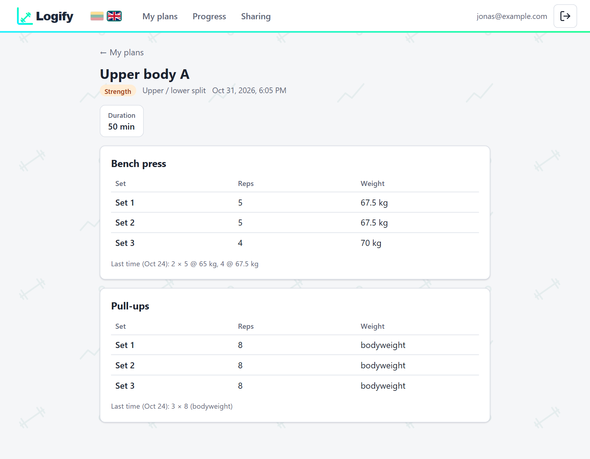

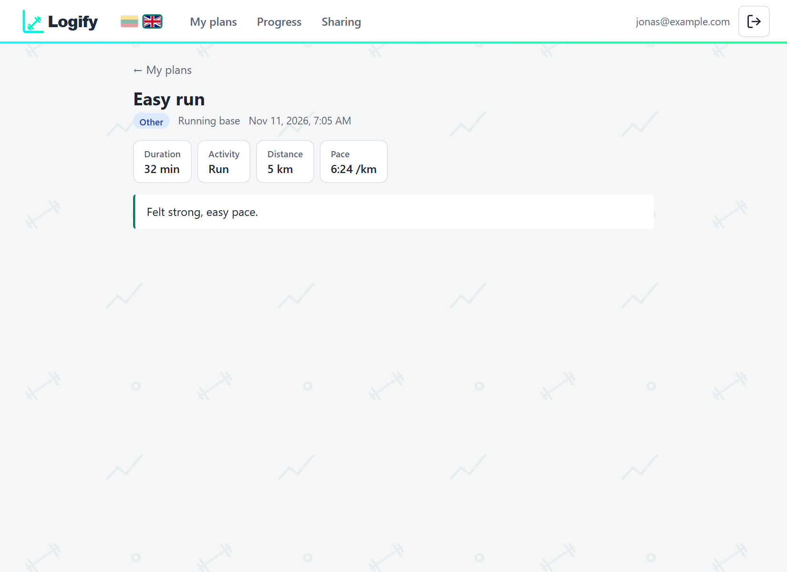

Use **← My plans** to go back.

To fix a typo in a title, press **Edit title** next to the workout, change it and press **Save** (or **Cancel**). Only the title can be edited; sets, duration and type cannot.

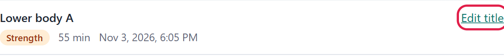

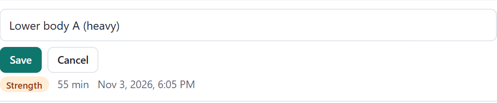

## 6. Progress

**Progress** has five cards. It needs at least one logged workout.

### Suggestions

Rule-based tips about what to do next, each with the numbers behind it. They are worked out in your browser, not by AI. Press **How suggestions work** to read the rules:

- **Add 2.5 kg** after you repeated the same sets at your top weight in your last two sessions.
- **Hold the weight** when your reps dropped two sessions in a row at the same weight.
- **Aim for more per week** when a goal needs a faster weekly gain than you have been making.
- **Pick up where you left off** after 7 days without a workout.

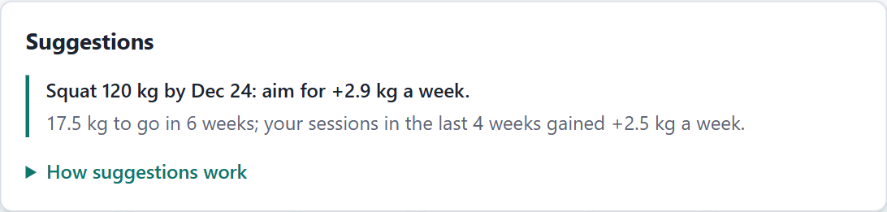

### Goals

A goal is an exercise, a target weight and a date. A bar shows your heaviest set so far against the target. Goals you have reached are marked ✓.

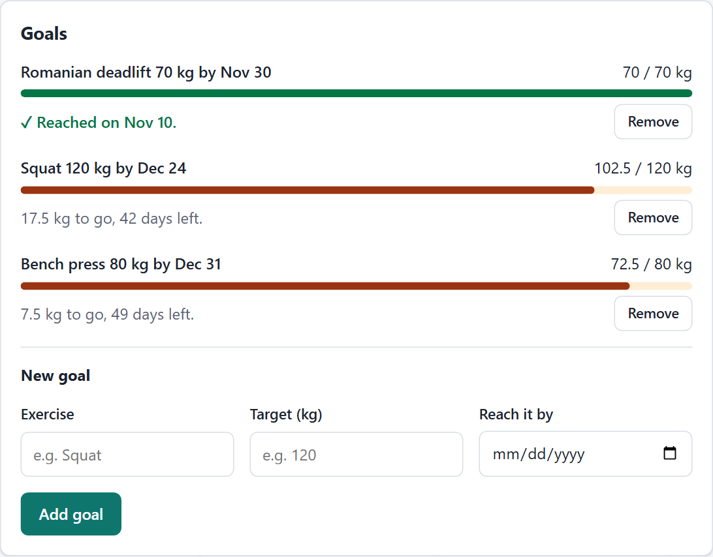

To add one, fill in **Exercise**, **Target (kg)** and **Reach it by**, then press **Add goal**. **Remove** deletes a goal. The date must be today or later.

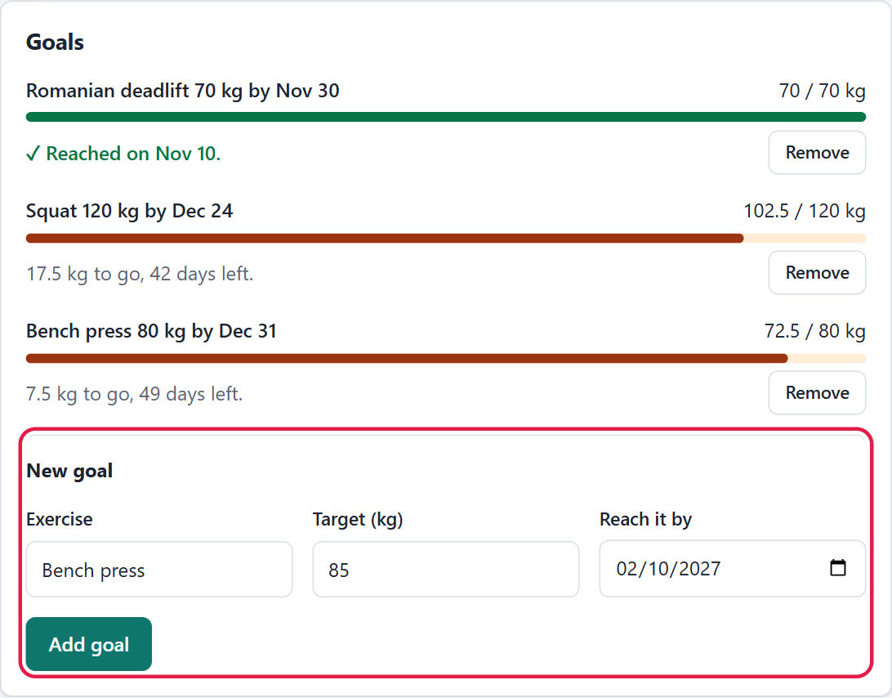

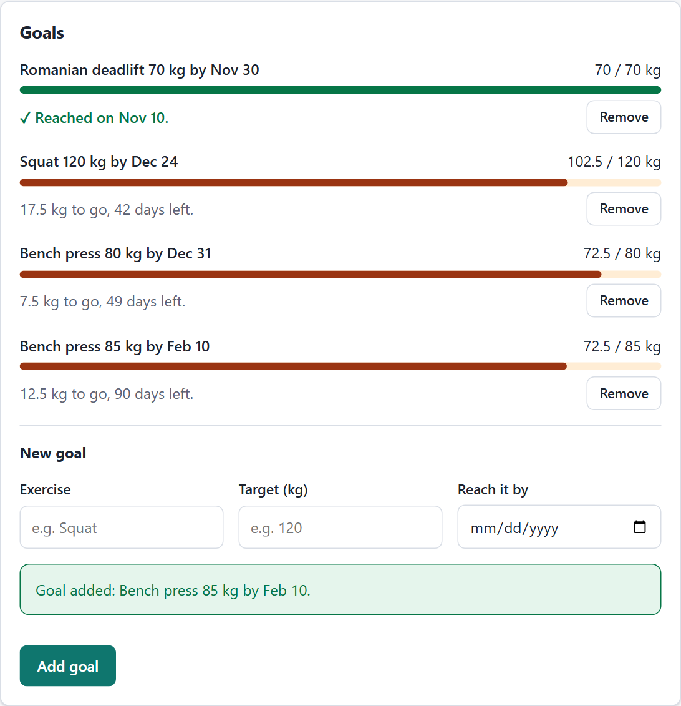

### Report to your instructor

The card summarises your last 7 days. Press **Send report to instructor** to email it to the instructor(s) you share with (if you share with nobody, it is saved but no email goes out). You can send one about every 5 minutes; the card shows when you last sent one. The report text is written by the database and is always in English.

### Heaviest set per session

Pick an **Exercise** to see the heaviest set of every session as a line chart, plus a one-line summary such as *Squat: 82.5 kg → 102.5 kg over 8 sessions (+20 kg)*. Press **Show as a table** for the same numbers in a table.

### Minutes per week

Columns for the last 8 weeks, split into strength and other.

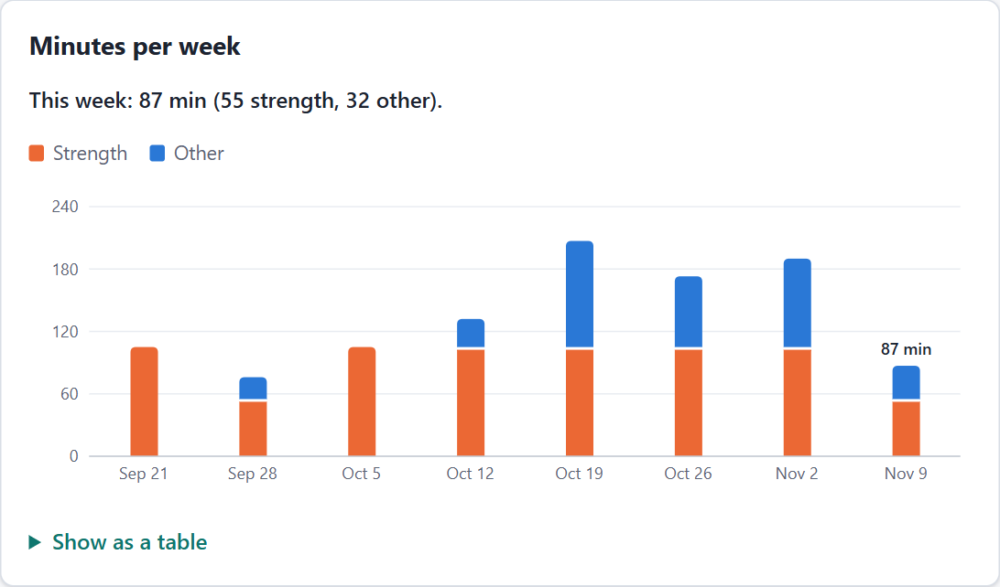

## 7. Share with your instructor

Under **Sharing** you decide who can follow you. An instructor you share with can **read** your workouts, sets, goals and reports. They can **never change** them, and you can stop sharing at any time.

1. Ask your instructor for their **code** (six letters and digits, for example `K7P2QX`). They find it on their **My athletes** screen.
2. Open **Sharing** and type it into **Instructor's code**.
3. Press **Share**. You will see *You now share with …* and the instructor appears under **Who you share with**.

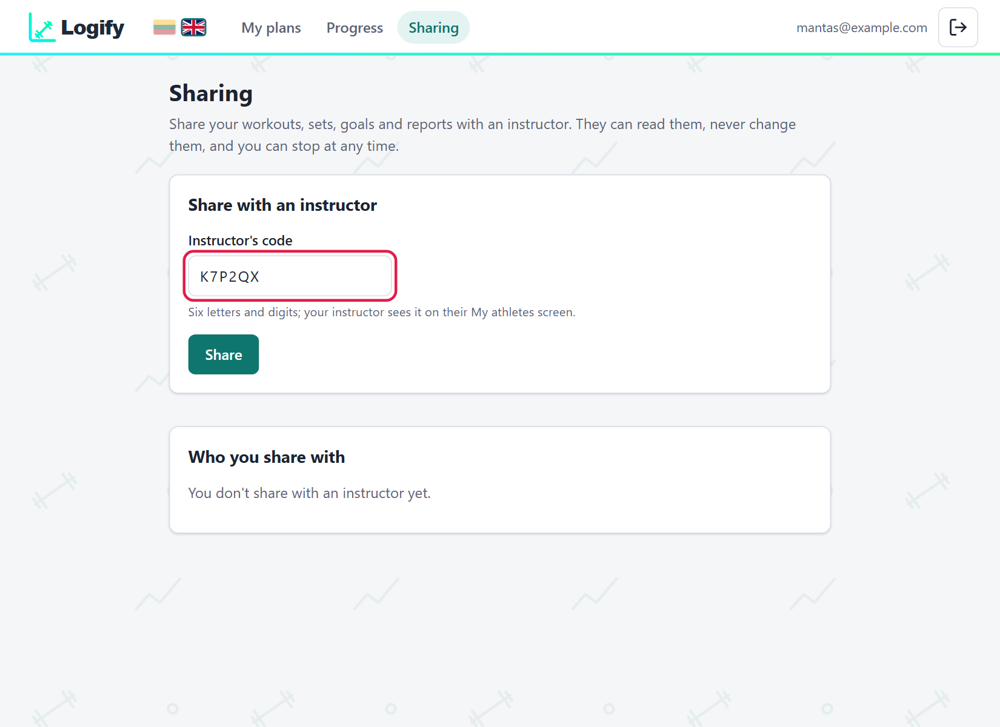

To stop, press **Stop sharing** next to the instructor. Your data stays yours; they just cannot see it any more.

## 8. Using Logify on a phone

Logify is built to be used in the gym. On a narrow screen the menu moves to its own row under the logo, and the buttons stay large enough to tap.

| My plans | Log workout |
|---|---|
|  |  |

## 9. Messages and what to do

| You see | What it means |
|---|---|
| *Wrong email or password.* | Check the details; they are case-sensitive for the password. |
| *An account with this email already exists. Log in instead.* | Use **I already have an account**. |
| *Please confirm your email first…* | Open the confirmation link in the email you received, then log in. |
| *Can't reach the server…* | Check your internet connection, then press **Try again**. |
| *Too many attempts…* | Wait a few minutes. |
| *No instructor has that code…* | Check the code with your instructor. |
| *That is your own code…* | You typed an instructor account's own code. |
| *You sent a report a few minutes ago…* | Wait a few minutes before sending another report. |
| *Athletes have logged workouts under this plan, so it can't be deleted.* | Only shown to instructors: see the [instructor manual](instructor.md). |

Every screen that loads or saves shows one of four states: **Loading**, **Error** (in plain words, with a **Try again** button), **Empty** (with a hint what to do) or **Success**.

Supported browsers: Chrome and Edge 111+, Firefox 121+, Safari 16.4+. Cookies and JavaScript must be on.
