# Logify: user manual for instructors

*English · [Lietuviškai](../lt/instructor.md) · [Athlete manual](athlete.md)*

As an instructor you follow your athletes' training, give them plans, and receive an email about every workout they log. You can **read** an athlete's data but never change it: only the athlete can.

> The people, plans and workouts in the screenshots are made-up demo data.

**Contents**

1. [Create an instructor account](#1-create-an-instructor-account)
2. [Language and menu](#2-language-and-menu)
3. [Your code: connect athletes](#3-your-code-connect-athletes)
4. [My athletes](#4-my-athletes)
5. [Create plans and assign them](#5-create-plans-and-assign-them)
6. [Read an athlete's progress](#6-read-an-athletes-progress)
7. [Emails you receive](#7-emails-you-receive)
8. [Messages and what to do](#8-messages-and-what-to-do)

---

## 1. Create an instructor account

The role is chosen once, when you sign up.

1. On the login screen press **Create an account**.
2. Enter your **Email** and a **Password** (at least 6 characters).
3. Under **I am signing up as**, choose **Instructor** ("See the athletes who share with you and assign them plans").
4. Press **Sign up**. You may need to confirm your email first: open the link in the message you receive, then log in.

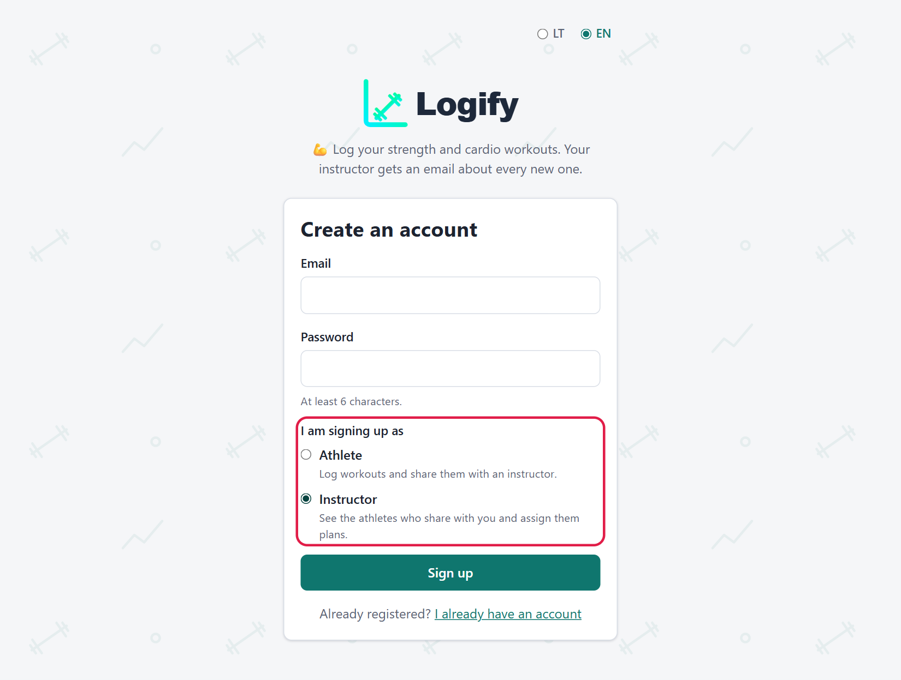

To log in later, use your email and password and press **Log in**. A wrong email or password shows a red message; check the details and try again. Press **Log out** at the top right when you are done.

## 2. Language and menu

The **LT / EN** switch at the top, next to the logo, changes the language of the whole app; it is remembered in this browser. Names typed by users (plans, exercises, notes) are not translated, and neither are the report summaries and set summaries the database writes (they are always in English, also in the emails).

Instructors have three menu entries:

| Menu | What it is for |
|---|---|
| **My plans** | The plans you create (and, if you log workouts yourself, your own workouts) |
| **My athletes** | Your code, the athletes who share with you, and each athlete's page |
| **Progress** | Your own progress, like an athlete's (empty until you log a workout) |

(There is no **Sharing** entry: that screen is for athletes.)

## 3. Your code: connect athletes

Athletes connect to you with a personal **code**. It is shown at the top of **My athletes**.

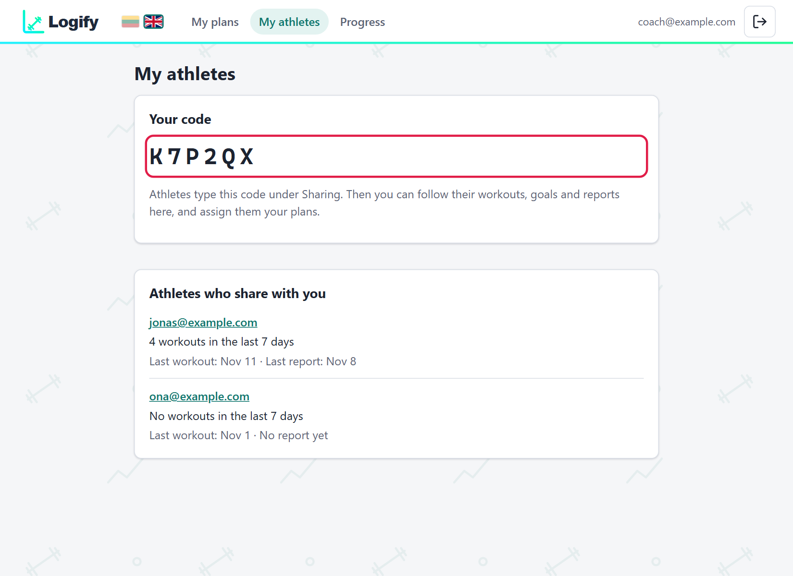

1. Open **My athletes** and read your code (six letters and digits).
2. Give it to your athlete.
3. The athlete opens **Sharing**, types the code under **Instructor's code** and presses **Share**.
4. They now appear in the list **Athletes who share with you**.

The athlete can stop sharing at any time; then they disappear from your list. If you do not see an athlete, ask them to check the code and that the screen said *You now share with …*.

## 4. My athletes

Under **Athletes who share with you** each athlete has one entry:

- their email (press it to open their page),
- how many workouts they logged in the last 7 days (or *No workouts in the last 7 days*),
- the date of their **Last workout** and **Last report**, or *No workouts yet* / *No report yet*.

An athlete with no workouts this week is easy to spot, which makes this screen a quick daily check.

## 5. Create plans and assign them

### Create a plan

Plans are made on **My plans**, exactly as athletes do it:

1. Press **New plan**.
2. Enter a **Plan name** and, optionally, a **Goal**.
3. Press **Create plan**.

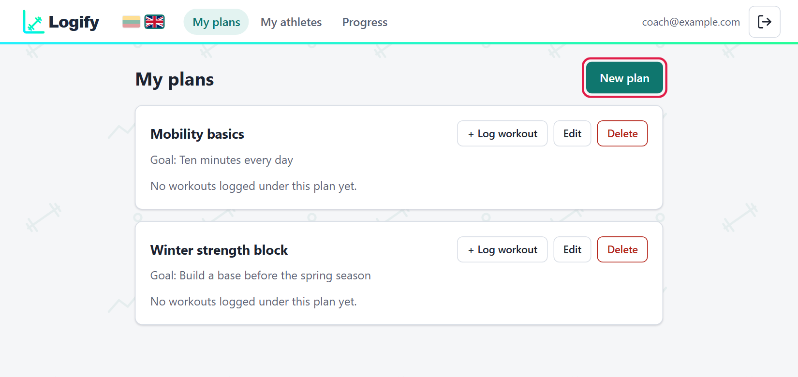

You can **Edit** or **Delete** your own plans. A plan that athletes have logged workouts under **cannot be deleted**; Logify says so and nothing is lost.

### Assign a plan to an athlete

1. In **My athletes**, press the athlete's email.
2. In the card **Plans you assigned**, choose a plan in the **Plan** list and press **Assign**.
3. A confirmation says *Assigned …: the athlete sees it under My plans.*

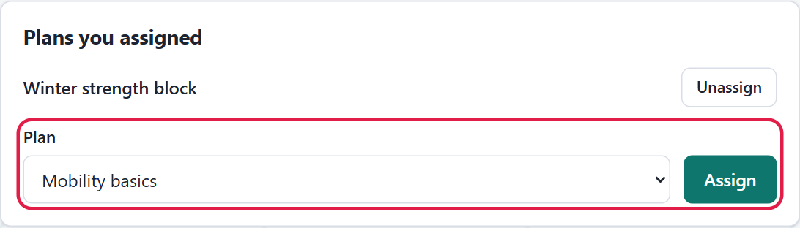

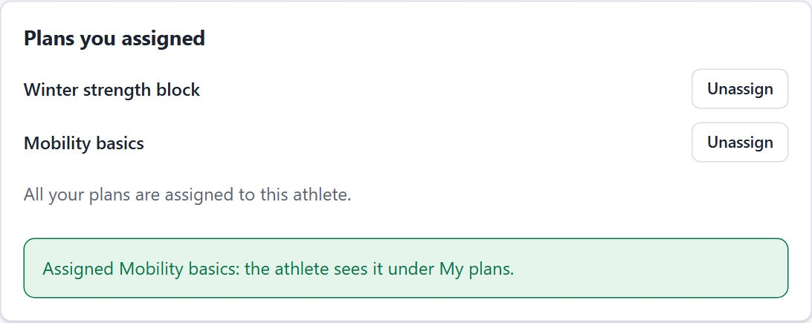

The same plan can be assigned to many athletes; each logs their own workouts under it, and it shows on their **My plans** screen with the label **Assigned by your instructor**. The athlete cannot edit or delete it.

To take a plan away, press **Unassign** next to it. The plan disappears from the athlete's **My plans**. Workouts they already logged are not deleted and still count in their progress, but they are no longer listed under that plan. If every plan you have is already assigned to this athlete, the card says so; if you have no plans yet, it links to **Create a plan**.

## 6. Read an athlete's progress

An athlete's page starts with the plans you assigned, followed by cards that are all **read-only**:

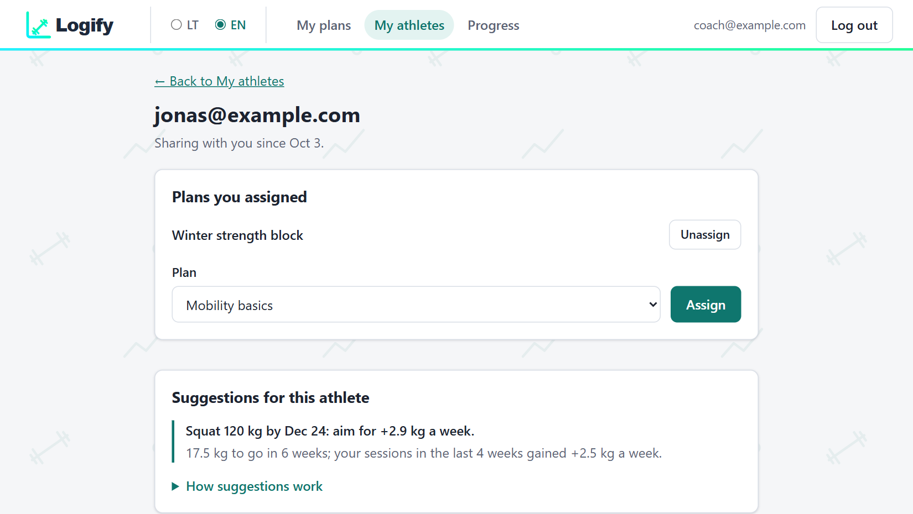

| Card | What you see |
|---|---|
| **Suggestions for this athlete** | The rule-based tips Logify gives them (add 2.5 kg, hold the weight, aim for more per week, pick up again after 7 days), each with the numbers behind it |
| **Goals** | Their goals with a bar of their heaviest set against the target; ✓ marks reached goals |
| **Recent workouts** | Their last 10 workouts with type, date, duration, activity, distance, the sets and notes |
| **Reports** | The reports they sent you, with date and summary |
| **Heaviest set per session** | A line chart per exercise, with **Show as a table** |
| **Minutes per week** | Strength vs other minutes for the last 8 weeks |

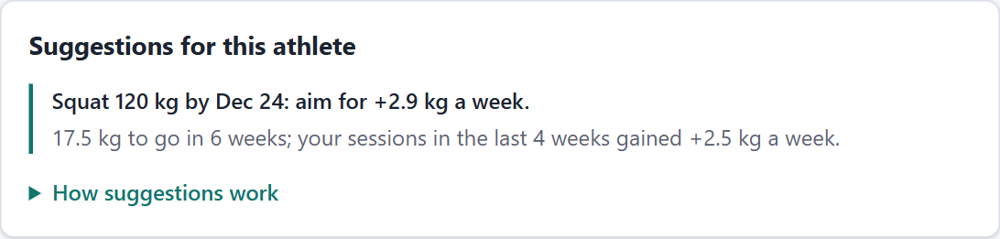

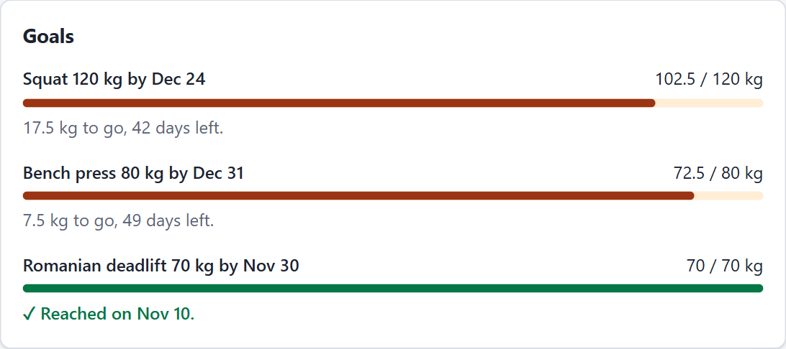

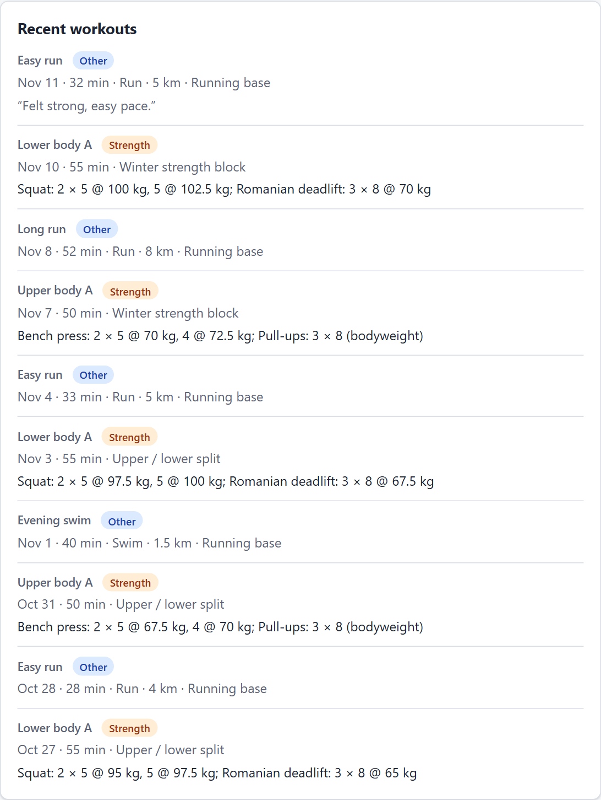

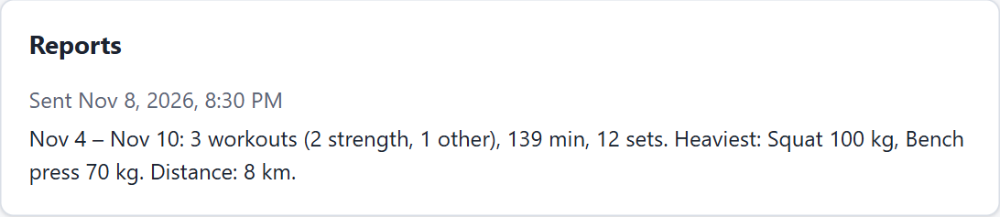

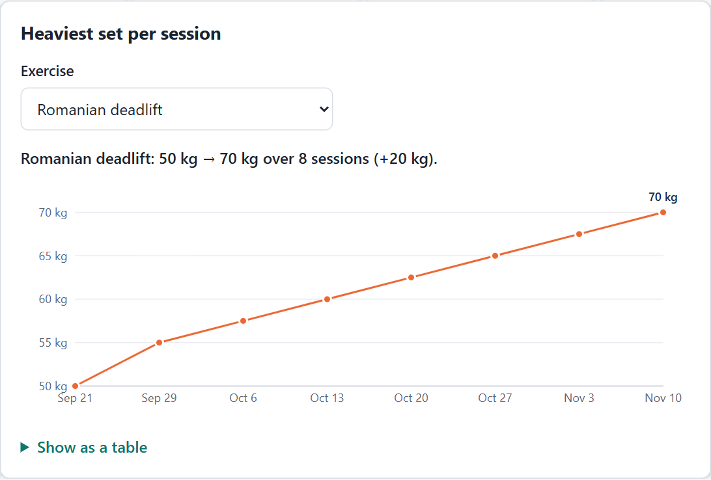

Use **Back to My athletes** to return to the list. If you see *This athlete isn't sharing with you*, the athlete has stopped sharing.

## 7. Emails you receive

Logify emails you automatically, without anyone pressing anything:

| When | Subject | Contents |
|---|---|---|
| An athlete saves a **strength** workout | `STRENGTH: <title>` | Title, type, duration, the sets (for example *Squat: 2 × 5 @ 100 kg, 5 @ 102.5 kg*) and when it was logged |
| An athlete saves any **other** workout | `New workout: <title>` | The same details without sets |
| An athlete presses **Send report to instructor** | `Progress report: <athlete> (<period>)` | The numbers for the athlete's last 7 days |

You only receive emails about athletes who **share with you** (they typed your code under **Sharing**). If an athlete shares with several instructors, each of them gets the email; if an athlete stops sharing, the emails stop too. Renaming a workout does not send another email. The emails are sent to the address you signed up with.

## 8. Messages and what to do

| You see | What it means |
|---|---|
| *No athletes yet. Give them your code: …* | Nobody has shared with you yet. |
| *Only instructor accounts have a code…* | You signed up as an athlete. Create a new account as an instructor. |
| *This athlete isn't sharing with you.* | The athlete stopped sharing. |
| *Athletes have logged workouts under this plan, so it can't be deleted.* | Keep the plan; athletes' workouts depend on it. |
| *You don't have permission to do that.* | Only the owner can change that data. |
| *Can't reach the server…* | Check your internet connection and press **Try again**. |

Every screen that loads or saves shows one of four states: **Loading**, **Error** (with **Try again**), **Empty** or **Success**.
