# „Logify“ naudotojo vadovas sportininkams

*Lietuviškai · [English](../en/athlete.md) · [Trenerio vadovas](instructor.md)*

„Logify“ – tai internetinis treniruočių žurnalas. Sekate treniruočių planus (savo arba tuos, kuriuos jums priskyrė treneris), registruojate jėgos ir kardio treniruotes, stebite pažangą, o treneris gali sekti kartu. Programa veikia naršyklėje kompiuteryje, planšetėje ar telefone, o telefone ją galima įdiegti kaip programėlę ir toliau naudoti be ryšio.

> Ekrano nuotraukose rodomi žmonės, planai ir treniruotės yra išgalvoti demonstraciniai duomenys.

**Turinys**

1. [Registracija ir prisijungimas](#1-registracija-ir-prisijungimas)
2. [Kalba ir meniu](#2-kalba-ir-meniu)
3. [Planai](#3-planai)
4. [Treniruotės įrašymas](#4-treniruotės-įrašymas)
5. [Treniruotės atidarymas ir pavadinimo keitimas](#5-treniruotės-atidarymas-ir-pavadinimo-keitimas)
6. [Pažanga](#6-pažanga)
7. [Dalijimasis su treneriu](#7-dalijimasis-su-treneriu)
8. [„Logify“ telefone](#8-logify-telefone)
9. [Įdiegimas telefone](#9-įdiegimas-telefone)
10. [„Logify“ naudojimas be ryšio](#10-logify-naudojimas-be-ryšio)
11. [Pranešimai ir ką daryti](#11-pranešimai-ir-ką-daryti)

---

## 1. Registracija ir prisijungimas

Atidarykite „Logify“ naršyklėje. Pamatysite prisijungimo ekraną.

**Kaip susikurti paskyrą**

1. Po forma paspauskite **Susikurti paskyrą**.
2. Įveskite **El. paštą** ir **Slaptažodį** (ne mažiau kaip 6 simboliai).
3. Skiltyje **Registruojuosi kaip** palikite pasirinktą **Sportininkas**.
4. Paspauskite **Registruotis**.

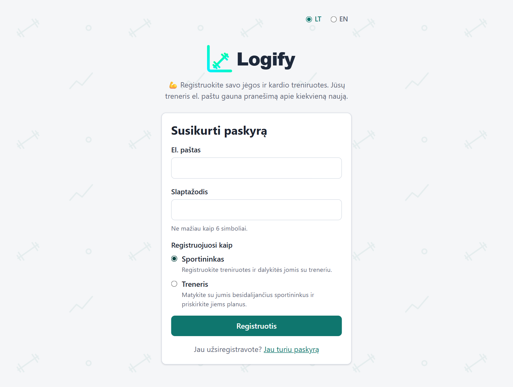

Priklausomai nuo projekto nustatymų, gali tekti pirmiausia patvirtinti el. paštą: atidarykite gautame laiške esančią nuorodą ir tada prisijunkite.

**Kaip prisijungti** – įveskite el. paštą ir slaptažodį, paspauskite **Prisijungti**. Jei jau turite paskyrą, paspauskite **Jau turiu paskyrą**, kad grįžtumėte į prisijungimo formą.

Jei el. paštas ar slaptažodis neteisingi, pamatysite raudoną pranešimą ir daugiau nieko neįvyks. Patikrinkite duomenis ir bandykite dar kartą.

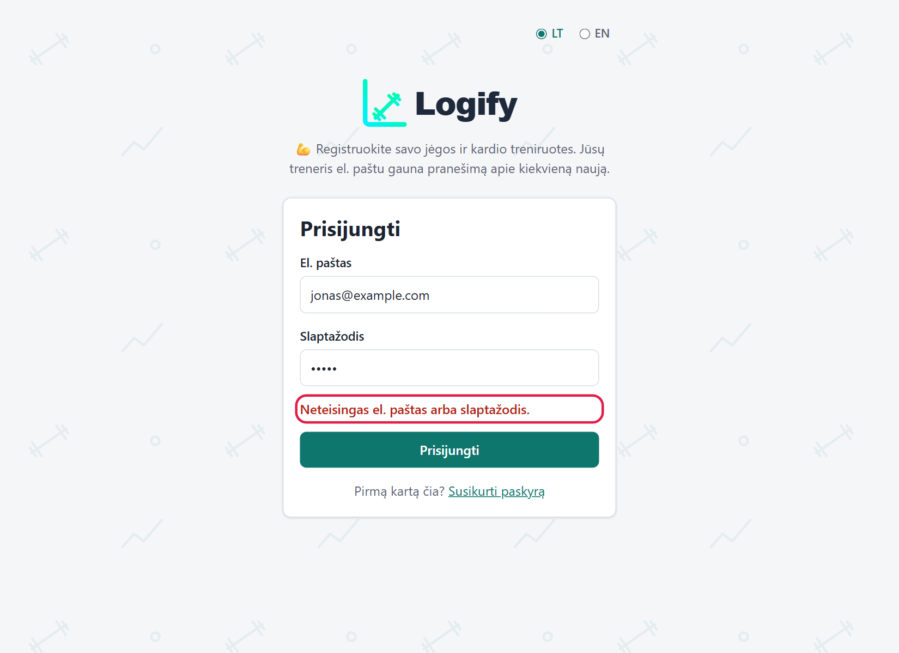

Norėdami baigti darbą, viršuje dešinėje paspauskite **Atsijungti**.

## 2. Kalba ir meniu

„Logify“ veikia **lietuvių (LT)** ir **anglų (EN)** kalbomis. **LT / EN** jungiklis yra viršuje, šalia logotipo, kiekviename ekrane, taip pat prisijungimo ekrane. Jūsų pasirinkimas įsimenamas šioje naršyklėje.

Pavadinimai, kuriuos įrašote patys (planai, pratimai, pastabos), niekada nėra verčiami.

Kompiuteryje meniu yra viršuje, o telefone – juosta ekrano apačioje (žr. [„Logify“ telefone](#8-logify-telefone)). Sportininko meniu skiltys:

| Meniu | Kam skirta |
|---|---|
| **Mano planai** | Jūsų planai ir kiekvieno plano treniruotės |
| **Įrašyti** (tik telefonuose) | Treniruotės įrašymas |
| **Pažanga** | Pasiūlymai, tikslai, ataskaita treneriui, diagramos |
| **Dalijimasis** | Ryšys su treneriu |

## 3. Planai

**Planas** – tai susijusių treniruočių aplankas, pavyzdžiui, *Viršaus / apačios skaidymas* ar *Bėgimo pagrindai*. Kiekviena jūsų įrašyta treniruotė priklauso kuriam nors planui, todėl pirmiausia sukurkite planą.

### Plano sukūrimas

1. Skiltyje **Mano planai** paspauskite **Naujas planas**.
2. Įveskite **Plano pavadinimą** (privaloma) ir, jei norite, **Tikslą (neprivaloma)**.
3. Paspauskite **Sukurti planą**.

Sukūrę planą, galite iškart tęsti paspausdami **Įrašyti treniruotę pagal šį planą** arba grįžti paspausdami **Eiti į „Mano planai“**.

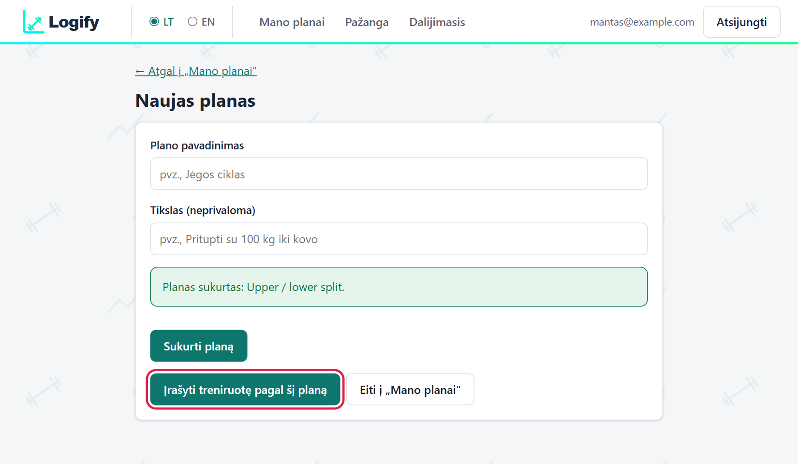

Jei planų dar neturite, skiltyje **Mano planai** matysite mygtuką **Sukurkite pirmąjį planą**.

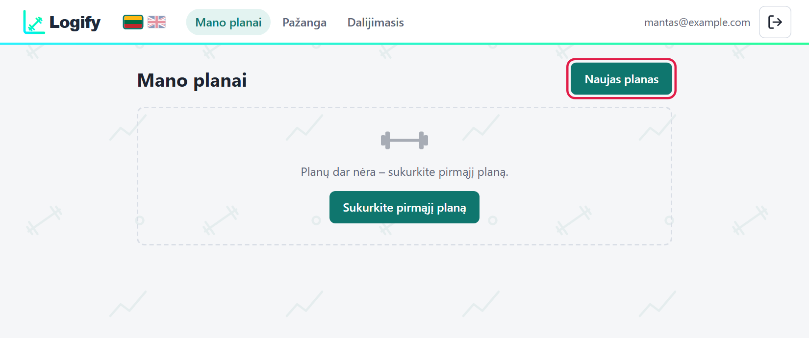

### Jūsų ir priskirti planai

Kiekvienas planas rodomas kaip kortelė su tikslu ir joje įrašytomis treniruotėmis, naujausios viršuje.

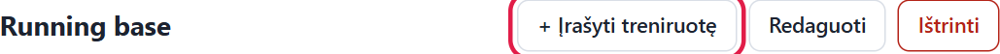

Planas, kurį jums priskyrė treneris, pažymėtas užrašu **Priskyrė jūsų treneris**. Pagal jį galite įrašyti savo treniruotes, bet jo negalite redaguoti ar ištrinti.

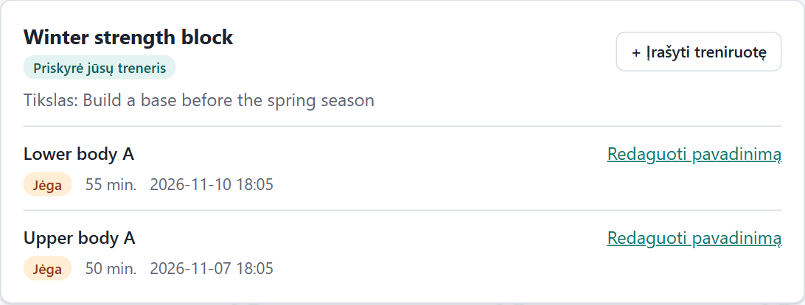

### Plano redagavimas

Plano kortelėje paspauskite **Redaguoti**, pakeiskite pavadinimą ar tikslą ir paspauskite **Išsaugoti planą** (arba **Atšaukti**).

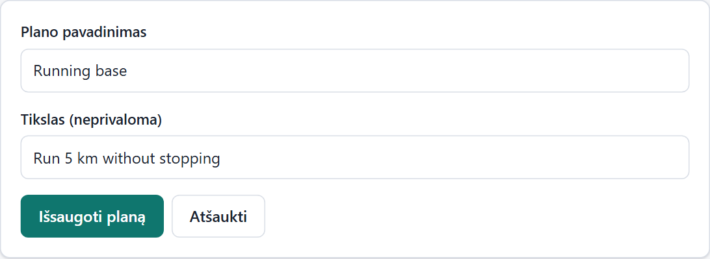

### Plano trynimas

Paspauskite **Ištrinti**. „Logify“ pirmiausia paklausia ir pasako, kiek treniruočių bus ištrinta kartu su planu. Paspauskite **Taip, ištrinti planą**, kad patvirtintumėte, arba **Atšaukti**, kad paliktumėte. **Ištrynimo atšaukti negalima.**

## 4. Treniruotės įrašymas

Plano kortelėje paspauskite **+ Įrašyti treniruotę**. (Čia galite patekti ir paspaudę *Įrašyti treniruotę pagal šį planą* sukūrę planą.)

1. **Planas** – patikrinkite, ar pasirinktas tinkamas planas.
2. **Pavadinimas** – pavyzdžiui, *Kojų diena* arba *5 km bėgimas*.
3. **Tipas** – pasirinkite **Jėga** arba **Kita (kardio, mobilumas…)**.
4. **Trukmė (minutėmis)** – sveikos minutės.
5. Užpildykite pasirinkto tipo duomenis (žr. žemiau).
6. **Pastabos (neprivaloma)**.
7. Paspauskite **Išsaugoti treniruotę**.

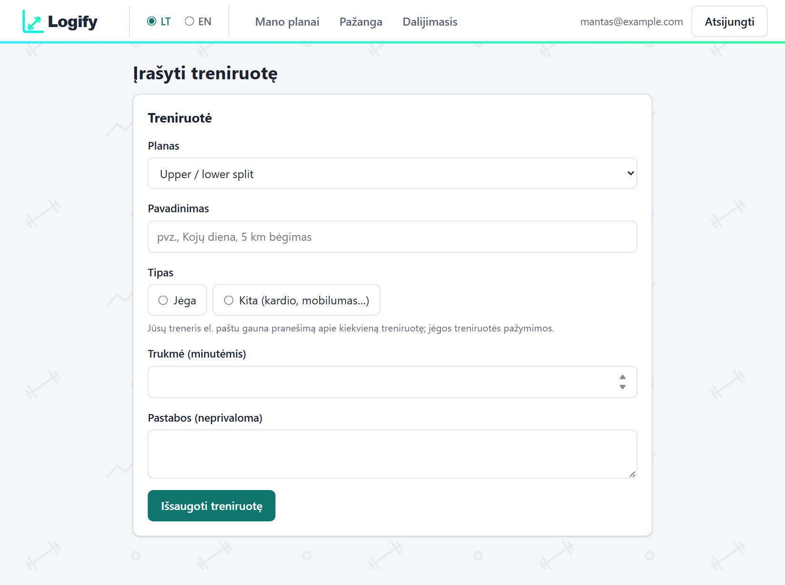

> Sporto salėje nėra ryšio? Treniruotę vis tiek galite įrašyti: „Logify“ ją laiko jūsų telefone ir išsiunčia vėliau. Žr. [„Logify“ naudojimas be ryšio](#10-logify-naudojimas-be-ryšio).

> Kiekviena išsaugota treniruotė automatiškai išsiunčiama el. paštu treneriui (treneriams), su kuriuo dalijatės; jėgos treniruotės pažymimos. Todėl prie **Tipo** yra atitinkama pastaba. Jei nesidalijate su niekuo, laiško negauna niekas (žr. [Dalijimasis su treneriu](#7-dalijimasis-su-treneriu)).

### Jėgos treniruotės

Pasirinkus **Jėga**, atsiranda skiltis **Pratimai**.

1. Paspauskite **Pridėti pratimą** ir įveskite jo pavadinimą, pavyzdžiui, *Squat*. Anksčiau naudoti pavadinimai siūlomi rašant.
2. Po pavadinimu „Logify“ parodo, ką darėte **praėjusį kartą** (pavyzdžiui, *Praėjusį kartą (11-03): 2 × 5 @ 100 kg*), arba *Pirmą kartą įrašote…*, jei pratimas naujas. Pasinaudokite tuo planuodami šiandienos svorius.
3. Kiekvienai serijai įveskite **pakartojimus** ir **kg**. **Pridėti seriją** nukopijuoja ankstesnę seriją, tad keičiate tik tai, kas skiriasi. **✕** pašalina seriją.
4. Daugiau pratimų pridedama mygtuku **Pridėti pratimą**; **Pašalinti** ištrina pratimą.
5. Pratimams su savo svoriu (pavyzdžiui, prisitraukimams) įveskite pakartojimus, o kg lauką palikite tuščią arba įrašykite 0.

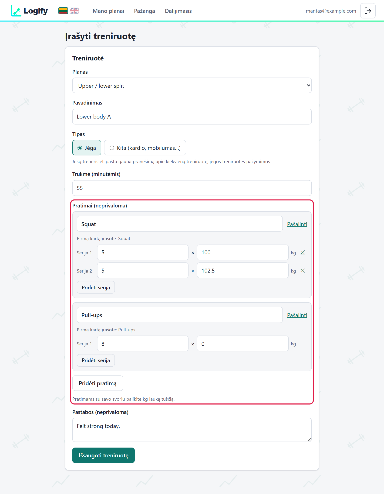

Išsaugojus pamatysite **Treniruotė išsaugota** su nuorodomis **Atidaryti** ir **Žiūrėti skiltyje „Mano planai“**, o forma vėl tuščia – paruošta kitai treniruotei.

### Kitos treniruotės (kardio, mobilumas…)

Pasirinkus **Kita**, atsiranda **Veikla** (Bėgimas, Dviratis, Plaukimas, Ėjimas, Irklavimas, Kita) ir **Atstumas (km)**. Abu laukai neprivalomi.

## 5. Treniruotės atidarymas ir pavadinimo keitimas

Skiltyje **Mano planai** paspauskite treniruotės pavadinimą, kad ją atidarytumėte. Pamatysite trukmę, pastabas, o jėgos treniruotėms – kiekvieną seriją, sugrupuotą pagal pratimą, ir žemiau – ankstesnę treniruotę. Kardio treniruotėse rodoma veikla, atstumas ir jūsų **Tempas**.

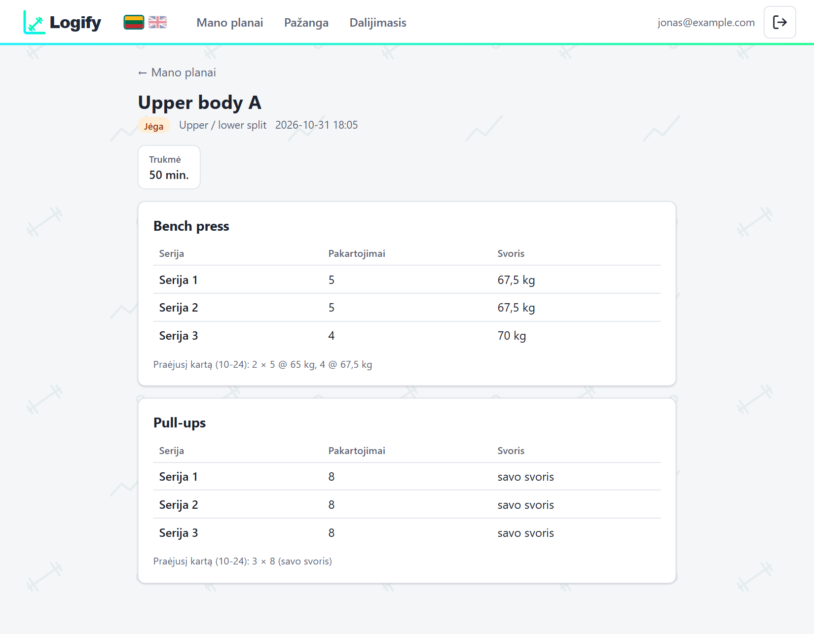

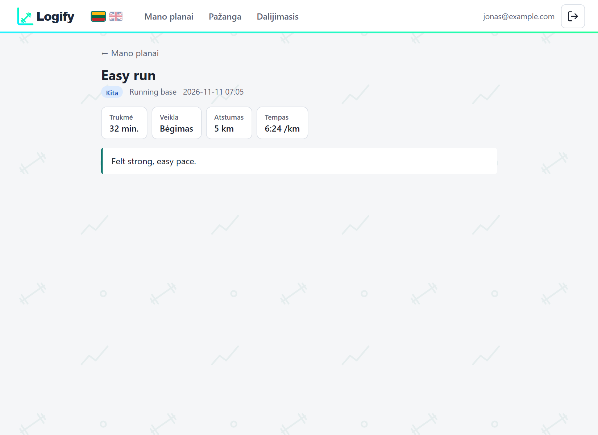

Mygtukas **← Mano planai** grąžina atgal.

Norėdami ištaisyti pavadinimo klaidą, šalia treniruotės paspauskite **Redaguoti pavadinimą**, pakeiskite jį ir paspauskite **Išsaugoti** (arba **Atšaukti**). Redaguoti galima tik pavadinimą; serijų, trukmės ir tipo keisti negalima.

## 6. Pažanga

Skiltyje **Pažanga** yra penkios kortelės. Jai reikia bent vienos įrašytos treniruotės.

### Pasiūlymai

Taisyklėmis pagrįsti patarimai, ką daryti toliau, kiekvienas su skaičiais, kuriais remiamasi. Jie skaičiuojami jūsų naršyklėje, ne dirbtinio intelekto. Paspauskite **Kaip veikia pasiūlymai**, kad pamatytumėte taisykles:

- **Pridėkite 2,5 kg**, jei paskutinėse dviejose treniruotėse atlikote tas pačias serijas su didžiausiu svoriu.
- **Nedidinkite svorio**, jei su tuo pačiu svoriu pakartojimų mažėjo dvi treniruotes iš eilės.
- **Siekite daugiau per savaitę**, jei tikslui reikia greitesnio savaitinio prieaugio nei iki šiol pasiekiate.
- **Grįžkite prie treniruočių**, jei 7 dienas neįrašėte jokios treniruotės.

### Tikslai

Tikslą sudaro pratimas, tikslinis svoris ir data. Juosta rodo jūsų sunkiausią seriją iki šiol palyginti su tikslu. Pasiekti tikslai pažymimi ✓.

Norėdami pridėti tikslą, užpildykite **Pratimas**, **Tikslas (kg)** ir **Pasiekti iki**, tada paspauskite **Pridėti tikslą**. **Pašalinti** ištrina tikslą. Data turi būti šiandienos arba vėlesnė. Datos laukas rodomas pagal jūsų naršyklės formatą.

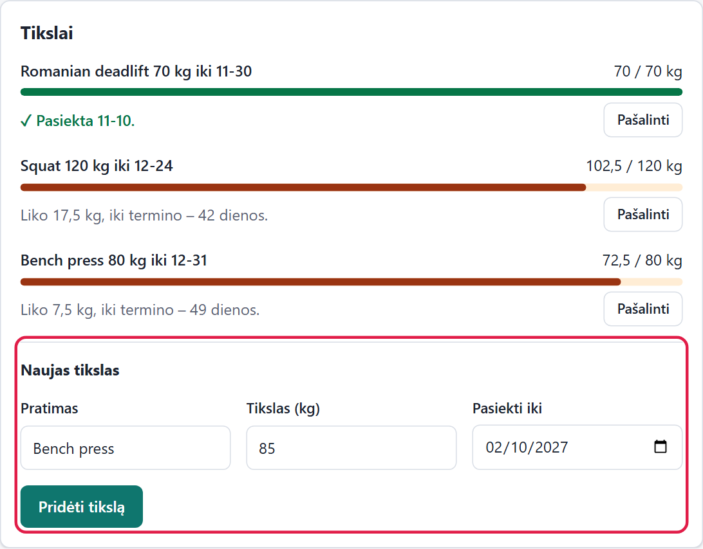

### Ataskaita treneriui

Kortelėje apibendrintos jūsų pastarosios 7 dienos. Paspauskite **Siųsti ataskaitą treneriui**, kad ji būtų išsiųsta el. paštu treneriui (treneriams), su kuriuo dalijatės (jei nesidalijate su niekuo, ataskaita išsaugoma, bet laiškas nesiunčiamas). Siųsti galima maždaug kas 5 minutes; kortelėje matyti, kada paskutinį kartą siuntėte. Ataskaitos tekstą parašo duomenų bazė, todėl jis visada angliškas.

### Sunkiausia serija per treniruotę

Pasirinkite **Pratimą**, kad linijine diagrama pamatytumėte kiekvienos treniruotės sunkiausią seriją, ir vienos eilutės santrauką, pavyzdžiui, *Squat: 82,5 kg → 102,5 kg per 8 treniruotes (+20 kg)*. Paspauskite **Rodyti lentele**, kad tuos pačius skaičius pamatytumėte lentelėje.

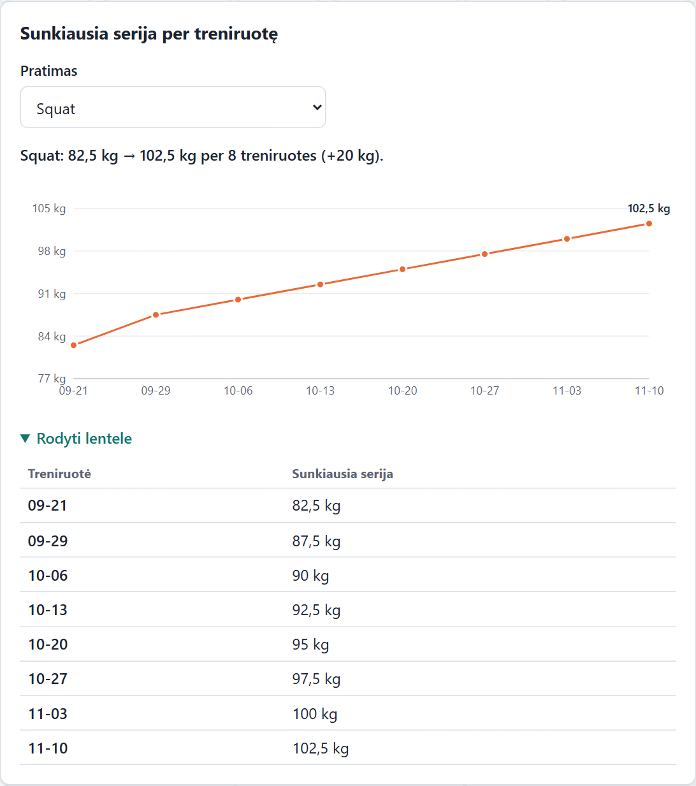

### Minutės per savaitę

Stulpeliai už pastarąsias 8 savaites, padalyti į jėgos ir kitas treniruotes.

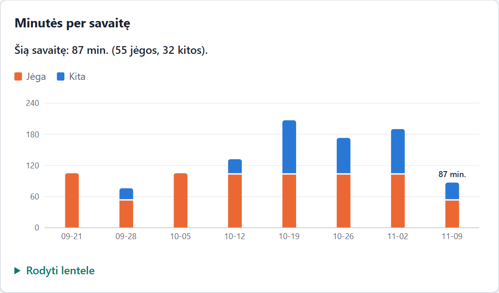

## 7. Dalijimasis su treneriu

Skiltyje **Dalijimasis** nusprendžiate, kas gali jus sekti. Treneris, su kuriuo dalijatės, gali **skaityti** jūsų treniruotes, serijas, tikslus ir ataskaitas, bet **niekada negali jų keisti**, o jūs bet kada galite nustoti dalytis.

1. Paprašykite trenerio **kodo** (šešios raidės ir skaitmenys, pavyzdžiui, `K7P2QX`). Treneris jį mato savo ekrane **Mano sportininkai**.
2. Atidarykite **Dalijimasis** ir įveskite kodą lauke **Trenerio kodas**.
3. Paspauskite **Dalytis**. Pamatysite *Dabar dalijatės su …*, o treneris atsiras sąraše **Su kuo dalijatės**.

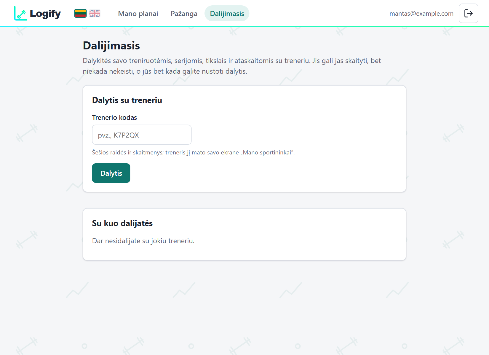

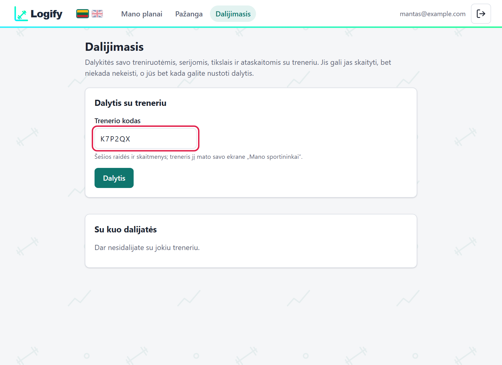

Norėdami nustoti, šalia trenerio paspauskite **Nebesidalyti**. Jūsų duomenys lieka jūsų, tiesiog treneris jų nebemato.

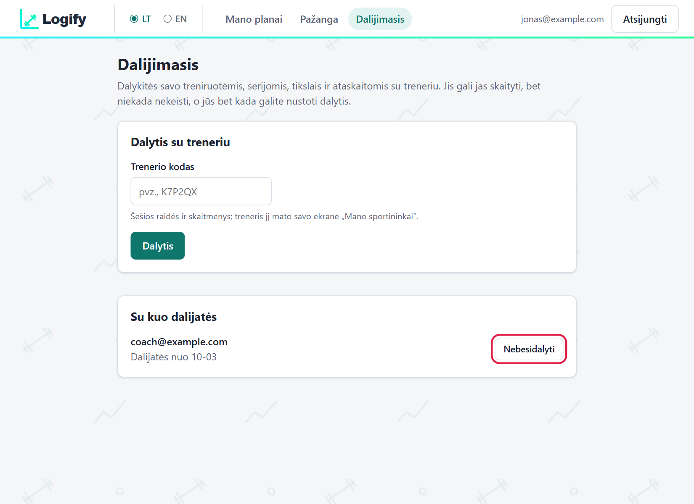

## 8. „Logify“ telefone

„Logify“ sukurta naudoti ir sporto salėje. Telefone (ekrane iki 640 px pločio) meniu tampa **juosta ekrano apačioje**, kaip programėlėje: piktograma ir užrašas kiekvienai skilčiai – **Mano planai**, **Įrašyti**, **Pažanga** ir **Dalijimasis**. Skiltis, kurioje esate, paryškinta akcento spalva. Skiltis **Įrašyti** iškart atveria treniruotės įrašymo formą; ji yra tik telefonuose. Antraštė susitraukia į vieną eilutę su logotipu, **LT / EN** jungikliu ir **Atsijungti** (mažiausiuose ekranuose jūsų el. paštas paslepiamas), todėl pačiam ekranui lieka daugiau vietos.

Po antrašte atsiranda **būsenos eilutė**, kai yra ką pasakyti: nėra ryšio, treniruotės laukia išsiuntimo arba paruošta nauja versija. Žr. [„Logify“ naudojimas be ryšio](#10-logify-naudojimas-be-ryšio).

Mygtukai ir planų bei pratimų pasirinkimai lieka pakankamai dideli paspausti pirštu.

| Mano planai | Treniruotės įrašymas |
|---|---|
|  | 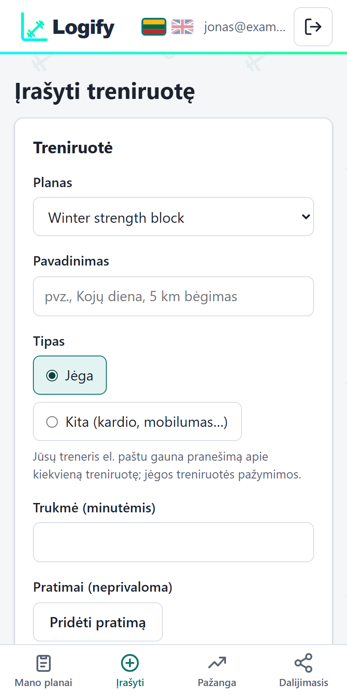 |

## 9. Įdiegimas telefone

Įdiegus „Logify“ atsiranda jūsų pradžios ekrane. Tada ji atsidaro per visą ekraną su sava piktograma, kaip bet kuri programėlė. Tai neprivaloma, o „Logify“ be ryšio veikia ir taip, ir taip, kai tik ją kartą atidarote su ryšiu ir prisijungiate.

**„Android“ („Chrome“)**

1. Atidarykite „Logify“. Skiltyje **Mano planai** kortelė sako **Įdiekite Logify**: *Logify atsidaro kaip programėlė ir veikia be ryšio.*
2. Paspauskite **Įdiegti** ir patvirtinkite. (Paspaudus **Ne dabar**, kortelė dingsta visam laikui; vis tiek galite naudoti naršyklės meniu → **Install app** arba **Add to Home screen**.)
3. Ilgai paspaudę piktogramą pradžios ekrane, pamatysite du trumpinius: vieną treniruotei įrašyti ir vieną **Pažangai**. (Jų pavadinimai visada lietuviški: programėlės diegimo failas negali sekti kalbos jungiklio.)

**iPhone („Safari“)**

1. Atidarykite „Logify“ naršyklėje **Safari**. Kortelė skiltyje **Mano planai** sako *iPhone: bakstelėkite „Bendrinti“, tada „Pridėti prie pradžios ekrano“.*
2. Bakstelėkite **Bendrinti**, tada **Pridėti prie pradžios ekrano** ir **Pridėti**. Kortelėje paspauskite **Supratau**.

> **iPhone įdiegta programėlė turi savo atmintį**, atskirą nuo „Safari“. Prisijungus „Safari“, pradžios ekrano programėlėje neprisijungiama: **prisijunkite joje dar kartą**. Išsaugoti duomenys ir išsiuntimo laukiančios treniruotės taip pat atskiros.

Įdiegus „Logify“, kortelė išnyksta.

**Atnaujinimai.** Kai nauja versija paruošta, būsenos eilutė parašo *Paruošta nauja Logify versija.* su **Atnaujinti**. „Logify“ niekada pati nesiperkrauna; paspauskite **Atnaujinti**, kai jums patogu (jūsų rašyta treniruotė po perkrovimo grįžta). Atidaryta programa taip pat kas valandą ieško naujos versijos.

## 10. „Logify“ naudojimas be ryšio

Sporto salėse ryšys dažnai silpnas arba jo nėra. „Logify“ toliau veikia: ji atsidaro, rodo tai, ką matėte paskutinį kartą, ir leidžia įrašyti treniruotę, kuri išsiunčiama, kai grįžta ryšys.

### Pasiruoškite vieną kartą

Atidarykite „Logify“ **su ryšiu** ir prisijunkite. Iškart po to „Logify“ tyliai išsaugo jūsų planus ir pažangą, todėl be ryšio veikia net ekranai, kurių dar neatidarėte. Kad treniruotės informaciją galėtumėte atidaryti be ryšio, kartą atidarykite ją su ryšiu (laikoma 30 paskutinių atidarytų treniruočių). Be ryšio lieka prisijungta, net jei ryšio neturėjote kelias valandas.

### Ką matote be ryšio

- Būsenos eilutė parašo *Nėra ryšio. Įrašytos treniruotės saugomos šiame telefone.*
- Planai, treniruotės, **Pažanga** ir **Dalijimasis** rodo paskutinius „Logify“ gautus duomenis su eilute, pavyzdžiui, *Nėra ryšio: rodomi duomenys, išsaugoti 2026-11-16 18:42.*, ir **Bandyti dar kartą**. Kai ryšys grįžta, ekranas pats atsinaujina, o eilutė dingsta. Išsaugoti duomenys gali būti seni, todėl pažiūrėkite į laiką.
- Tas pats įvyksta ir esant silpnam ryšiui: jei ekranas kraunasi ilgiau nei apie 4 sekundes, matote išsaugotus duomenis (o šviežiai, jei atkeliauja, juos pakeičia).
- Jei kas nors telefone niekada nebuvo išsaugota, ekranas parašo *Nėra ryšio, o šie duomenys šiame telefone dar neišsaugoti.*
- Įrašant, pratimų pavadinimų siūlymai ir *Praėjusį kartą* imami iš jūsų išsaugotos pažangos.

### Treniruotės įrašymas be ryšio

1. Atidarykite **Įrašyti** (arba plano **+ Įrašyti treniruotę**) ir užpildykite treniruotę kaip įprasta.
2. Paspauskite **Išsaugoti treniruotę**. Vietoje *Treniruotė išsaugota* pamatysite *Išsaugota šiame telefone. Treniruotė bus išsiųsta, kai tik atsiras ryšys; tada treneris gaus ir laišką.* Forma vėl tuščia.
3. Skiltyje **Mano planai** treniruotė atsiranda po savo planu su užrašu **Laukia išsiuntimo**. Kol kas tai nėra nuoroda: kol treniruotė neišsiųsta, jos puslapio nėra. Būsenos eilutė parodo, kiek jų laukia, pavyzdžiui, *1 treniruotė laukia išsiuntimo*.

Treneris gauna laišką, kai treniruotė išsiunčiama, o ne tada, kai ją išsaugojote telefone.

Jei rašant treniruotę telefonas uždaro programą arba atnaujinate „Logify“, forma grįžta su užrašu *Atkurta neišsaugota treniruotė.* Paspauskite **Pradėti iš naujo**, kad ją išvalytumėte.

### Kai grįžta ryšys

Kol „Logify“ atidaryta, laukiančios treniruotės išsiunčiamos pačios: kai grįžta ryšys, kai sugrįžtate į programą ir kas 30 sekundžių. Paspauskite **Siųsti dabar** būsenos eilutėje, kad išsiųstumėte iškart. Tuo metu būsenos eilutė rodo *Siunčiama…*, o išsiųsta treniruotė tampa įprasta eilute. **Kiekviena treniruotė išsaugoma, ir laiškas išsiunčiamas, lygiai vieną kartą**, net jei siunčiant ryšys nutrūksta ir „Logify“ turi bandyti dar kartą.

„Logify“ siunčia tik kol programa atidaryta (fone siųsti negali), todėl grįžę į ryšio zoną atidarykite ją. Treniruotės laikas yra tas, kada paspaudėte **Išsaugoti treniruotę**, jei tai buvo per pastarąsias 30 dienų.

### Jei treniruotės išsiųsti nepavyksta

Jei serveris treniruotę atmeta (pavyzdžiui, planas ištrintas arba treneris jo nebepriskiria), ji rodoma su **Nepavyko išsiųsti: …** ir priežastimi, o skiltyje **Mano planai** – su mygtukais **Bandyti dar kartą** ir **Ištrinti**. **Ištrinti** pirmiausia paklausia: *Ištrinti „…“? Ji nebuvo išsiųsta, todėl dings visam laikui.* Jei plano jūsų sąraše nebėra, treniruotė rodoma kortelėje **Išsiuntimo laukiančios treniruotės** skilties **Mano planai** viršuje. Būsenos eilutė parašo *Nepavyko išsiųsti 1 treniruotės: žr. „Mano planai“.*

### Atsijungimas, kai yra laukiančių treniruočių

„Logify“ pirmiausia paklausia: *1 treniruotė dar neišsiųsta. Ji liks šiame telefone ir bus išsiųsta, kai kitą kartą čia prisijungsite.* Norėdami ją išsiųsti, vėl prisijunkite šiame telefone. Atsijungti galima ir be ryšio; tada iš telefono pašalinami jūsų išsaugoti duomenys (bet ne laukiančios treniruotės).

### Kam vis dar reikia ryšio

Planų kūrimui, redagavimui ir trynimui, treniruotės pervadinimui, tikslams, ataskaitos siuntimui, dalijimuisi su treneriu ir prisijungimui reikia ryšio; be jo matysite *Nepavyksta pasiekti serverio…* (o prisijungimo ekrane – *Nėra ryšio. Prisijungti galima tik turint ryšį.*).

### Jei telefono atmintis pilna

„Logify“ pašalina išsaugotus duomenis, kad atlaisvintų vietos jūsų treniruotei. Jei treniruotės vis tiek išsaugoti nepavyksta, forma parašo *Šio telefono atmintis pilna, todėl treniruotės čia išsaugoti nepavyko. Atlaisvinkite vietos arba išsaugokite, kai bus ryšys.* ir nesako, kad ji išsaugota.

### Senesnė duomenų bazė

Jei projekto duomenų bazė dar neatnaujinta iki naujausios versijos, „Logify“ vis tiek veikia, bet būsenos eilutė perspėja, kad be ryšio įrašytoms treniruotėms priskiriamas jų išsiuntimo laikas ir kad nutrūkus ryšiui viena gali būti išsaugota du kartus. Paspauskite **Slėpti**, kad paslėptumėte likusiai sesijai. Tai ištaiso projektą prižiūrintis žmogus, atnaujindamas duomenų bazę ([docs/lt/supabase.md](../../lt/supabase.md#v5-pritaikymas-esamam-projektui)).

## 11. Pranešimai ir ką daryti

| Ką matote | Ką tai reiškia |
|---|---|
| *Neteisingas el. paštas arba slaptažodis.* | Patikrinkite duomenis; slaptažodyje svarbios didžiosios ir mažosios raidės. |
| *Paskyra su šiuo el. paštu jau egzistuoja. Geriau prisijunkite.* | Paspauskite **Jau turiu paskyrą**. |
| *Pirmiausia patvirtinkite el. paštą…* | Atidarykite gautame laiške esančią patvirtinimo nuorodą ir prisijunkite. |
| *Nepavyksta pasiekti serverio…* | Patikrinkite interneto ryšį ir paspauskite **Bandyti dar kartą**. (Treniruotės įrašymui jo nereikia: ji laikoma telefone.) |
| *Nėra ryšio. Prisijungti galima tik turint ryšį.* | Prisijunkite vieną kartą su ryšiu; po to „Logify“ veikia be ryšio. |
| *Nėra ryšio. Įrašytos treniruotės saugomos šiame telefone.* | Ryšio nėra. Viskas, ką įrašote, laukia telefone. |
| *Nėra ryšio: rodomi duomenys, išsaugoti …* | Ekranas rodo paskutinius išsaugotus duomenis. Jis pats atsinaujina, kai grįžta ryšys, arba paspauskite **Bandyti dar kartą**. |
| *Nėra ryšio, o šie duomenys šiame telefone dar neišsaugoti.* | Atidarykite tą ekraną vieną kartą su ryšiu. |
| *Išsaugota šiame telefone. Treniruotė bus išsiųsta, kai tik atsiras ryšys; tada treneris gaus ir laišką.* | Jūsų treniruotė saugi. Kai turėsite ryšį, palikite „Logify“ atidarytą. |
| *1 treniruotė laukia išsiuntimo* · **Laukia išsiuntimo** | Išsiunčiama automatiškai; arba paspauskite **Siųsti dabar**. |
| *Nepavyko išsiųsti: …* | Serveris ją atmetė; žr. priežastį. **Bandyti dar kartą** arba **Ištrinti**. |
| *Nepavyko išsiųsti 1 treniruotės: žr. „Mano planai“.* | Atidarykite **Mano planai** ir susitvarkykite su ja. |
| *Šio telefono atmintis pilna, todėl treniruotės čia išsaugoti nepavyko…* | Atlaisvinkite vietos telefone arba išsaugokite treniruotę, kai turėsite ryšį. |
| *1 treniruotė dar neišsiųsta. Ji liks šiame telefone…* | Rodoma atsijungiant. Vėliau prisijunkite šiame telefone, kad ją išsiųstumėte. |
| *Atkurta neišsaugota treniruotė.* | Grįžo forma, kurią rašėte. **Pradėti iš naujo** ją išvalo. |
| *Paruošta nauja Logify versija.* | Paspauskite **Atnaujinti**. |
| *Logify duomenų bazė senesnė nei ši programėlė…* | Žr. [Senesnė duomenų bazė](#senesnė-duomenų-bazė). |
| *Per daug bandymų…* | Palaukite kelias minutes. |
| *Joks treneris neturi tokio kodo…* | Patikrinkite kodą pas trenerį. |
| *Tai jūsų pačių kodas…* | Įvedėte trenerio paskyros savo paties kodą. |
| *Ataskaitą išsiuntėte prieš kelias minutes…* | Prieš siųsdami kitą ataskaitą palaukite kelias minutes. |
| *Sportininkai yra įrašę treniruočių pagal šį planą, todėl jo ištrinti negalima.* | Rodoma tik treneriams: žr. [trenerio vadovą](instructor.md). |

Kiekvienas ekranas, kuris kraunasi ar saugo duomenis, rodo vieną iš keturių būsenų: **Kraunama**, **Klaida** (paprastais žodžiais, su mygtuku **Bandyti dar kartą**), **Tuščia** (su užuomina, ką daryti) arba **Pavyko**.

Palaikomos naršyklės: „Chrome“ ir „Edge“ 111+, „Firefox“ 121+, „Safari“ 16.4+. Slapukai ir „JavaScript“ turi būti įjungti.
