# „Logify“ naudotojo vadovas sportininkams

*Lietuviškai · [English](../en/athlete.md) · [Trenerio vadovas](instructor.md)*

„Logify“ – tai internetinis treniruočių žurnalas. Sekate treniruočių planus (savo arba tuos, kuriuos jums priskyrė treneris), registruojate jėgos ir kardio treniruotes, stebite pažangą, o treneris gali sekti kartu. Nieko diegti nereikia: programa veikia naršyklėje kompiuteryje, planšetėje ar telefone.

> Ekrano nuotraukose rodomi žmonės, planai ir treniruotės yra išgalvoti demonstraciniai duomenys.

**Turinys**

1. [Registracija ir prisijungimas](#1-registracija-ir-prisijungimas)
2. [Kalba ir meniu](#2-kalba-ir-meniu)
3. [Planai](#3-planai)
4. [Treniruotės įrašymas](#4-treniruotės-įrašymas)
5. [Treniruotės atidarymas ir pavadinimo keitimas](#5-treniruotės-atidarymas-ir-pavadinimo-keitimas)
6. [Pažanga](#6-pažanga)
7. [Dalijimasis su treneriu](#7-dalijimasis-su-treneriu)
8. [„Logify“ telefone](#8-logify-telefone)
9. [Pranešimai ir ką daryti](#9-pranešimai-ir-ką-daryti)

---

## 1. Registracija ir prisijungimas

Atidarykite „Logify“ naršyklėje. Pamatysite prisijungimo ekraną.

**Kaip susikurti paskyrą**

1. Po forma paspauskite **Susikurti paskyrą**.
2. Įveskite **El. paštą** ir **Slaptažodį** (ne mažiau kaip 6 simboliai).
3. Skiltyje **Registruojuosi kaip** palikite pasirinktą **Sportininkas**.
4. Paspauskite **Registruotis**.

Priklausomai nuo projekto nustatymų, gali tekti pirmiausia patvirtinti el. paštą: atidarykite gautame laiške esančią nuorodą ir tada prisijunkite.

**Kaip prisijungti** – įveskite el. paštą ir slaptažodį, paspauskite **Prisijungti**. Jei jau turite paskyrą, paspauskite **Jau turiu paskyrą**, kad grįžtumėte į prisijungimo formą.

Jei el. paštas ar slaptažodis neteisingi, pamatysite raudoną pranešimą ir daugiau nieko neįvyks. Patikrinkite duomenis ir bandykite dar kartą.

Norėdami baigti darbą, viršuje dešinėje paspauskite **Atsijungti**.

## 2. Kalba ir meniu

„Logify“ veikia **lietuvių (LT)** ir **anglų (EN)** kalbomis. **LT / EN** jungiklis yra viršuje, šalia logotipo, kiekviename ekrane, taip pat prisijungimo ekrane. Jūsų pasirinkimas įsimenamas šioje naršyklėje.

Pavadinimai, kuriuos įrašote patys (planai, pratimai, pastabos), niekada nėra verčiami.

Sportininko meniu viršuje turi tris skiltis:

| Meniu | Kam skirta |
|---|---|
| **Mano planai** | Jūsų planai ir kiekvieno plano treniruotės |
| **Pažanga** | Pasiūlymai, tikslai, ataskaita treneriui, diagramos |
| **Dalijimasis** | Ryšys su treneriu |

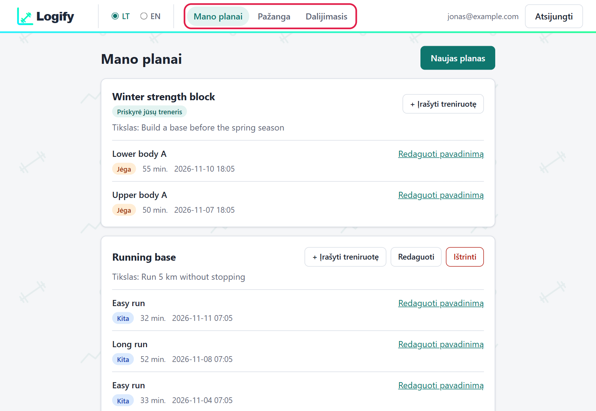

## 3. Planai

**Planas** – tai susijusių treniruočių aplankas, pavyzdžiui, *Viršaus / apačios skaidymas* ar *Bėgimo pagrindai*. Kiekviena jūsų įrašyta treniruotė priklauso kuriam nors planui, todėl pirmiausia sukurkite planą.

### Plano sukūrimas

1. Skiltyje **Mano planai** paspauskite **Naujas planas**.
2. Įveskite **Plano pavadinimą** (privaloma) ir, jei norite, **Tikslą (neprivaloma)**.
3. Paspauskite **Sukurti planą**.

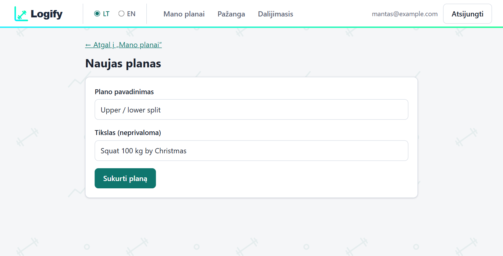

Sukūrę planą, galite iškart tęsti paspausdami **Įrašyti treniruotę pagal šį planą** arba grįžti paspausdami **Eiti į „Mano planai“**.

Jei planų dar neturite, skiltyje **Mano planai** matysite mygtuką **Sukurkite pirmąjį planą**.

### Jūsų ir priskirti planai

Kiekvienas planas rodomas kaip kortelė su tikslu ir joje įrašytomis treniruotėmis, naujausios viršuje.

Planas, kurį jums priskyrė treneris, pažymėtas užrašu **Priskyrė jūsų treneris**. Pagal jį galite įrašyti savo treniruotes, bet jo negalite redaguoti ar ištrinti.

### Plano redagavimas

Plano kortelėje paspauskite **Redaguoti**, pakeiskite pavadinimą ar tikslą ir paspauskite **Išsaugoti planą** (arba **Atšaukti**).

### Plano trynimas

Paspauskite **Ištrinti**. „Logify“ pirmiausia paklausia ir pasako, kiek treniruočių bus ištrinta kartu su planu. Paspauskite **Taip, ištrinti planą**, kad patvirtintumėte, arba **Atšaukti**, kad paliktumėte. **Ištrynimo atšaukti negalima.**

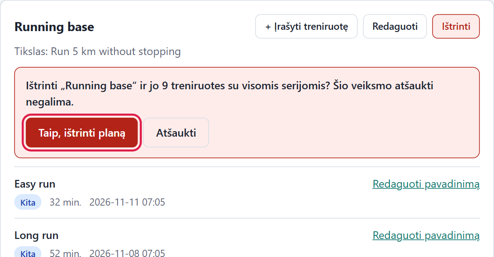

## 4. Treniruotės įrašymas

Plano kortelėje paspauskite **+ Įrašyti treniruotę**. (Čia galite patekti ir paspaudę *Įrašyti treniruotę pagal šį planą* sukūrę planą.)

1. **Planas** – patikrinkite, ar pasirinktas tinkamas planas.
2. **Pavadinimas** – pavyzdžiui, *Kojų diena* arba *5 km bėgimas*.
3. **Tipas** – pasirinkite **Jėga** arba **Kita (kardio, mobilumas…)**.
4. **Trukmė (minutėmis)** – sveikos minutės.
5. Užpildykite pasirinkto tipo duomenis (žr. žemiau).
6. **Pastabos (neprivaloma)**.
7. Paspauskite **Išsaugoti treniruotę**.

> Kiekviena išsaugota treniruotė automatiškai išsiunčiama el. paštu jūsų treneriui; jėgos treniruotės pažymimos. Todėl prie **Tipo** yra atitinkama pastaba.

### Jėgos treniruotės

Pasirinkus **Jėga**, atsiranda skiltis **Pratimai**.

1. Paspauskite **Pridėti pratimą** ir įveskite jo pavadinimą, pavyzdžiui, *Squat*. Anksčiau naudoti pavadinimai siūlomi rašant.
2. Po pavadinimu „Logify“ parodo, ką darėte **praėjusį kartą** (pavyzdžiui, *Praėjusį kartą (11-03): 2 × 5 @ 100 kg*), arba *Pirmą kartą įrašote…*, jei pratimas naujas. Pasinaudokite tuo planuodami šiandienos svorius.
3. Kiekvienai serijai įveskite **pakartojimus** ir **kg**. **Pridėti seriją** nukopijuoja ankstesnę seriją, tad keičiate tik tai, kas skiriasi. **✕** pašalina seriją.
4. Daugiau pratimų pridedama mygtuku **Pridėti pratimą**; **Pašalinti** ištrina pratimą.
5. Pratimams su savo svoriu (pavyzdžiui, prisitraukimams) įveskite pakartojimus, o kg lauką palikite tuščią arba įrašykite 0.

Išsaugojus pamatysite **Treniruotė išsaugota** su nuorodomis **Atidaryti** ir **Žiūrėti skiltyje „Mano planai“**, o forma vėl tuščia – paruošta kitai treniruotei.

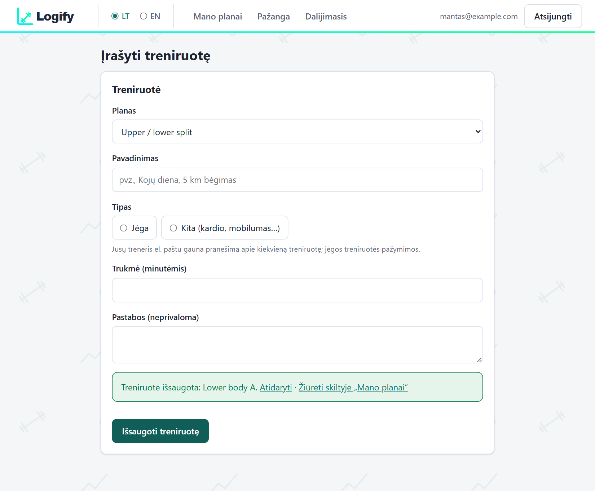

### Kitos treniruotės (kardio, mobilumas…)

Pasirinkus **Kita**, atsiranda **Veikla** (Bėgimas, Dviratis, Plaukimas, Ėjimas, Irklavimas, Kita) ir **Atstumas (km)**. Abu laukai neprivalomi.

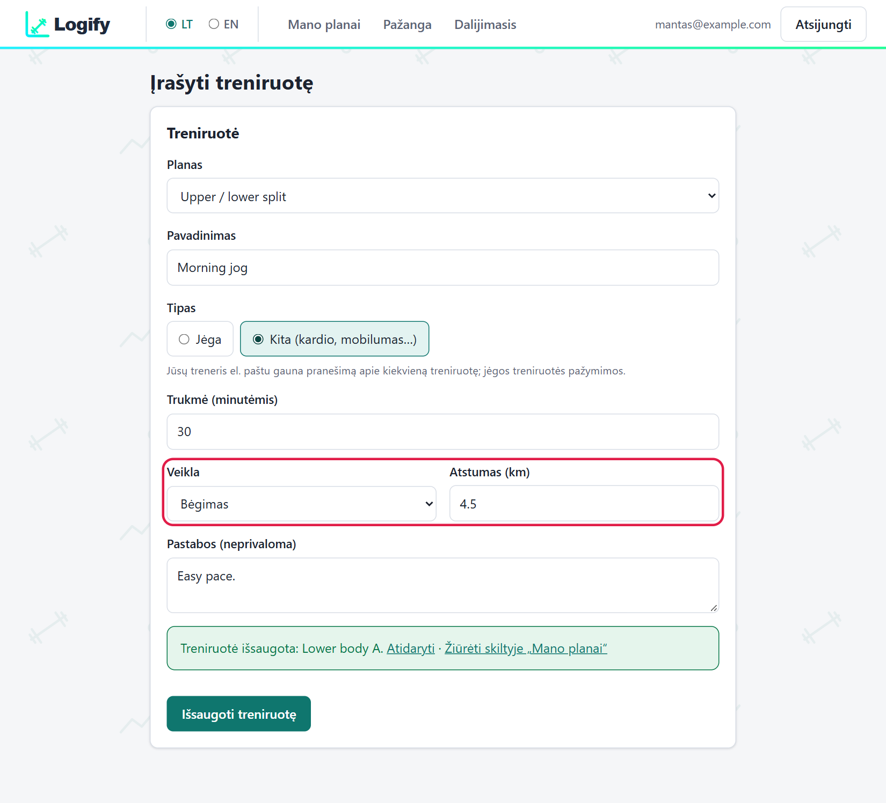

## 5. Treniruotės atidarymas ir pavadinimo keitimas

Skiltyje **Mano planai** paspauskite treniruotės pavadinimą, kad ją atidarytumėte. Pamatysite trukmę, pastabas, o jėgos treniruotėms – kiekvieną seriją, sugrupuotą pagal pratimą, ir žemiau – ankstesnę treniruotę. Kardio treniruotėse rodoma veikla, atstumas ir jūsų **Tempas**.

Mygtukas **← Mano planai** grąžina atgal.

Norėdami ištaisyti pavadinimo klaidą, šalia treniruotės paspauskite **Redaguoti pavadinimą**, pakeiskite jį ir paspauskite **Išsaugoti** (arba **Atšaukti**). Redaguoti galima tik pavadinimą; serijų, trukmės ir tipo keisti negalima.

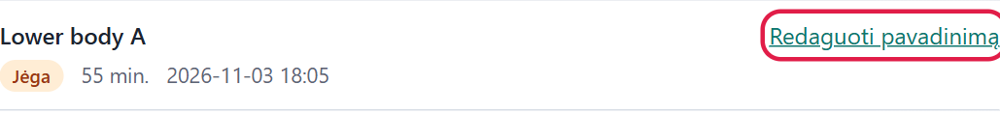

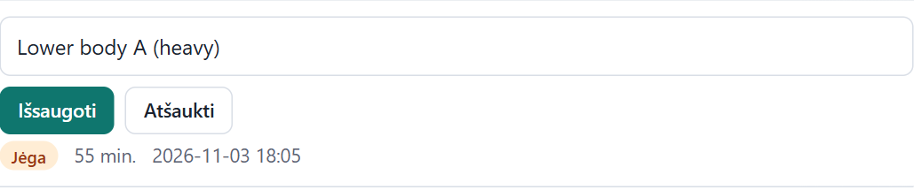

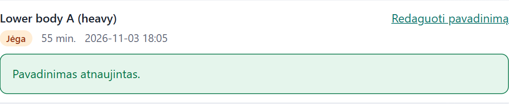

## 6. Pažanga

Skiltyje **Pažanga** yra penkios kortelės. Jai reikia bent vienos įrašytos treniruotės.

### Pasiūlymai

Taisyklėmis pagrįsti patarimai, ką daryti toliau, kiekvienas su skaičiais, kuriais remiamasi. Jie skaičiuojami jūsų naršyklėje, ne dirbtinio intelekto. Paspauskite **Kaip veikia pasiūlymai**, kad pamatytumėte taisykles:

- **Pridėkite 2,5 kg**, jei paskutinėse dviejose treniruotėse atlikote tas pačias serijas su didžiausiu svoriu.
- **Nedidinkite svorio**, jei su tuo pačiu svoriu pakartojimų mažėjo dvi treniruotes iš eilės.
- **Siekite daugiau per savaitę**, jei tikslui reikia greitesnio savaitinio prieaugio nei iki šiol pasiekiate.
- **Grįžkite prie treniruočių**, jei 7 dienas neįrašėte jokios treniruotės.

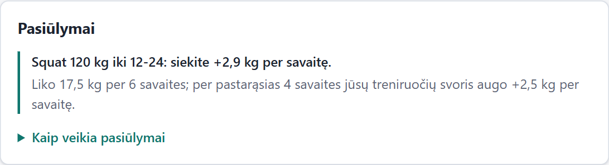

### Tikslai

Tikslą sudaro pratimas, tikslinis svoris ir data. Juosta rodo jūsų sunkiausią seriją iki šiol palyginti su tikslu. Pasiekti tikslai pažymimi ✓.

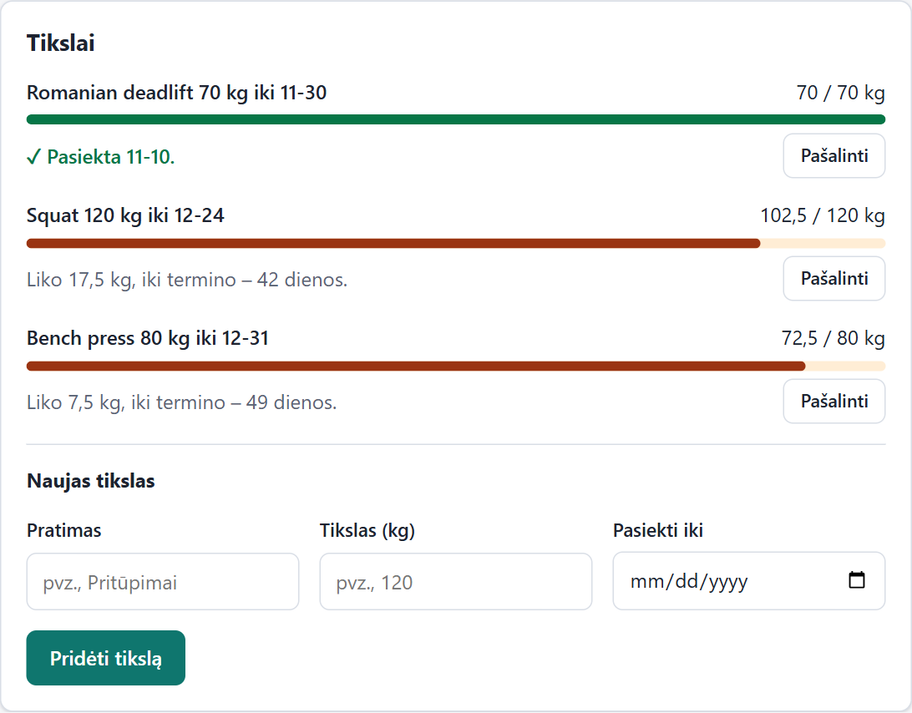

Norėdami pridėti tikslą, užpildykite **Pratimas**, **Tikslas (kg)** ir **Pasiekti iki**, tada paspauskite **Pridėti tikslą**. **Pašalinti** ištrina tikslą. Data turi būti šiandienos arba vėlesnė. Datos laukas rodomas pagal jūsų naršyklės formatą.

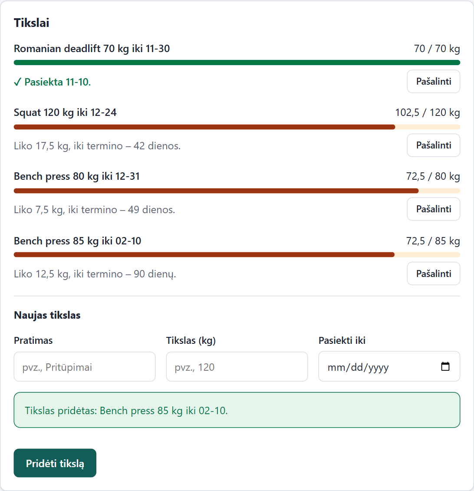

### Ataskaita treneriui

Kortelėje apibendrintos jūsų pastarosios 7 dienos. Paspauskite **Siųsti ataskaitą treneriui**, kad ji būtų išsiųsta el. paštu. Siųsti galima maždaug kas 5 minutes; kortelėje matyti, kada paskutinį kartą siuntėte. Ataskaitos tekstą parašo duomenų bazė, todėl jis visada angliškas.

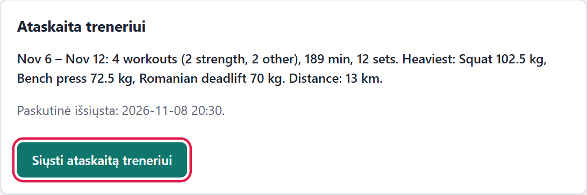

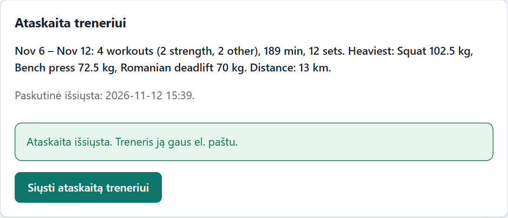

### Sunkiausia serija per treniruotę

Pasirinkite **Pratimą**, kad linijine diagrama pamatytumėte kiekvienos treniruotės sunkiausią seriją, ir vienos eilutės santrauką, pavyzdžiui, *Squat: 82,5 kg → 102,5 kg per 8 treniruotes (+20 kg)*. Paspauskite **Rodyti lentele**, kad tuos pačius skaičius pamatytumėte lentelėje.

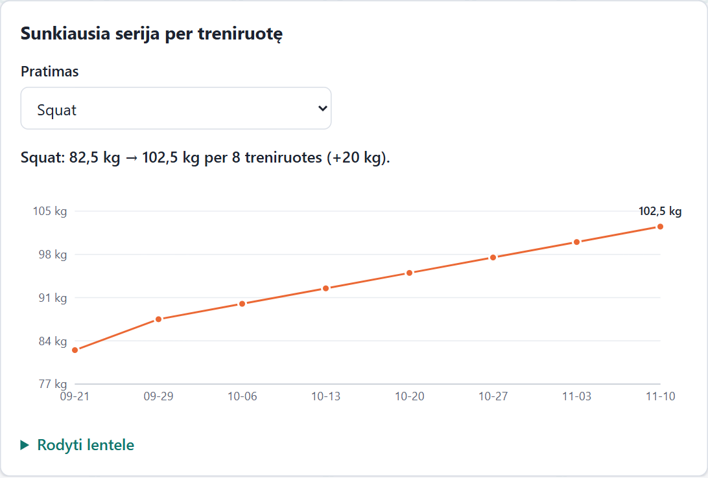

### Minutės per savaitę

Stulpeliai už pastarąsias 8 savaites, padalyti į jėgos ir kitas treniruotes.

## 7. Dalijimasis su treneriu

Skiltyje **Dalijimasis** nusprendžiate, kas gali jus sekti. Treneris, su kuriuo dalijatės, gali **skaityti** jūsų treniruotes, serijas, tikslus ir ataskaitas, bet **niekada negali jų keisti**, o jūs bet kada galite nustoti dalytis.

1. Paprašykite trenerio **kodo** (šešios raidės ir skaitmenys, pavyzdžiui, `K7P2QX`). Treneris jį mato savo ekrane **Mano sportininkai**.
2. Atidarykite **Dalijimasis** ir įveskite kodą lauke **Trenerio kodas**.
3. Paspauskite **Dalytis**. Pamatysite *Dabar dalijatės su …*, o treneris atsiras sąraše **Su kuo dalijatės**.

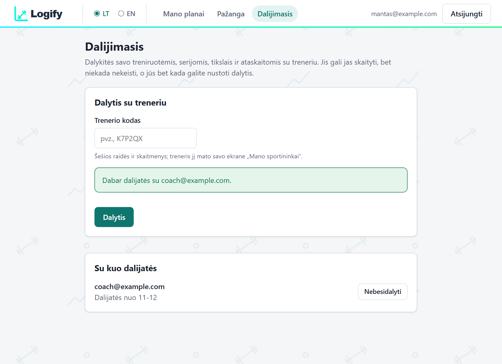

Norėdami nustoti, šalia trenerio paspauskite **Nebesidalyti**. Jūsų duomenys lieka jūsų, tiesiog treneris jų nebemato.

## 8. „Logify“ telefone

„Logify“ sukurta naudoti ir sporto salėje. Siaurame ekrane meniu persikelia į atskirą eilutę po logotipu, o mygtukai lieka pakankamai dideli paspausti pirštu.

| Mano planai | Treniruotės įrašymas |
|---|---|
| 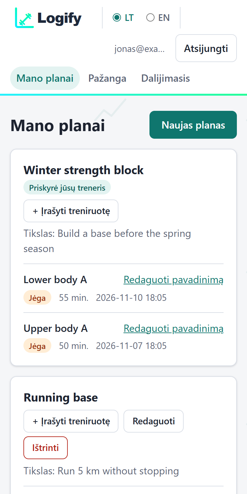 |  |

## 9. Pranešimai ir ką daryti

| Ką matote | Ką tai reiškia |
|---|---|
| *Neteisingas el. paštas arba slaptažodis.* | Patikrinkite duomenis; slaptažodyje svarbios didžiosios ir mažosios raidės. |
| *Paskyra su šiuo el. paštu jau egzistuoja. Geriau prisijunkite.* | Paspauskite **Jau turiu paskyrą**. |
| *Pirmiausia patvirtinkite el. paštą…* | Atidarykite gautame laiške esančią patvirtinimo nuorodą ir prisijunkite. |
| *Nepavyksta pasiekti serverio…* | Patikrinkite interneto ryšį ir paspauskite **Bandyti dar kartą**. |
| *Per daug bandymų…* | Palaukite kelias minutes. |
| *Joks treneris neturi tokio kodo…* | Patikrinkite kodą pas trenerį. |
| *Tai jūsų pačių kodas…* | Įvedėte trenerio paskyros savo paties kodą. |
| *Ataskaitą išsiuntėte prieš kelias minutes…* | Prieš siųsdami kitą ataskaitą palaukite kelias minutes. |
| *Sportininkai yra įrašę treniruočių pagal šį planą, todėl jo ištrinti negalima.* | Rodoma tik treneriams: žr. [trenerio vadovą](instructor.md). |

Kiekvienas ekranas, kuris kraunasi ar saugo duomenis, rodo vieną iš keturių būsenų: **Kraunama**, **Klaida** (paprastais žodžiais, su mygtuku **Bandyti dar kartą**), **Tuščia** (su užuomina, ką daryti) arba **Pavyko**.

Palaikomos naršyklės: „Chrome“ ir „Edge“ 111+, „Firefox“ 121+, „Safari“ 16.4+. Slapukai ir „JavaScript“ turi būti įjungti.
