# „Logify“ naudotojo vadovas treneriams

*Lietuviškai · [English](../en/instructor.md) · [Sportininko vadovas](athlete.md)*

Kaip treneris sekate savo sportininkų treniruotes, skiriate jiems planus ir gaunate el. laišką apie kiekvieną jų įrašytą treniruotę. Sportininko duomenis galite **skaityti**, bet niekada **negalite keisti**: keisti gali tik pats sportininkas.

> Ekrano nuotraukose rodomi žmonės, planai ir treniruotės yra išgalvoti demonstraciniai duomenys.

**Turinys**

1. [Trenerio paskyros sukūrimas](#1-trenerio-paskyros-sukūrimas)
2. [Kalba ir meniu](#2-kalba-ir-meniu)
3. [Jūsų kodas: sportininkų prijungimas](#3-jūsų-kodas-sportininkų-prijungimas)
4. [Mano sportininkai](#4-mano-sportininkai)
5. [Planų kūrimas ir priskyrimas](#5-planų-kūrimas-ir-priskyrimas)
6. [Sportininko pažangos peržiūra](#6-sportininko-pažangos-peržiūra)
7. [El. laiškai, kuriuos gaunate](#7-el-laiškai-kuriuos-gaunate)
8. [Pranešimai ir ką daryti](#8-pranešimai-ir-ką-daryti)

---

## 1. Trenerio paskyros sukūrimas

Vaidmuo pasirenkamas vieną kartą – registruojantis.

1. Prisijungimo ekrane paspauskite **Susikurti paskyrą**.
2. Įveskite **El. paštą** ir **Slaptažodį** (ne mažiau kaip 6 simboliai).
3. Skiltyje **Registruojuosi kaip** pasirinkite **Treneris** („Matykite su jumis besidalijančius sportininkus ir priskirkite jiems planus“).
4. Paspauskite **Registruotis**. Gali tekti pirmiausia patvirtinti el. paštą: atidarykite gautame laiške esančią nuorodą ir tada prisijunkite.

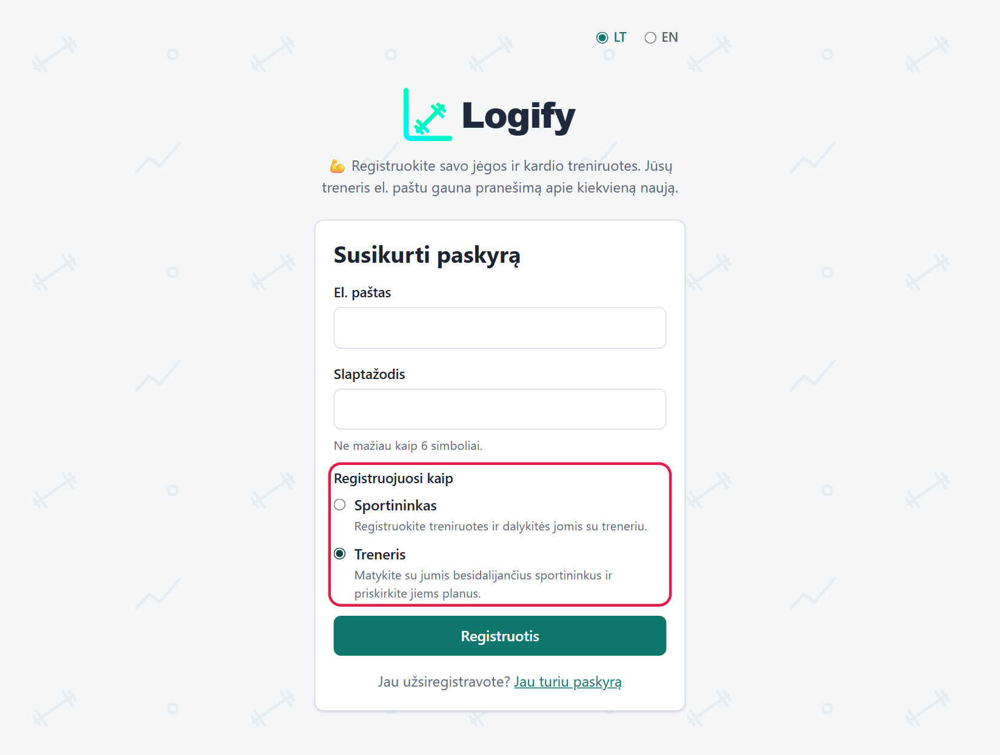

Vėliau prisijungiate su el. paštu ir slaptažodžiu, paspausdami **Prisijungti**. Neteisingas el. paštas ar slaptažodis parodo raudoną pranešimą; patikrinkite duomenis ir bandykite dar kartą. Baigę darbą viršuje dešinėje paspauskite **Atsijungti**.

## 2. Kalba ir meniu

**LT / EN** jungiklis viršuje, šalia logotipo, pakeičia visos programos kalbą; pasirinkimas įsimenamas šioje naršyklėje. Naudotojų įvesti pavadinimai (planai, pratimai, pastabos) neverčiami, taip pat neverčiamos ataskaitų ir serijų santraukos, kurias parašo duomenų bazė (jos visada angliškos, tokios pat ir el. laiškuose).

Treneriai turi tris meniu skiltis:

| Meniu | Kam skirta |
|---|---|
| **Mano planai** | Jūsų sukurti planai (ir, jei patys registruojate treniruotes, jūsų treniruotės) |
| **Mano sportininkai** | Jūsų kodas, su jumis besidalijantys sportininkai ir kiekvieno sportininko puslapis |
| **Pažanga** | Jūsų pačių pažanga, kaip sportininko (tuščia, kol neįrašysite treniruotės) |

(Skilties **Dalijimasis** nėra: ji skirta sportininkams.)

## 3. Jūsų kodas: sportininkų prijungimas

Sportininkai prisijungia prie jūsų naudodami asmeninį **kodą**. Jis rodomas ekrano **Mano sportininkai** viršuje.

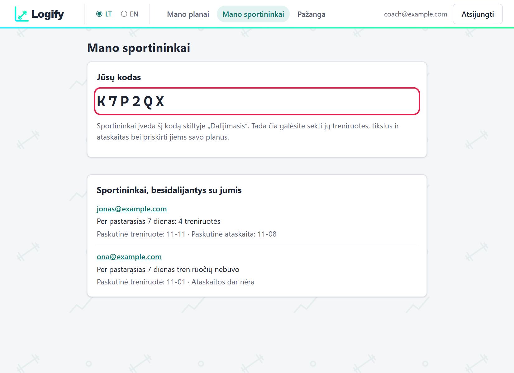

1. Atidarykite **Mano sportininkai** ir perskaitykite savo kodą (šešios raidės ir skaitmenys).
2. Perduokite jį sportininkui.
3. Sportininkas atidaro **Dalijimasis**, įveda kodą lauke **Trenerio kodas** ir paspaudžia **Dalytis**.
4. Jis atsiranda sąraše **Sportininkai, besidalijantys su jumis**.

Sportininkas bet kada gali nustoti dalytis, tada jis dingsta iš jūsų sąrašo. Jei sportininko nematote, paprašykite jo patikrinti kodą ir ar ekrane buvo parašyta *Dabar dalijatės su …*.

## 4. Mano sportininkai

Skiltyje **Sportininkai, besidalijantys su jumis** kiekvienas sportininkas turi vieną įrašą:

- jo el. paštas (paspauskite jį, kad atidarytumėte sportininko puslapį),
- kiek treniruočių jis įrašė per pastarąsias 7 dienas (arba *Per pastarąsias 7 dienas treniruočių nebuvo*),
- **Paskutinės treniruotės** ir **Paskutinės ataskaitos** data, arba *Treniruočių dar nėra* / *Ataskaitos dar nėra*.

Sportininką, kuris šią savaitę netreniravosi, lengva pastebėti, todėl šis ekranas tinka greitam kasdieniam patikrinimui.

## 5. Planų kūrimas ir priskyrimas

### Plano sukūrimas

Planai kuriami skiltyje **Mano planai**, lygiai taip pat kaip ir sportininkų:

1. Paspauskite **Naujas planas**.
2. Įveskite **Plano pavadinimą** ir, jei norite, **Tikslą**.
3. Paspauskite **Sukurti planą**.

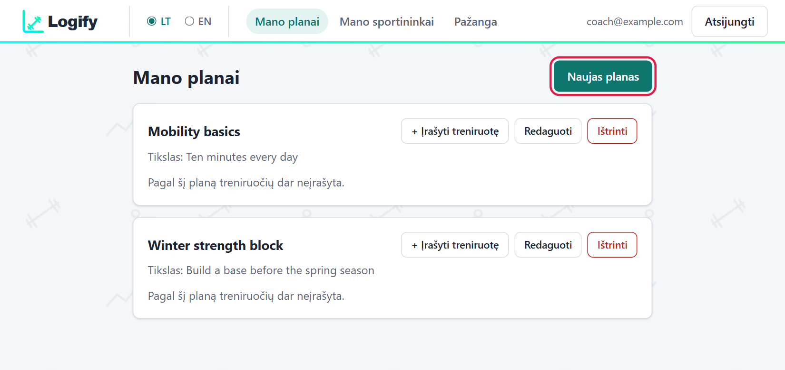

Savo planus galite **Redaguoti** arba **Ištrinti**. Plano, pagal kurį sportininkai jau įrašė treniruočių, **ištrinti negalima**; „Logify“ tai pasako ir nieko neprarandama.

### Plano priskyrimas sportininkui

1. Skiltyje **Mano sportininkai** paspauskite sportininko el. paštą.
2. Kortelėje **Jūsų priskirti planai** sąraše **Planas** pasirinkite planą ir paspauskite **Priskirti**.
3. Patvirtinimas parašys *Priskirtas planas „…“: sportininkas mato jį skiltyje „Mano planai“.*

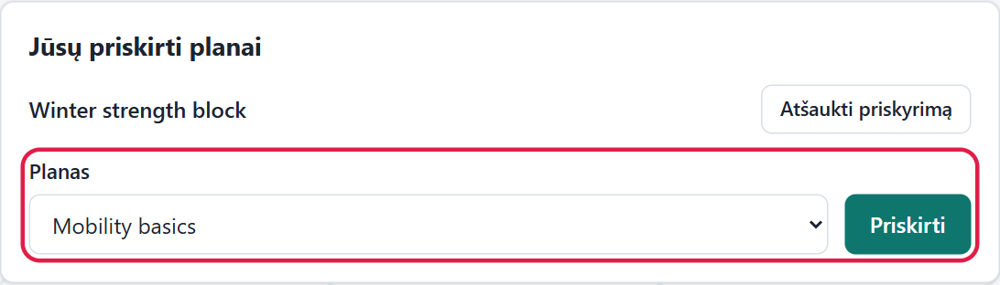

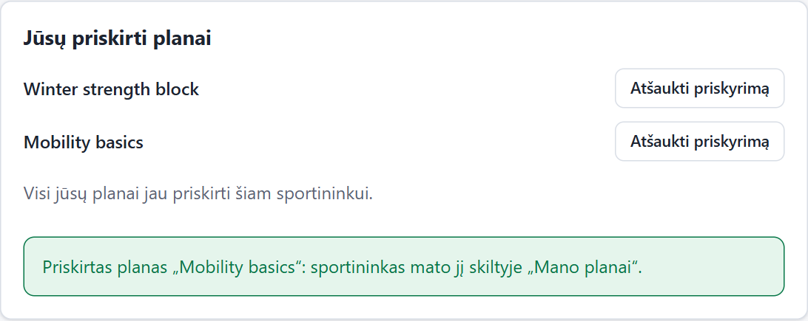

Tą patį planą galima priskirti daugeliui sportininkų; kiekvienas pagal jį įrašo savo treniruotes, o jų ekrane **Mano planai** jis rodomas su užrašu **Priskyrė jūsų treneris**. Sportininkas jo negali redaguoti ar ištrinti.

Norėdami planą atimti, šalia jo paspauskite **Atšaukti priskyrimą**. Planas išnyksta iš sportininko skilties **Mano planai**. Jau įrašytos treniruotės neištrinamos ir lieka sportininko pažangos skaičiuose, bet po tuo planu jos nebesirodo. Jei visi jūsų planai jau priskirti šiam sportininkui, kortelė tai parašo; jei planų dar neturite, ji nukreipia į **Sukurkite planą**.

## 6. Sportininko pažangos peržiūra

Sportininko puslapis prasideda nuo jūsų priskirtų planų, o toliau eina kortelės, kurios visos **tik skaitomos**:

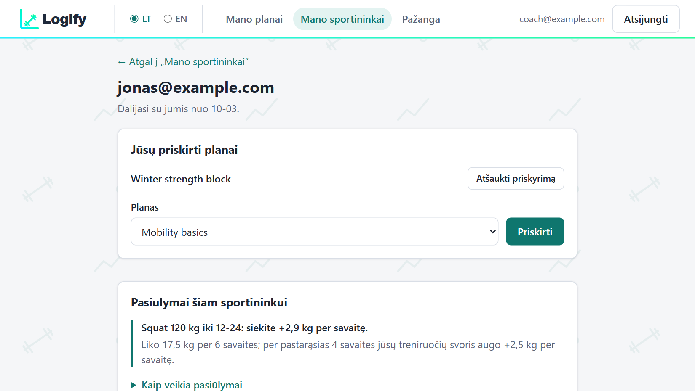

| Kortelė | Ką matote |
|---|---|
| **Pasiūlymai šiam sportininkui** | Taisyklėmis pagrįsti patarimai, kuriuos „Logify“ duoda sportininkui (pridėti 2,5 kg, nedidinti svorio, siekti daugiau per savaitę, grįžti po 7 dienų pertraukos), kiekvienas su skaičiais, kuriais remiamasi |
| **Tikslai** | Sportininko tikslai su juosta, rodančia sunkiausią seriją palyginti su tikslu; ✓ žymi pasiektus tikslus |
| **Naujausios treniruotės** | Paskutinės 10 treniruočių: tipas, data, trukmė, veikla, atstumas, serijos ir pastabos |
| **Ataskaitos** | Jums išsiųstos ataskaitos su data ir santrauka |
| **Sunkiausia serija per treniruotę** | Kiekvieno pratimo linijinė diagrama su **Rodyti lentele** |
| **Minutės per savaitę** | Jėgos ir kitų treniruočių minutės už pastarąsias 8 savaites |

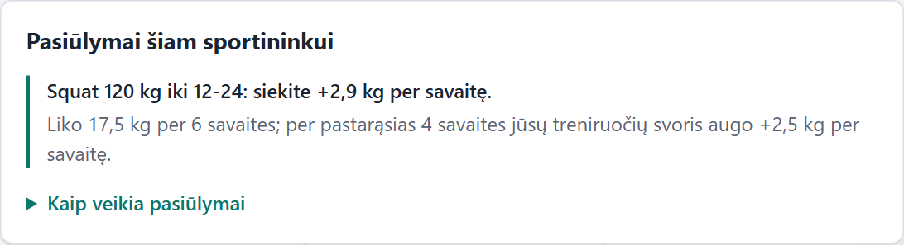

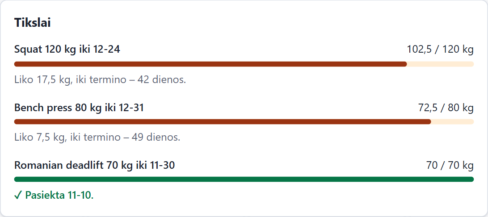

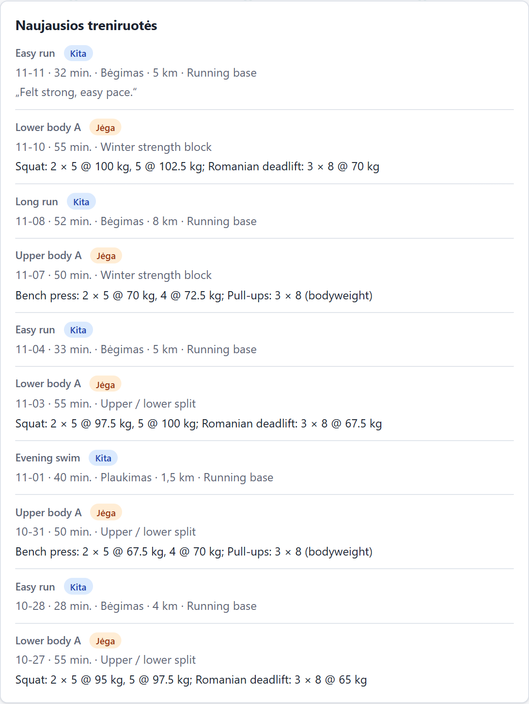

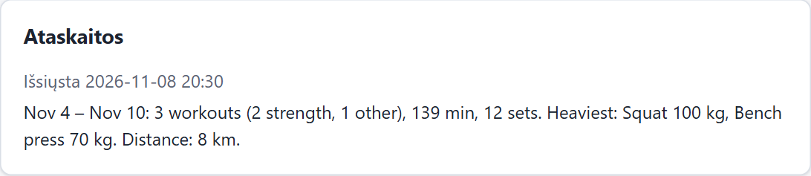

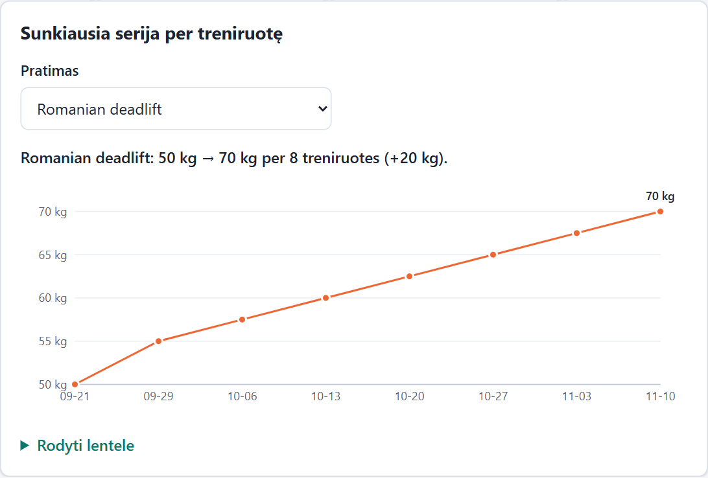

Mygtukas **Atgal į „Mano sportininkai“** grąžina į sąrašą. Jei matote *Šis sportininkas nesidalija su jumis*, sportininkas nustojo dalytis.

## 7. El. laiškai, kuriuos gaunate

„Logify“ siunčia jums el. laiškus automatiškai, niekam nieko nespaudžiant:

| Kada | Tema | Turinys |
|---|---|---|
| Sportininkas išsaugo **jėgos** treniruotę | `STRENGTH: <pavadinimas>` | Pavadinimas, tipas, trukmė, serijos (pavyzdžiui, *Squat: 2 × 5 @ 100 kg, 5 @ 102.5 kg*) ir įrašymo laikas |
| Sportininkas išsaugo bet kokią **kitą** treniruotę | `New workout: <pavadinimas>` | Tos pačios detalės be serijų |
| Sportininkas paspaudžia **Siųsti ataskaitą treneriui** | `Progress report: <sportininkas> (<laikotarpis>)` | Sportininko pastarųjų 7 dienų skaičiai |

Pervadinus treniruotę kitas laiškas nesiunčiamas. Laiškai siunčiami į trenerio adresą, nustatytą projekto „Zapier“ automatizacijoje; šis adresas nepasirenkamas kiekvienai paskyrai atskirai. Laiškų temos ir turinys visada angliški.

## 8. Pranešimai ir ką daryti

| Ką matote | Ką tai reiškia |
|---|---|
| *Sportininkų dar nėra. Duokite jiems savo kodą: …* | Kol kas niekas su jumis nesidalija. |
| *Kodą turi tik trenerių paskyros…* | Užsiregistravote kaip sportininkas. Sukurkite naują paskyrą kaip treneris. |
| *Šis sportininkas nesidalija su jumis.* | Sportininkas nustojo dalytis. |
| *Sportininkai yra įrašę treniruočių pagal šį planą, todėl jo ištrinti negalima.* | Palikite planą; sportininkų treniruotės nuo jo priklauso. |
| *Neturite teisės to daryti.* | Tuos duomenis gali keisti tik jų savininkas. |
| *Nepavyksta pasiekti serverio…* | Patikrinkite interneto ryšį ir paspauskite **Bandyti dar kartą**. |

Kiekvienas ekranas, kuris kraunasi ar saugo duomenis, rodo vieną iš keturių būsenų: **Kraunama**, **Klaida** (su **Bandyti dar kartą**), **Tuščia** arba **Pavyko**.
